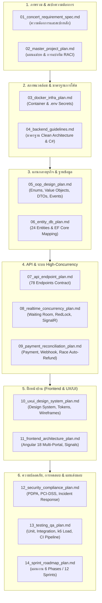

# 🧭 Project Roadmap & Reading Order Guide

> **คู่มือนำทางการอ่านและลำดับการพัฒนาโครงการ TicketWorld**  
> เรียงลำดับไฟล์ตั้งแต่ 01 ถึง 14 เพื่อให้ทุกคนในทีมเข้าใจทิศทางเดียวกันและเริ่มลงมือพัฒนาได้อย่างถูกต้อง

---

## 📌 สรุปภาพรวมลำดับไฟล์ทั้งหมด (01 - 14)

---

## 📖 ลำดับการอ่านตามขั้นตอนพัฒนา (Step-by-Step)

### ขั้นที่ 1: ทำความเข้าใจ Business & ภาพรวมโครงการ
1. [01_concert_requirement_spec.md](file:///c:/Users/wwwwww/Documents/project-test/concert/Plan/01_concert_requirement_spec.md)
   * **ต้องอ่านก่อนเป็นอันดับแรก:** เป็นเอกสาร Requirement หลัก (Data Dictionary v2.1) ครอบคลุมกฎธุรกิจทั้งหมด
2. [02_master_project_plan.md](file:///c:/Users/wwwwww/Documents/project-test/concert/Plan/02_master_project_plan.md)
   * **อ่านเพื่อแบ่งหน้าที่:** ดูตาราง RACI Matrix ว่าใครรับผิดชอบส่วนไหน

### ขั้นที่ 2: เตรียม Environment & กติกาการเขียนโค้ด
3. [03_docker_infra_plan.md](file:///c:/Users/wwwwww/Documents/project-test/concert/Plan/03_docker_infra_plan.md)
   * **เริ่มติดตั้งระบบจำลอง:** รัน Docker Compose (PostgreSQL, Redis, MinIO, Seq, MailDev) และแยก `.env`
4. [04_backend_guidelines.md](file:///c:/Users/wwwwww/Documents/project-test/concert/Plan/04_backend_guidelines.md)
   * **กติกาทีม Backend:** โครงสร้าง 4 Layers, กฎ Async, Result Pattern, Seeding Data

### ขั้นที่ 3: ออกแบบ Model & Database
5. [05_oop_design_plan.md](file:///c:/Users/wwwwww/Documents/project-test/concert/Plan/05_oop_design_plan.md)
   * **เริ่มเขียนโค้ด Domain:** สร้าง Enums 17 ตัว, Value Objects 8 ตัว, Domain Exceptions, Domain Events
6. [06_entity_db_plan.md](file:///c:/Users/wwwwww/Documents/project-test/concert/Plan/06_entity_db_plan.md)
   * **สร้างตารางและ Entities:** Mapping ทั้ง 24 Entities ด้วย EF Core Fluent API พร้อม Optimistic Concurrency `xmin`

### ขั้นที่ 4: พัฒนา API & จัดการ Concurrency
7. [07_api_endpoint_plan.md](file:///c:/Users/wwwwww/Documents/project-test/concert/Plan/07_api_endpoint_plan.md)
   * **สัญญาเชื่อมต่อ API:** สเปก 78 Endpoints, Request/Response DTOs, Headers, Rate Limits
8. [08_realtime_concurrency_plan.md](file:///c:/Users/wwwwww/Documents/project-test/concert/Plan/08_realtime_concurrency_plan.md)
   * **ระบบช่วงคนแย่งกดบัตร:** Virtual Waiting Room (Redis), RedLock 3 วินาที, SignalR Broadcast ผังที่นั่ง
9. [09_payment_reconciliation_plan.md](file:///c:/Users/wwwwww/Documents/project-test/concert/Plan/09_payment_reconciliation_plan.md)
   * **ระบบเงินและ Webhook:** การตรวจ Webhook Idempotency, 3 สถานการณ์แย่งที่นั่ง (Auto-Refund) และตั๋ว QR

### ขั้นที่ 5: พัฒนาส่วน Frontend & ประสบการณ์ผู้ใช้
10. [10_uxui_design_system_plan.md](file:///c:/Users/wwwwww/Documents/project-test/concert/Plan/10_uxui_design_system_plan.md)
    * **คู่มือดีไซน์:** กฎ 5 สีหลัก, Typography, Spacing 4px, Component tokens, Wireframes
11. [11_frontend_architecture_plan.md](file:///c:/Users/wwwwww/Documents/project-test/concert/Plan/11_frontend_architecture_plan.md)
    * **โครงสร้าง Angular 18:** 3 Portals (Customer, Organizer, Admin), SVG Seat Map Viewer, WebRTC QR Scanner

### ขั้นที่ 6: มาตรฐานความปลอดภัย, การทดสอบ & แผนส่งมอบ
12. [12_security_compliance_plan.md](file:///c:/Users/wwwwww/Documents/project-test/concert/Plan/12_security_compliance_plan.md)
    * **ความปลอดภัยระดับ Enterprise:** PDPA Anonymization, PCI-DSS SAQ A, KMS Key Rotation, Incident Response
13. [13_testing_qa_plan.md](file:///c:/Users/wwwwww/Documents/project-test/concert/Plan/13_testing_qa_plan.md)
    * **แผน QA & CI/CD:** Unit Tests, Integration (Testcontainers), Load Test (k6 500 VUs), GitHub Actions
14. [14_sprint_roadmap_plan.md](file:///c:/Users/wwwwww/Documents/project-test/concert/Plan/14_sprint_roadmap_plan.md)
    * **แผนกำหนดส่ง:** แผนพัฒนาแบ่งเป็น 6 Phase (Sprint 1 ถึง Sprint 12)

---

## 👥 คู่มือการอ่านแบ่งตามตำแหน่ง (Who Reads What?)

| ตำแหน่ง | ลำดับไฟล์ที่ต้องอ่านและโฟกัส |
| :--- | :--- |
| **Project Manager / Tech Lead** | `01` ➔ `02` ➔ `14` ➔ `12` ➔ `13` |
| **Backend Lead / Senior Developer** | `01` ➔ `02` ➔ `04` ➔ `05` ➔ `06` ➔ `07` ➔ `08` ➔ `09` ➔ `13` |
| **Frontend Lead / Developer** | `01` ➔ `02` ➔ `10` ➔ `11` ➔ `07` ➔ `08` ➔ `13` |
| **DevOps / Infra Engineer** | `02` ➔ `03` ➔ `12` ➔ `13` |
| **QA / Tester** | `01` ➔ `02` ➔ `07` ➔ `08` ➔ `09` ➔ `13` |
