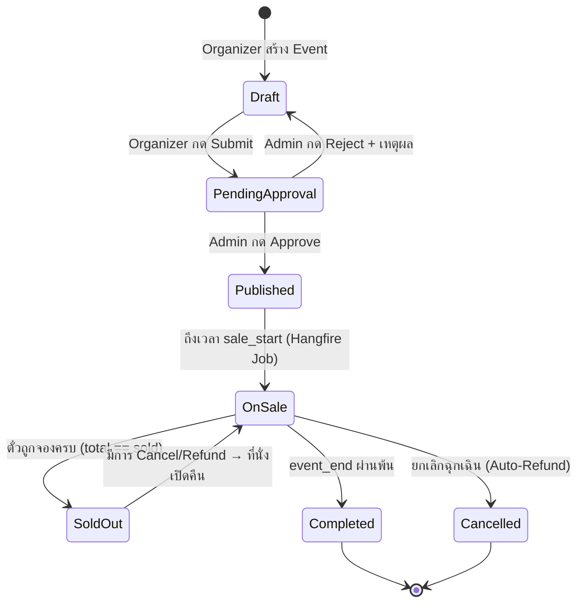
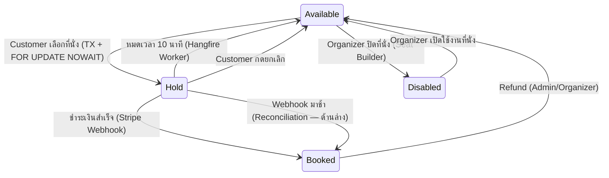
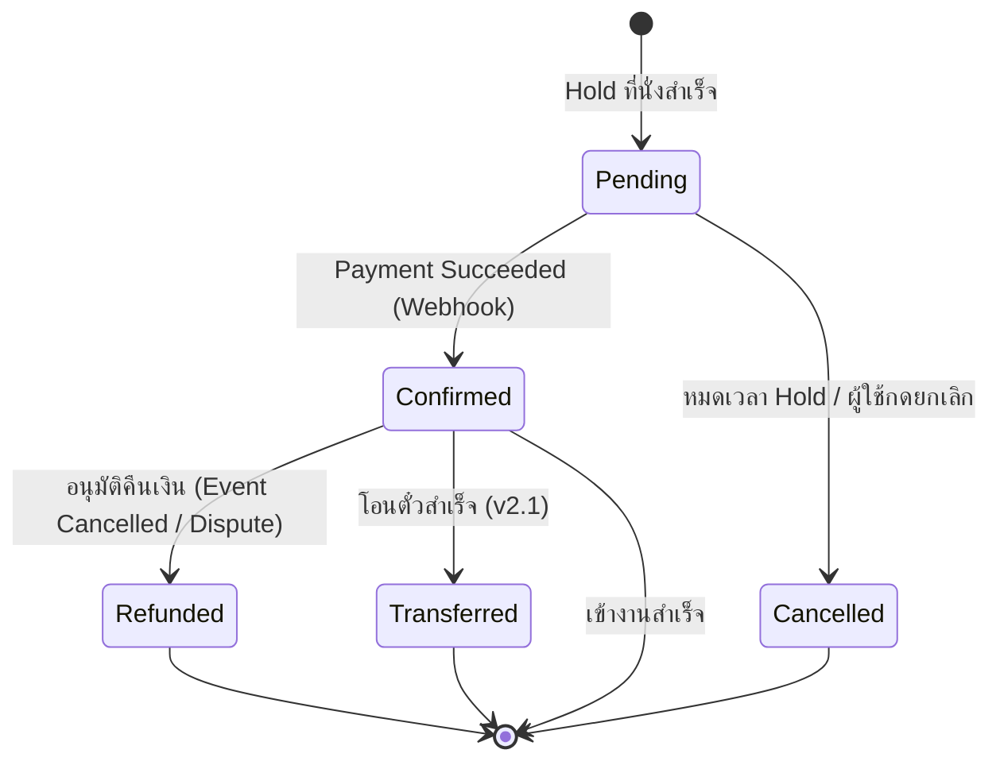
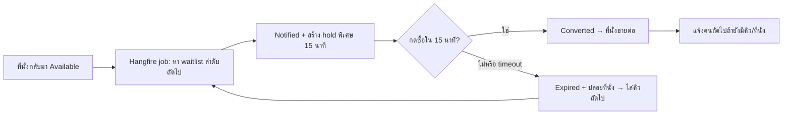

# 📘 TICKETWORLD — ENTERPRISE DATA DICTIONARY & SYSTEM SPECIFICATION v2.1

> **Version:** 2.1.0  
> **Last Updated:** 2026-09-12  
> **Architecture:** Clean Architecture (C# .NET 8) + Angular 18 (TypeScript) + Tailwind CSS + PostgreSQL 16 + Redis + SignalR  
> **Scope:** Multi-Portal Global Ticketing Platform (Customer, Organizer + Staff, Platform Admin/Dev)  
> **v2.1 Major Updates:** 2FA, Idempotency, PDPA/PCI Compliance, Virtual Waiting Room, Refund Engine, Organizer Staff, Webhook Idempotency, SignalR Auth, Backup/DR, CI Security

---

## 📑 TABLE OF CONTENTS

1. [Security, Roles & Access Control Matrix (RBAC/ABAC)](#1-security-roles--access-control-matrix)
2. [Database Data Dictionary (PostgreSQL Schema)](#2-database-data-dictionary)
3. [API Data Dictionary & Endpoint Contract](#3-api-data-dictionary--endpoint-contract)
4. [Frontend Data Models & Route Access Matrix (Angular 18)](#4-frontend-data-models--route-access-matrix)
5. [State Machines & Concurrency Rules](#5-state-machines--concurrency-rules)
6. [Cross-Cutting Architecture & Infrastructure](#6-cross-cutting-architecture--infrastructure)
7. [Security & Compliance Specification (NEW v2.1)](#7-security--compliance-specification)

---

## 1. SECURITY, ROLES & ACCESS CONTROL MATRIX

ระบบใช้ Hybrid **RBAC (Role-Based Access Control)** ผสม **ABAC (Attribute-Based Access Control / Resource Ownership)** ผ่าน ASP.NET Core Claims-based Authorization Policies และ Angular Route Guards

### 1.1 User Roles Definition

| Role ID | Role Name | Code | Level | Target Portal | Description |
| :--- | :--- | :--- | :---: | :--- | :--- |
| `R1` | **Customer** | `ROLE_CUSTOMER` | 1 | Customer Portal (`/`) | ผู้ใช้ทั่วไป ซื้อตั๋ว ติดตามศิลปิน จัดการตั๋วของตนเอง |
| `R2` | **Organizer** | `ROLE_ORGANIZER` | 2 | Organizer Dashboard (`/organizer`) | ผู้จัดงาน, แบรนด์, ตัวแทนศิลปิน จัดการอีเวนต์ ผังที่นั่ง ตรวจสอบยอดขาย สแกนตั๋ว |
| `R2b` | **Organizer Staff** | `ROLE_ORG_STAFF` | 2 | Organizer Dashboard (scoped) | พนักงานของ Organizer ได้รับสิทธิ์แบบ Subset ตาม Event (เช่น เฉพาะ Check-in) — *เพิ่มใหม่ v2.1* |
| `R3` | **Platform Admin / Dev** | `ROLE_ADMIN` | 3 | Admin Panel (`/admin`) | เจ้าของระบบ ทีมพัฒนา ตรวจสอบ Log, อนุมัติงาน, ควบคุม Feature Flag, ดู System Health |

---

### 1.2 Fine-Grained Permissions & Claims

| Permission Claim | Description | Customer | Organizer | Admin |
| :--- | :--- | :---: | :---: | :---: |
| `events.view:published` | ดูอีเวนต์ที่เปิดขายต่อสาธารณะ | ✅ | ✅ | ✅ |
| `events.view:draft` | ดูอีเวนต์ฉบับร่างของตนเอง (Own Only) | ❌ | ✅ *(Own)* | ✅ *(All)* |
| `events.create` | สร้าง Event / ร่างผังที่นั่ง | ❌ | ✅ | ✅ |
| `events.update:own` | แก้ไขข้อมูล Event ตนเองก่อนเปิดขาย | ❌ | ✅ *(Own)* | ✅ |
| `events.publish` | ส่ง Event เข้าคิวขออนุมัติเปิดขาย | ❌ | ✅ *(Own)* | ✅ |
| `events.moderate` | Approve / Reject / Suspend อีเวนต์ | ❌ | ❌ | ✅ |
| `events.cancel` | ยกเลิกอีเวนต์ (Trigger Auto-Refund) | ❌ | ✅ *(Own, pre-event)* | ✅ |
| `seats.hold` | ล็อกที่นั่งชั่วคราว (Hold 10 นาที) | ✅ | ❌ | ❌ |
| `seats.release` | สละที่นั่งที่ Hold ไว้ | ✅ *(Own)* | ❌ | ✅ *(Force)* |
| `seats.layout:edit` | วาดและจัดผังที่นั่ง (Seat Map Builder) | ❌ | ✅ *(Own)* | ✅ |
| `bookings.create` | ทำรายการจองและจ่ายเงิน | ✅ | ❌ | ❌ |
| `bookings.view:own` | ดูประวัติและตั๋ว QR Code ของตนเอง | ✅ | ❌ | ✅ |
| `bookings.view:event` | ดูรายการจองทั้งหมดใน Event ตนเอง | ❌ | ✅ *(Own)* | ✅ *(All)* |
| `bookings.cancel:own` | ขอยกเลิกตั๋ว / ขอ Refund ตามเงื่อนไข | ✅ | ❌ | ✅ |
| `checkin.scan` | สแกน QR Code ตรวจตั๋วหน้างาน | ❌ | ✅ *(Event)* | ✅ |
| `promo.manage` | สร้าง/แก้ไข/ลบ Promo Code | ❌ | ✅ *(Own)* | ✅ |
| `reviews.write` | เขียนรีวิว Event ที่เข้าร่วมแล้ว | ✅ | ❌ | ❌ |
| `reviews.moderate` | ลบรีวิวที่ไม่เหมาะสม | ❌ | ❌ | ✅ |
| `artists.manage` | สร้าง/แก้ไขโปรไฟล์ศิลปิน | ❌ | ✅ | ✅ |
| `artists.follow` | กดติดตามศิลปิน | ✅ | ❌ | ❌ |
| `waitlist.join` | ลงทะเบียนรอตั๋วเมื่อ Sold Out | ✅ | ❌ | ❌ |
| `waitlist.view` | ดูรายชื่อ Waitlist ของ Event ตนเอง | ❌ | ✅ *(Own)* | ✅ |
| `analytics.organizer` | ดูยอดขาย, Conversion, Heatmap ของงานตนเอง | ❌ | ✅ *(Own)* | ✅ |
| `analytics.platform` | ดู GMV รวมทั่วโลก, Top Events, Platform Revenue | ❌ | ❌ | ✅ |
| `finance.payout:request` | ขอยื่นเบิกเงินยอดขายเข้าบัญชีบริษัท | ❌ | ✅ | ❌ |
| `finance.payout:process` | อนุมัติและโอนเงิน Payout ให้ Organizer | ❌ | ❌ | ✅ |
| `files.upload` | อัปโหลดรูปภาพ / สื่อ | ❌ | ✅ | ✅ |
| `notifications.read` | ดูและจัดการการแจ้งเตือนของตนเอง | ✅ | ✅ | ✅ |
| `audit.logs:view` | ตรวจสอบ Audit Trail (Who/When/What Changed) | ❌ | ❌ | ✅ |
| `system.health:view` | ตรวจสอบ APM, Connection Pool, Cache Hit, Queues | ❌ | ❌ | ✅ |
| `system.config:write` | ปรับแก้ Feature Flags และ System Configs | ❌ | ❌ | ✅ |
| `users.manage` | Ban / Unban / กำหนด Role ผู้ใช้ | ❌ | ❌ | ✅ |
| `auth.2fa:manage` | เปิด/ปิด/รีเซ็ต Two-Factor Authentication ของตนเอง | ✅ | ✅ | ✅ |
| `staff.manage` | เชิญ/เพิกถอน/กำหนดสิทธิ์พนักงานในองค์กรของตน | ❌ | ✅ *(Own Org)* | ✅ |
| `waitingroom.enter` | เข้าคิว Virtual Waiting Room ก่อนเปิดขาย/ตอน High Load | ✅ | ❌ | ✅ *(Bypass)* |
| `refunds.approve` | อนุมัติคำขอคืนเงิน (Partial/Full) | ❌ | ✅ *(Own Event, ภายในนโยบาย)* | ✅ |
| `transfers.execute` | โอนตั๋วให้ผู้ใช้อื่น (Ticket Transfer) | ✅ *(Own)* | ❌ | ❌ |

> **หมายเหตุ v2.1:** สิทธิ์ `admin.*` ทั้งหมดต้องผ่าน Step-up Authentication (ดู 1.4) และการเปลี่ยน `users.manage` ที่กระทบ Admin ด้วยกันเองถูกบล็อกโดย `LastAdminProtectionPolicy`

---

### 1.3 Authorization Enforcement Architecture

**Backend (ASP.NET Core):**
- Policy-based: `[Authorize(Policy = "OrganizerOnly")]`, `[Authorize(Roles = "Organizer,Admin")]`
- Resource-based: `EventOwnerAuthorizationHandler` ตรวจสอบ `organizer_id == CurrentUser.OrganizerId`
- Rate Limiting Middleware ป้องกัน Brute-force & Bot scalping:

| Endpoint Group | Rate Limit | Window |
| :--- | :--- | :--- |
| Public Search (`GET /events`) | 120 req | 1 min |
| Seat Hold (`POST /seats/hold`) | 5 req | 1 min per user |
| Payment (`POST /bookings/*/checkout`) | 3 req | 1 min per user |
| Auth Login (`POST /auth/login`) | 10 req | 5 min per IP |
| File Upload (`POST /files/upload`) | 10 req | 1 min per user |
| Waiting Room Heartbeat (`GET /queue/position`) | 30 req | 1 min per user |
| SignalR JoinEvent (`/hubs/seats`) | 10 event joins | 1 min per connection |
| Check-in Scan (`POST /organizer/events/{id}/checkin`) | 60 req | 1 min per staff |
| OTP Verify (`POST /auth/2fa/verify`) | 5 req | 5 min per user |

**Frontend (Angular):**
- `canActivate: [AuthGuard, RoleGuard]` ตรวจสอบ JWT Token + Claims ก่อนเข้าหน้า
- Custom Structural Directive `*hasPermission="'events.create'"` ซ่อน/แสดง UI Component อัตโนมัติตามสิทธิ์
- HTTP Interceptor: แนบ `Authorization: Bearer [REDACTED:Authorization header] ทุก Request + Auto refresh token เมื่อ 401

### 1.4 Session & Token Policy (NEW v2.1)

| นโยบาย | รายละเอียด |
| :--- | :--- |
| **Access Token TTL** | 15 นาที (สั้น ลดความเสียหายจาก token ถูกขโมย) |
| **Refresh Token TTL** | 7 วัน พร้อม Rotation (ใช้ครั้งเดียว) + Reuse Detection: ถ้ามีการใช้ token ที่ถูก rotate ไปแล้ว → revoke ทุก token ของ user นั้น + บันทึก `SECURITY.TokenReuse` ใน audit_logs |
| **Refresh Token Storage** | httpOnly + Secure + SameSite=Strict cookie (ไม่ใช้ localStorage กัน XSS) — Access token เก็บในหน่วยความจำ (in-memory) เท่านั้น |
| **CSRF Protection** | เนื่องจากใช้ cookie สำหรับ refresh → ทุก mutating request ต้องแนบ `X-CSRF-Token` (Double-submit cookie pattern) |
| **Ban Instant-Effect** | Middleware ตรวจ `users.is_banned` จาก Redis cache (TTL 60s) ทุก request + revoke refresh tokens ทันทีที่ ban — access token ตายได้สูงสุด 15 นาที |
| **JWT Signing** | RS256 (asymmetric) + เผย JWKS endpoint สำหรับ key rotation; ห้ามใช้ HS256 กัน algorithm confusion |
| **2FA (TOTP)** | บังคับสำหรับ Admin ทุกคนตั้งแต่ provision; Organizer บังคับก่อนเริ่มขาย Event แรก; Customer สมัครใจ |
| **Step-up Auth** | Admin actions ที่กระทบเงิน/role (`payouts/{id}/process`, `users/{id}/role`, `config/{key}`) ต้องมี claim `amr: mfa` อายุ ≤ 5 นาที ไม่งั้นตอบ 401 + flag `MFA_REQUIRED` ให้ frontend ขอ OTP ก่อน |
| **Account Lockout** | 5 ครั้งผิดต่อ 15 นาที → lock 15 นาที (exponential backoff) + แจ้งอีเมล; ป้องกัน per-account ไม่ใช่แค่ per-IP |
| **Bot Protection** | CAPTCHA (Turnstile/hCaptcha) บังคับที่ register / forgot-password / login ที่ fail 1 ครั้ง; ระหว่าง on-sale hot event อาจเปิด proof-of-work challenge |
| **Email Normalization** | บันทึกและเปรียบเทียบ email แบบ lowercase + trim (unique ป้องกัน `Foo@x.com` กับ `foo@x.com` คนละแถว) |

---

## 2. DATABASE DATA DICTIONARY

### 2.1 Table: `users`
เก็บข้อมูลบัญชีผู้ใช้งานส่วนกลางของทุกบทบาทในระบบ

| Column Name | Data Type | Constraint | Nullable | Default | Description / Business Rule | Sample Value |
| :--- | :--- | :--- | :---: | :--- | :--- | :--- |
| `id` | `UUID` | PK | NO | `gen_random_uuid()` | รหัสประจำตัวผู้ใช้ (UUID v4) | `a1b2c3d4-e5f6-7890-abcd-ef1234567890` |
| `email` | `VARCHAR(255)` | UNIQUE, Index | NO | - | อีเมลสำหรับ Login (RFC 5322) | `somchai.dev@gmail.com` |
| `password_hash` | `TEXT` | - | NO | - | รหัสผ่านแฮชด้วย Argon2id / BCrypt | `$argon2id$v=19$m=65536...` |
| `full_name` | `VARCHAR(200)` | - | NO | - | ชื่อ-นามสกุลจริง | `Somchai Prasert` |
| `phone` | `VARCHAR(20)` | - | YES | NULL | เบอร์โทรศัพท์สากล (E.164 format) | `+66812345678` |
| `avatar_url` | `TEXT` | - | YES | NULL | CDN URL รูปประจำตัว | `https://cdn.ticketworld.io/avatars/u1.webp` |
| `preferred_lang` | `VARCHAR(5)` | - | NO | `'en'` | ภาษาที่เลือก (`th`, `en`, `ja`, `ko`) | `'th'` |
| `preferred_currency`| `VARCHAR(3)` | - | NO | `'THB'` | สกุลเงินแสดงผล (ISO 4217) | `'THB'` |
| `timezone` | `VARCHAR(50)` | - | NO | `'Asia/Bangkok'` | IANA Timezone | `'Asia/Bangkok'` |
| `role` | `VARCHAR(20)` | Index | NO | `'Customer'` | บทบาทหลัก (`Customer`, `Organizer`, `OrgStaff`, `Admin`) | `'Customer'` |
| `is_verified` | `BOOLEAN` | - | NO | `FALSE` | ผ่านการยืนยันอีเมลแล้วหรือไม่ | `TRUE` |
| `is_banned` | `BOOLEAN` | Index | NO | `FALSE` | สถานะระงับการใช้งาน | `FALSE` |
| `banned_reason` | `TEXT` | - | YES | NULL | เหตุผลการระงับ (Admin กรอก สำหรับ audit) | NULL |
| `two_factor_enabled` | `BOOLEAN` | - | NO | `FALSE` | เปิด TOTP 2FA แล้วหรือไม่ (บังคับสำหรับ Admin/Organizer) | `TRUE` |
| `failed_login_count` | `INT` | - | NO | `0` | ตัวนับสำหรับ Account Lockout (reset เมื่อ login สำเร็จ) | `0` |
| `locked_until` | `TIMESTAMPTZ` | - | YES | NULL | เวลาที่บัญชีเลิกถูกล็อก (Account Lockout) | NULL |
| `auth_provider` | `VARCHAR(20)` | - | NO | `'local'` | ช่องทางสมัคร (`local`, `google`) — สำหรับ OAuth account linking | `'local'` |
| `google_sub` | `VARCHAR(100)` | UNIQUE, Index | YES | NULL | Google `sub` claim (เชื่อม OAuth แบบไม่ใช้ email เป็น key) | NULL |
| `deleted_at` | `TIMESTAMPTZ` | Index | YES | NULL | Soft-delete (PDPA erasure) — ดู 7.3 | NULL |
| `created_at` | `TIMESTAMPTZ` | Index | NO | `NOW()` | วันเวลาที่สร้างบัญชี (UTC) | `2026-09-12T12:00:00Z` |
| `updated_at` | `TIMESTAMPTZ` | - | NO | `NOW()` | วันเวลาที่มีการแก้ไขล่าสุด | `2026-09-12T12:00:00Z` |

---

### 2.2 Table: `refresh_tokens`
จัดเก็บ JWT Refresh Token สำหรับ Token Rotation (ป้องกัน Token Replay Attack)

| Column Name | Data Type | Constraint | Nullable | Default | Description / Business Rule | Sample Value |
| :--- | :--- | :--- | :---: | :--- | :--- | :--- |
| `id` | `UUID` | PK | NO | `gen_random_uuid()` | รหัส Token | `aa11bb22-cc33-dd44-ee55-ff6677889900` |
| `user_id` | `UUID` | FK (`users.id`), Index | NO | - | เจ้าของ Token | `a1b2c3d4-e5f6-7890-abcd-ef1234567890` |
| `token_hash` | `VARCHAR(128)` | UNIQUE, Index | NO | - | SHA-256 Hash ของ Refresh Token (ไม่เก็บ plain text) | `e3b0c44298fc1c149afb...` |
| `device_info` | `VARCHAR(300)` | - | YES | NULL | ชื่อ Device / Browser / OS (User-Agent parsed) | `Chrome 120 on Windows 11` |
| `ip_address` | `INET` | - | YES | NULL | IP ที่สร้าง Token | `'203.144.144.168'` |
| `expires_at` | `TIMESTAMPTZ` | Index | NO | - | วันหมดอายุ (ปกติ 7 วัน) | `2026-09-19T12:00:00Z` |
| `is_revoked` | `BOOLEAN` | Index | NO | `FALSE` | ถูกเพิกถอนแล้วหรือไม่ | `FALSE` |
| `revoked_at` | `TIMESTAMPTZ` | - | YES | NULL | เวลาที่ถูก Revoke | NULL |
| `replaced_by_token` | `VARCHAR(128)` | - | YES | NULL | Hash ของ Token ตัวใหม่ที่มาแทน (Token Rotation) | NULL |
| `created_at` | `TIMESTAMPTZ` | - | NO | `NOW()` | วันที่สร้าง | `2026-09-12T12:00:00Z` |

---

### 2.3 Table: `organizer_profiles`
เก็บข้อมูลนิติบุคคลหรือตัวแทนผู้จัดงาน สำหรับการออกใบเสร็จและการจ่ายเงิน Payout

| Column Name | Data Type | Constraint | Nullable | Default | Description / Business Rule | Sample Value |
| :--- | :--- | :--- | :---: | :--- | :--- | :--- |
| `id` | `UUID` | PK | NO | `gen_random_uuid()` | รหัสโปรไฟล์ผู้จัดงาน | `b2c3d4e5-f6a7-8901-bcde-f12345678901` |
| `user_id` | `UUID` | FK (`users.id`), UNIQUE | NO | - | เชื่อมโยงบัญชี User หลัก | `a1b2c3d4-e5f6-7890-abcd-ef1234567890` |
| `company_name` | `VARCHAR(300)` | Index | NO | - | ชื่อบริษัท / ค่ายเพลง / ผู้จัด | `Live Nation Tero Co., Ltd.` |
| `company_logo_url`| `TEXT` | - | YES | NULL | CDN URL โลโก้ผู้จัด | `https://cdn.ticketworld.io/orgs/logo1.png` |
| `description` | `TEXT` | - | YES | NULL | รายละเอียดประวัติผลงาน | `Global entertainment promoter` |
| `website` | `VARCHAR(500)` | - | YES | NULL | เว็บไซต์ทางการ | `https://www.livenation.co.th` |
| `tax_id` | `VARCHAR(50)` | UNIQUE | YES | NULL | เลขประจำตัวผู้เสียภาษี 13 หลัก | `0105561000000` |
| `bank_account_no_enc`| `TEXT` | - | NO | - | เลขที่บัญชี **เข้ารหัสด้วย AES-256-GCM (application-level, key จาก KMS)** — ห้ามเก็บ plaintext (v2.1) | `gQw9x2...==` |
| `bank_name` | `VARCHAR(100)` | - | NO | - | ชื่อธนาคาร / Swift Code | `Kasikornbank (KBANK)` |
| `bank_account_last4`| `VARCHAR(4)` | - | NO | - | 4 หลักสุดท้ายสำหรับแสดงผลบน UI (ไม่ถอดรหัสทุกครั้ง) | `89-0` |
| `payout_schedule` | `VARCHAR(20)` | - | NO | `'monthly'` | รอบโอนเงิน (`weekly`, `biweekly`, `monthly`) | `'monthly'` |
| `commission_rate` | `DECIMAL(5,4)` | CHECK (0..1) | NO | `0.0500` | ส่วนแบ่งแพลตฟอร์ม (0.0500 = 5%) | `0.0500` |
| `is_approved` | `BOOLEAN` | Index | NO | `FALSE` | อนุมัติโดย Admin ให้เริ่มขายได้ | `TRUE` |
| `approved_at` | `TIMESTAMPTZ` | - | YES | NULL | วันที่ Admin อนุมัติ | `2026-09-13T08:00:00Z` |
| `approved_by` | `UUID` | FK (`users.id`) | YES | NULL | Admin คนไหนเป็นคนอนุมัติ | `ff112233-4455-6677-8899-aabbccddeeff` |
| `created_at` | `TIMESTAMPTZ` | - | NO | `NOW()` | วันที่ลงทะเบียนเป็น Organizer | `2026-09-12T12:00:00Z` |
| `updated_at` | `TIMESTAMPTZ` | - | NO | `NOW()` | วันที่แก้ไขล่าสุด | `2026-09-12T12:00:00Z` |
| `deleted_at` | `TIMESTAMPTZ` | Index | YES | NULL | Soft-delete (PDPA) | NULL |

> **v2.1:** Payout snapshot (`payouts.bank_account_snapshot`) เก็บ **encrypted** เช่นกัน และมี retention 7 ปีตามกฎหมายบัญชี

### 2.3b Table: `organizer_staff` (NEW v2.1)
พนักงานของ Organizer — แยกสิทธิ์รายบุคคล/ราย Event ออกจากบัญชีเจ้าของ (เดิมพนักงานสแกนตั๋วต้องยืม login เจ้าของ = เห็นยอดเงินทั้งหมด)

| Column Name | Data Type | Constraint | Nullable | Default | Description / Business Rule | Sample Value |
| :--- | :--- | :--- | :---: | :--- | :--- | :--- |
| `id` | `UUID` | PK | NO | `gen_random_uuid()` | รหัส staff assignment | `b9d0e1f2-a3b4-5678-cd90-123456789abc` |
| `organizer_id` | `UUID` | FK (`organizer_profiles.id`), Index | NO | - | องค์กรที่สังกัด | `b2c3d4e5-f6a7-8901-bcde-f12345678901` |
| `user_id` | `UUID` | FK (`users.id`), Index | NO | - | บัญชีพนักงาน (role=`OrgStaff`) | `a9b8c7d6-e5f4-4321-dcba-0987654321fe` |
| `event_id` | `UUID` | FK (`events.id`), Index | YES | NULL | จำกัดขอบเขตเฉพาะ Event (NULL = ทุก Event ของ Org) | `e5f6a7b8-c9d0-1234-ef12-345678901234` |
| `permissions` | `TEXT[]` | - | NO | `'{}'` | Subset เช่น `{checkin.scan, bookings.view:event}` — ห้ามมี `finance.*`, `staff.manage` | `ARRAY['checkin.scan']` |
| `is_active` | `BOOLEAN` | - | NO | `TRUE` | เพิกถอนการเข้าถึงได้ทันที | `TRUE` |
| `invited_by` | `UUID` | FK (`users.id`) | NO | - | ผู้เชิญ | `a1b2c3d4-e5f6-7890-abcd-ef1234567890` |
| `created_at` | `TIMESTAMPTZ` | - | NO | `NOW()` | วันที่เชิญ/กำหนดสิทธิ์ | `2026-09-12T12:00:00Z` |
| UNIQUE Constraint | | (`organizer_id`, `user_id`, `event_id`) | | | 1 staff ต่อ scope | |

---

### 2.4 Table: `artists`
ข้อมูลศิลปิน / วงดนตรี / วิทยากร

| Column Name | Data Type | Constraint | Nullable | Default | Description / Business Rule | Sample Value |
| :--- | :--- | :--- | :---: | :--- | :--- | :--- |
| `id` | `UUID` | PK | NO | `gen_random_uuid()` | รหัสศิลปิน | `c3d4e5f6-a7b8-9012-cdef-123456789012` |
| `name` | `VARCHAR(300)` | Index | NO | - | ชื่อศิลปินทางการ | `Coldplay` |
| `slug` | `VARCHAR(300)` | UNIQUE, Index | NO | - | SEO URL slug | `'coldplay'` |
| `bio` | `TEXT` | - | YES | NULL | ประวัติย่อ | `British rock band formed in London in 1997` |
| `profile_image_url`| `TEXT` | - | YES | NULL | รูปโปรไฟล์สี่เหลี่ยมจัตุรัส | `https://cdn.ticketworld.io/artists/coldplay.jpg` |
| `cover_image_url` | `TEXT` | - | YES | NULL | รูป Header Cover Banner | `https://cdn.ticketworld.io/artists/coldplay-cover.jpg` |
| `genre` | `VARCHAR(100)` | Index | YES | NULL | แนวเพลงหลัก | `'Alternative Rock'` |
| `country` | `VARCHAR(100)` | - | YES | NULL | ประเทศต้นกำเนิด | `'United Kingdom'` |
| `social_links` | `JSONB` | - | YES | `'{}'` | ลิงก์โซเชียลมีเดีย | `{"spotify":"...","instagram":"..."}` |
| `follower_count` | `INT` | Index | NO | `0` | ยอด Follower รวม (Denormalized) | `145200` |
| `created_at` | `TIMESTAMPTZ` | - | NO | `NOW()` | วันที่บันทึกข้อมูล | `2026-09-12T12:00:00Z` |

---

### 2.5 Table: `artist_followers` (Junction)
ตารางความสัมพันธ์ระหว่าง User กับ Artist ที่ติดตาม

| Column Name | Data Type | Constraint | Nullable | Default | Description / Business Rule | Sample Value |
| :--- | :--- | :--- | :---: | :--- | :--- | :--- |
| `user_id` | `UUID` | PK (Composite), FK (`users.id`) | NO | - | ผู้ใช้ที่กดติดตาม | `a1b2c3d4-e5f6-7890-abcd-ef1234567890` |
| `artist_id` | `UUID` | PK (Composite), FK (`artists.id`), Index | NO | - | ศิลปินที่ถูกติดตาม | `c3d4e5f6-a7b8-9012-cdef-123456789012` |
| `followed_at` | `TIMESTAMPTZ` | - | NO | `NOW()` | วันที่เริ่มติดตาม | `2026-09-12T12:00:00Z` |

> **Trigger:** เมื่อ INSERT/DELETE แถวในตาราง → อัปเดต `artists.follower_count` อัตโนมัติ

---

### 2.6 Table: `venues`
สถานที่จัดงาน รองรับแผนที่พิกัดทางภูมิศาสตร์ (GIS)

| Column Name | Data Type | Constraint | Nullable | Default | Description / Business Rule | Sample Value |
| :--- | :--- | :--- | :---: | :--- | :--- | :--- |
| `id` | `UUID` | PK | NO | `gen_random_uuid()` | รหัสสถานที่จัดงาน | `d4e5f6a7-b8c9-0123-def1-234567890123` |
| `name` | `VARCHAR(300)` | Index | NO | - | ชื่อสถานที่ | `Rajamangala National Stadium` |
| `slug` | `VARCHAR(300)` | UNIQUE, Index | NO | - | SEO slug | `'rajamangala-national-stadium'` |
| `address` | `TEXT` | - | NO | - | ที่อยู่เต็ม | `Hua Mak, Bang Kapi, Bangkok 10240` |
| `city` | `VARCHAR(100)` | Index | NO | - | เมือง / จังหวัด | `'Bangkok'` |
| `country` | `VARCHAR(100)` | Index | NO | - | ประเทศ | `'Thailand'` |
| `country_code` | `VARCHAR(3)` | Index | NO | - | รหัส ISO 3166-1 alpha-2 | `'TH'` |
| `latitude` | `DECIMAL(10,7)`| - | YES | NULL | พิกัดละติจูด | `13.7553170` |
| `longitude` | `DECIMAL(10,7)`| - | YES | NULL | พิกัดลองจิจูด | `100.6222850` |
| `total_capacity` | `INT` | - | NO | `0` | ความจุผู้ชมสูงสุด | `51552` |
| `seat_map_template`| `JSONB` | - | YES | NULL | Layout SVG / Vector Template | `{"zones":[{"name":"A1","nodes":[...]}]}` |
| `created_at` | `TIMESTAMPTZ` | - | NO | `NOW()` | วันที่บันทึก | `2026-09-12T12:00:00Z` |

---

### 2.7 Table: `events`
หัวใจของระบบ จัดเก็บข้อมูลคอนเสิร์ตและสถานะวงจรชีวิตของงาน

| Column Name | Data Type | Constraint | Nullable | Default | Description / Business Rule | Sample Value |
| :--- | :--- | :--- | :---: | :--- | :--- | :--- |
| `id` | `UUID` | PK | NO | `gen_random_uuid()` | รหัสประจำอีเวนต์ | `e5f6a7b8-c9d0-1234-ef12-345678901234` |
| `organizer_id` | `UUID` | FK (`organizer_profiles.id`), Index | NO | - | รหัสผู้จัดที่เป็นเจ้าของงาน | `b2c3d4e5-f6a7-8901-bcde-f12345678901` |
| `venue_id` | `UUID` | FK (`venues.id`), Index | YES | NULL | สถานที่จัดงาน (NULL = Online Event) | `d4e5f6a7-b8c9-0123-def1-234567890123` |
| `title` | `VARCHAR(500)` | FTS Index | NO | - | ชื่องาน (รองรับ Full-Text Search) | `Coldplay Music of the Spheres World Tour` |
| `slug` | `VARCHAR(500)` | UNIQUE, Index | NO | - | URL Path Slug | `'coldplay-mot-spheres-bangkok-2026'` |
| `description` | `TEXT` | - | YES | NULL | รายละเอียดและกติกาเข้างาน | `Detailed concert description and T&C...` |
| `short_description`| `VARCHAR(300)`| - | YES | NULL | สรุปสั้นสำหรับ Social Share Card | `The spectacular world tour returns to BKK!` |
| `poster_url` | `TEXT` | - | NO | - | โปสเตอร์แนวตั้ง (3:4 ratio) | `https://cdn.ticketworld.io/posters/coldplay2026.webp` |
| `banner_url` | `TEXT` | - | YES | NULL | แบนเนอร์แนวนอน (16:9 ratio) | `https://cdn.ticketworld.io/banners/coldplay-wide.webp` |
| `category` | `VARCHAR(100)` | Index | NO | - | หมวดหมู่ (`Concert`, `Festival`, `FanMeeting`, `Sports`, `Conference`) | `'Concert'` |
| `tags` | `TEXT[]` | Index (GIN) | YES | `'{}'` | แท็กคำค้นหา | `ARRAY['kpop','worldtour','stadium']` |
| `status` | `VARCHAR(30)` | Index | NO | `'Draft'` | ดูหัวข้อ [5.1 Event State Machine](#51-event-state-machine) | `'OnSale'` |
| `event_start` | `TIMESTAMPTZ` | Index | NO | - | วันเวลาเริ่มการแสดง (UTC) | `2026-11-20T12:00:00Z` |
| `event_end` | `TIMESTAMPTZ` | - | YES | NULL | วันเวลาสิ้นสุดการแสดง (UTC) | `2026-11-20T16:00:00Z` |
| `doors_open` | `TIMESTAMPTZ` | - | YES | NULL | ประตูเปิด | `2026-11-20T10:00:00Z` |
| `sale_start` | `TIMESTAMPTZ` | Index | NO | - | วันเวลาที่เปิดให้กดซื้อตั๋ว | `2026-10-01T03:00:00Z` |
| `sale_end` | `TIMESTAMPTZ` | - | NO | - | วันเวลาที่ปิดรับการจอง | `2026-11-20T10:00:00Z` |
| `min_price` | `DECIMAL(12,2)`| Index | NO | `0.00` | ราคาเริ่มต้น (Denormalized) | `2800.00` |
| `max_price` | `DECIMAL(12,2)`| - | NO | `0.00` | ราคาสูงสุด (Denormalized) | `12500.00` |
| `currency` | `VARCHAR(3)` | - | NO | `'THB'` | สกุลเงินฐาน (ISO 4217) | `'THB'` |
| `max_tickets_per_user`| `INT` | - | NO | `4` | จำกัดตั๋วต่อ User (ป้องกันบอท) | `4` |
| `hold_duration_minutes`| `INT` | - | NO | `10` | ระยะเวลา Hold ที่นั่ง (นาที) | `10` |
| `is_featured` | `BOOLEAN` | Index | NO | `FALSE` | แสดง Hero Carousel หน้าแรก | `TRUE` |
| `total_seats` | `INT` | - | NO | `0` | จำนวนที่นั่งทั้งหมด (Denormalized) | `50000` |
| `sold_seats` | `INT` | - | NO | `0` | จำนวนที่ขายสำเร็จแล้ว (Denormalized — อัปเดตผ่าน `UPDATE ... SET sold_seats = sold_seats + @n` atomic เท่านั้น) | `48200` |
| `avg_rating` | `DECIMAL(3,2)` | Index | YES | NULL | คะแนนเฉลี่ยรีวิว (Denormalized, trigger จาก reviews) | `4.70` |
| `rating_count` | `INT` | - | NO | `0` | จำนวนรีวิว (Denormalized) | `1520` |
| `waiting_room_enabled`| `BOOLEAN` | - | NO | `FALSE` | เปิด Virtual Waiting Room ตอน on-sale (บังคับเมื่อ total_seats ≥ 10,000) | `TRUE` |
| `refund_policy_json` | `JSONB` | - | NO | `'{}'` | นโยบายคืนเงินของ Event เช่น cutoff windows, ค่าธรรมเนียม (v2.1) | `{"beforeSaleEnd":100,"afterSaleEnd":0}` |
| `created_at` | `TIMESTAMPTZ` | - | NO | `NOW()` | วันที่สร้าง | `2026-09-12T12:00:00Z` |
| `updated_at` | `TIMESTAMPTZ` | - | NO | `NOW()` | วันที่แก้ไขล่าสุด | `2026-09-12T12:00:00Z` |
| `published_at` | `TIMESTAMPTZ` | - | YES | NULL | วันที่ Publish สำเร็จ | `2026-09-15T09:00:00Z` |

---

### 2.8 Table: `event_artists` (Junction)
ตารางเชื่อมศิลปินกับอีเวนต์ รองรับ Line-up หลายคน

| Column Name | Data Type | Constraint | Nullable | Default | Description / Business Rule | Sample Value |
| :--- | :--- | :--- | :---: | :--- | :--- | :--- |
| `event_id` | `UUID` | PK (Composite), FK (`events.id`) | NO | - | อีเวนต์ | `e5f6a7b8-c9d0-1234-ef12-345678901234` |
| `artist_id` | `UUID` | PK (Composite), FK (`artists.id`), Index | NO | - | ศิลปิน | `c3d4e5f6-a7b8-9012-cdef-123456789012` |
| `is_headliner` | `BOOLEAN` | - | NO | `FALSE` | เป็นศิลปินหลักหรือไม่ (แสดง Badge บน UI) | `TRUE` |
| `display_order` | `INT` | - | NO | `0` | ลำดับแสดงผลใน Line-up | `1` |

---

### 2.9 Table: `zones`
โซนที่นั่งและโครงสร้างราคา

| Column Name | Data Type | Constraint | Nullable | Default | Description / Business Rule | Sample Value |
| :--- | :--- | :--- | :---: | :--- | :--- | :--- |
| `id` | `UUID` | PK | NO | `gen_random_uuid()` | รหัสโซน | `f6a7b8c9-d0e1-2345-f123-456789012345` |
| `event_id` | `UUID` | FK (`events.id`), Index | NO | - | ผูกกับ Event | `e5f6a7b8-c9d0-1234-ef12-345678901234` |
| `name` | `VARCHAR(100)` | - | NO | - | ชื่อโซน | `'VIP Experience'` |
| `color` | `VARCHAR(7)` | - | NO | `'#3B82F6'` | รหัสสี Hex สำหรับ Interactive Map | `'#EC4899'` |
| `price` | `DECIMAL(12,2)`| Index | NO | - | ราคาตั๋วต่อที่นั่ง (ไม่รวม Fee) | `12500.00` |
| `currency` | `VARCHAR(3)` | - | NO | `'THB'` | สกุลเงินประจำโซน | `'THB'` |
| `capacity` | `INT` | - | NO | - | ความจุทั้งหมดของโซน | `500` |
| `is_numbered_seat`| `BOOLEAN` | - | NO | `TRUE` | `TRUE` = เลือกที่นั่งได้ / `FALSE` = โซนยืน (GA) | `TRUE` |
| `sort_order` | `INT` | - | NO | `0` | ลำดับแสดงผล | `1` |
| `created_at` | `TIMESTAMPTZ` | - | NO | `NOW()` | วันที่สร้าง | `2026-09-12T12:00:00Z` |

---

### 2.10 Table: `seats`
ที่นั่งรายตัว พร้อม Optimistic Concurrency Control

| Column Name | Data Type | Constraint | Nullable | Default | Description / Business Rule | Sample Value |
| :--- | :--- | :--- | :---: | :--- | :--- | :--- |
| `id` | `UUID` | PK | NO | `gen_random_uuid()` | รหัสที่นั่ง | `01a2b3c4-d5e6-7890-abcd-ef1234567890` |
| `zone_id` | `UUID` | FK (`zones.id`), Index | NO | - | โซนสังกัด | `f6a7b8c9-d0e1-2345-f123-456789012345` |
| `row_label` | `VARCHAR(10)` | - | YES | NULL | ชื่อแถว | `'A'` |
| `seat_number` | `VARCHAR(10)` | - | YES | NULL | หมายเลขเก้าอี้ | `'15'` |
| `display_label` | `VARCHAR(20)` | - | NO | - | ป้ายแสดงผลเต็ม | `'VIP-A-15'` |
| `status` | `VARCHAR(20)` | Index | NO | `'Available'` | ดูหัวข้อ [5.2 Seat State Machine](#52-seat-state-machine) | `'Hold'` |
| `held_by` | `UUID` | FK (`users.id`), Index | YES | NULL | ผู้ใช้ที่กำลัง Hold | `a1b2c3d4-e5f6-7890-abcd-ef1234567890` |
| `held_until` | `TIMESTAMPTZ` | Index | YES | NULL | เวลาที่ Hold จะหลุด (UTC) | `2026-09-12T12:35:00Z` |
| `payment_intent_id` | `VARCHAR(200)` | Index | YES | NULL | Intent ที่สร้างตอน hold ยัง valid — ใช้พิสูจน์สิทธิ์ใน grace window (ดู 5.2) (v2.1) | `'pi_3MtwL2...'` |
| `pos_x` | `INT` | - | YES | `0` | พิกัดแกน X บน Canvas | `450` |
| `pos_y` | `INT` | - | YES | `0` | พิกัดแกน Y บน Canvas | `120` |
| `version` | `INT` | - | NO | `1` | **Optimistic Concurrency Version Counter** | `3` |
| `created_at` | `TIMESTAMPTZ` | - | NO | `NOW()` | วันที่สร้าง | `2026-09-12T12:00:00Z` |
| `updated_at` | `TIMESTAMPTZ` | - | NO | `NOW()` | วันที่แก้ไข | `2026-09-12T12:25:00Z` |

---

### 2.11 Table: `bookings`
คำสั่งจองตั๋ว (Order Record)

| Column Name | Data Type | Constraint | Nullable | Default | Description / Business Rule | Sample Value |
| :--- | :--- | :--- | :---: | :--- | :--- | :--- |
| `id` | `UUID` | PK | NO | `gen_random_uuid()` | รหัสคำสั่งจอง | `12b3c4d5-e6f7-8901-bcde-f12345678901` |
| `booking_number` | `VARCHAR(25)` | UNIQUE, Index | NO | - | เลขอ้างอิงมนุษย์อ่านได้ | `'TW-20260912-8924A'` |
| `user_id` | `UUID` | FK (`users.id`), Index | NO | - | ผู้ซื้อ | `a1b2c3d4-e5f6-7890-abcd-ef1234567890` |
| `event_id` | `UUID` | FK (`events.id`), Index | NO | - | งานที่จอง | `e5f6a7b8-c9d0-1234-ef12-345678901234` |
| `status` | `VARCHAR(20)` | Index | NO | `'Pending'` | ดู [5.3 Booking State Machine](#53-booking-state-machine) | `'Confirmed'` |
| `total_amount` | `DECIMAL(12,2)`| - | NO | - | ยอดรวมตั๋ว (Gross) | `25000.00` |
| `discount_amount`| `DECIMAL(12,2)`| - | NO | `0.00` | ส่วนลดจาก Promo | `2500.00` |
| `fee_amount` | `DECIMAL(12,2)`| - | NO | `0.00` | ค่าธรรมเนียมระบบ (Convenience Fee) | `200.00` |
| `net_amount` | `DECIMAL(12,2)`| - | NO | - | ยอดสุทธิ (Total - Discount + Fee) | `22700.00` |
| `currency` | `VARCHAR(3)` | - | NO | `'THB'` | สกุลเงิน | `'THB'` |
| `promo_code_id` | `UUID` | FK (`promo_codes.id`) | YES | NULL | โค้ดส่วนลดที่ใช้ | `23c4d5e6-f7a8-9012-cdef-123456789012` |
| `expires_at` | `TIMESTAMPTZ` | Index | YES | NULL | เวลาที่จะ Auto-Cancel ถ้ายังไม่จ่าย | `2026-09-12T12:35:00Z` |
| `confirmed_at` | `TIMESTAMPTZ` | - | YES | NULL | เวลาชำระเงินสำเร็จ | `2026-09-12T12:28:15Z` |
| `cancelled_at` | `TIMESTAMPTZ` | - | YES | NULL | เวลาที่ยกเลิก | NULL |
| `cancellation_reason`| `TEXT` | - | YES | NULL | สาเหตุการยกเลิก | NULL |
| `idempotency_key` | `VARCHAR(64)` | UNIQUE, Index | YES | NULL | `Idempotency-Key` header จาก checkout — กัน double-charge เวลา retry (v2.1) | `'idem-8f3a2b...'` |
| `created_at` | `TIMESTAMPTZ` | Index | NO | `NOW()` | วันที่สั่งจอง | `2026-09-12T12:25:00Z` |
| `updated_at` | `TIMESTAMPTZ` | - | NO | `NOW()` | วันที่อัปเดต | `2026-09-12T12:28:15Z` |

---

### 2.12 Table: `booking_items`
ตั๋วใบย่อยรายที่นั่ง (Individual E-Ticket with QR Code)

| Column Name | Data Type | Constraint | Nullable | Default | Description / Business Rule | Sample Value |
| :--- | :--- | :--- | :---: | :--- | :--- | :--- |
| `id` | `UUID` | PK | NO | `gen_random_uuid()` | รหัสตั๋วใบนี้ | `34d5e6f7-a8b9-0123-def1-234567890123` |
| `booking_id` | `UUID` | FK (`bookings.id`), Index | NO | - | รหัสออเดอร์แม่ | `12b3c4d5-e6f7-8901-bcde-f12345678901` |
| `seat_id` | `UUID` | FK (`seats.id`), Index | NO | - | รหัสที่นั่งที่ผูก | `01a2b3c4-d5e6-7890-abcd-ef1234567890` |
| `zone_name` | `VARCHAR(100)` | - | NO | - | ชื่อโซน ณ เวลาซื้อ (Snapshot) | `'VIP Experience'` |
| `seat_label` | `VARCHAR(20)` | - | NO | - | ป้ายที่นั่ง ณ เวลาซื้อ (Snapshot) | `'VIP-A-15'` |
| `price` | `DECIMAL(12,2)`| - | NO | - | ราคาต่อใบ ณ เวลาซื้อ | `12500.00` |
| `ticket_code` | `VARCHAR(64)` | UNIQUE, Index | NO | - | Token พิสูจน์ตั๋ว (HMAC-SHA256) | `'TK-COLDPLAY-89A7B3901C'` |
| `qr_code_url` | `TEXT` | - | YES | NULL | URL รูป QR Code บน S3/MinIO | `https://cdn.ticketworld.io/qr/tk89a.png` |
| `is_checked_in` | `BOOLEAN` | Index | NO | `FALSE` | สแกนเข้างานแล้วหรือไม่ | `FALSE` |
| `checked_in_at` | `TIMESTAMPTZ` | - | YES | NULL | เวลาสแกนเข้าประตู | NULL |
| `checked_in_by` | `UUID` | FK (`users.id`) | YES | NULL | พนักงานคนไหนสแกน (Audit + กัน double-scan dispute) | NULL |
| `transferred_to_user_id`| `UUID` | FK (`users.id`) | YES | NULL | โอนตั๋วให้ผู้ใช้รายนี้แล้ว (Ticket Transfer) | NULL |
| `transferred_at` | `TIMESTAMPTZ` | - | YES | NULL | เวลาที่โอนสำเร็จ | NULL |
| `created_at` | `TIMESTAMPTZ` | - | NO | `NOW()` | วันที่สร้าง | `2026-09-12T12:28:15Z` |

> **v2.1 Double-scan prevention:** Check-in ใช้ conditional update atomic กัน race ระหว่าง 2 ประตู:
> ```sql
> UPDATE booking_items SET is_checked_in = TRUE, checked_in_at = NOW(), checked_in_by = @staffId
>   WHERE id = @itemId AND is_checked_in = FALSE
>   AND EXISTS (SELECT 1 FROM bookings WHERE id = booking_id AND status = 'Confirmed')
> RETURNING ...; -- 0 rows = ตั๋วโดนสแกนไปแล้ว/ถูกยกเลิก → แจ้ง staff ทันที
> ```
> **Transfer rule:** โอนได้เมื่อ booking `Confirmed` + ก่อน doors_open; ระบบ regenerate `ticket_code` ใหม่ + invalidate QR เดิม (เพิ่ม `version` บนตั๋ว) และส่งอีเมลยืนยันทั้งสองฝ่าย

---

### 2.13 Table: `payments`
ธุรกรรมทางการเงิน ⇔ Payment Gateway

| Column Name | Data Type | Constraint | Nullable | Default | Description / Business Rule | Sample Value |
| :--- | :--- | :--- | :---: | :--- | :--- | :--- |
| `id` | `UUID` | PK | NO | `gen_random_uuid()` | รหัสธุรกรรม | `45e6f7a8-b9c0-1234-ef12-345678901234` |
| `booking_id` | `UUID` | FK (`bookings.id`), Index | NO | - | อ้างอิงออเดอร์ | `12b3c4d5-e6f7-8901-bcde-f12345678901` |
| `method` | `VARCHAR(30)` | - | NO | - | วิธีชำระ (`CreditCard`, `PromptPay`, `PayPal`, `BankTransfer`) | `'CreditCard'` |
| `gateway` | `VARCHAR(30)` | - | NO | - | ผู้ให้บริการ (`Stripe`, `Omise`, `Mock`) | `'Stripe'` |
| `gateway_tx_id` | `VARCHAR(200)` | UNIQUE, Index | YES | NULL | Charge ID ของ Gateway | `'ch_3MtwL2LkdIwHu7ix28a3tqZ'` |
| `amount` | `DECIMAL(12,2)`| - | NO | - | ยอดเงินที่ตัดจริง | `22700.00` |
| `currency` | `VARCHAR(3)` | - | NO | `'THB'` | สกุลเงินที่ตัดบัตร | `'THB'` |
| `status` | `VARCHAR(20)` | Index | NO | `'Pending'` | `Pending`, `Completed`, `Failed`, `Refunded`, `PartiallyRefunded` (v2.1) | `'Completed'` |
| `paid_at` | `TIMESTAMPTZ` | - | YES | NULL | เวลาที่ Gateway ตอบรับสำเร็จ | `2026-09-12T12:28:14Z` |
| `refunded_at` | `TIMESTAMPTZ` | - | YES | NULL | เวลาที่คืนเงินสำเร็จ (full refund) | NULL |
| `idempotency_key` | `VARCHAR(64)` | UNIQUE, Index | YES | NULL | Idempotency ของ checkout request (mirror จาก bookings) | `'idem-8f3a2b...'` |
| `three_ds_status` | `VARCHAR(20)` | - | YES | NULL | ผล 3DS/SCA: `authenticated`, `attempted`, `failed`, `unavailable` (PCI/SCA compliance v2.1) | `'authenticated'` |
| `raw_response` | `JSONB` | - | YES | NULL | Raw Webhook payload สำหรับ Audit — **ถูก sanitize ก่อนเก็บ: whitelist fields + strip PAN/card data ทุกชั้น** (กันขยาย PCI scope) | `{"id":"ch_xxx","status":"succeeded"}` |
| `created_at` | `TIMESTAMPTZ` | - | NO | `NOW()` | เวลาเริ่มธุรกรรม | `2026-09-12T12:27:00Z` |

### 2.13b Table: `refunds` (NEW v2.1)
กระบวนการคืนเงินแบบมีเจ้าภาพ — รองรับ partial refund + การเฉลี่ย commission ที่ต้องคืน

| Column Name | Data Type | Constraint | Nullable | Default | Description / Business Rule | Sample Value |
| :--- | :--- | :--- | :---: | :--- | :--- | :--- |
| `id` | `UUID` | PK | NO | `gen_random_uuid()` | รหัสรายการคืนเงิน | `55e8a9b0-c1d2-3456-f234-567890123456` |
| `payment_id` | `UUID` | FK (`payments.id`), Index | NO | - | ธุรกรรมต้นทาง | `45e6f7a8-b9c0-1234-ef12-345678901234` |
| `booking_id` | `UUID` | FK (`bookings.id`), Index | NO | - | ออเดอร์ที่ขอคืน | `12b3c4d5-e6f7-8901-bcde-f12345678901` |
| `type` | `VARCHAR(30)` | Index | NO | - | `Full`, `Partial`, `AutoEventCancelled`, `Goodwill` | `'Partial'` |
| `amount` | `DECIMAL(12,2)`| - | NO | - | ยอดคืนลูกค้า | `5000.00` |
| `commission_return`| `DECIMAL(12,2)`| - | NO | `0.00` | ค่าคอมมิชชันที่ Platform คืนให้ Organizer (คำนวณ pro-rata) | `250.00` |
| `reason` | `TEXT` | - | NO | - | เหตุผล (ลูกค้าระบุ / นโยบาย / Admin) | `'Event postponed'` |
| `status` | `VARCHAR(20)` | Index | NO | `'Requested'` | `Requested → Approved → Processing → Completed / Rejected` | `'Completed'` |
| `requested_by` | `UUID` | FK (`users.id`) | YES | NULL | ผู้ขอ (NULL = ระบบ เช่น event cancelled) | `a1b2c3d4-e5f6-7890-abcd-ef1234567890` |
| `approved_by` | `UUID` | FK (`users.id`) | YES | NULL | ผู้อนุมัติ (ตาม `refunds.approve`) | `ff112233-4455-6677-8899-aabbccddeeff` |
| `gateway_refund_id` | `VARCHAR(200)` | UNIQUE | YES | NULL | Refund ID จาก Gateway (idempotency กับ gateway) | `'re_3MtwL2...'` |
| `completed_at` | `TIMESTAMPTZ` | - | YES | NULL | เวลาคืนเงินสำเร็จ | `2026-11-25T08:00:00Z` |
| `created_at` | `TIMESTAMPTZ` | Index | NO | `NOW()` | วันที่สร้างคำขอ | `2026-11-22T10:00:00Z` |

> **Refund Policy Matrix (ต้อง implement เป็น rule engine):** ลูกค้าขอเองก่อน sale_end → full refund หัก fee; หลัง sale_end → ตามนโยบายต่อ Event (Organizer กำหนดได้ใน `events.refund_policy_json`); Event ยกเลิกโดย Organizer → คืนเต็ม 100% + commission คืนทั้งหมด; Platform ยกเลิก (fraud/force majeure) → Platform ซัพค่าคอมมิชชันเอง

---

### 2.14 Table: `promo_codes`
โค้ดส่วนลด / คูปอง ผูกกับ Event เฉพาะหรือใช้ได้ทั้ง Platform

| Column Name | Data Type | Constraint | Nullable | Default | Description / Business Rule | Sample Value |
| :--- | :--- | :--- | :---: | :--- | :--- | :--- |
| `id` | `UUID` | PK | NO | `gen_random_uuid()` | รหัสโค้ด | `23c4d5e6-f7a8-9012-cdef-123456789012` |
| `event_id` | `UUID` | FK (`events.id`), Index | YES | NULL | ผูกเฉพาะ Event (NULL = ใช้ได้ทุก Event) | `e5f6a7b8-c9d0-1234-ef12-345678901234` |
| `organizer_id` | `UUID` | FK (`organizer_profiles.id`), Index | YES | NULL | ผู้สร้าง (Organizer หรือ Admin) | `b2c3d4e5-f6a7-8901-bcde-f12345678901` |
| `code` | `VARCHAR(50)` | UNIQUE, Index | NO | - | รหัสโค้ด (ตัวอักษรพิมพ์ใหญ่) | `'EARLYBIRD2026'` |
| `discount_type` | `VARCHAR(10)` | - | NO | - | ประเภทส่วนลด (`percent` หรือ `fixed`) | `'percent'` |
| `discount_value` | `DECIMAL(12,2)`| - | NO | - | ค่าส่วนลด (10 = 10% หรือ 500 = ฿500) | `10.00` |
| `max_uses` | `INT` | - | YES | NULL | จำนวนครั้งที่ใช้ได้สูงสุด (NULL = ไม่จำกัด) | `500` |
| `used_count` | `INT` | - | NO | `0` | จำนวนครั้งที่ถูกใช้ไปแล้ว | `123` |
| `max_discount_amount`| `DECIMAL(12,2)` | - | YES | NULL | ยอดส่วนลดสูงสุดต่อครั้ง (NULL = ไม่จำกัด) | `1000.00` |
| `min_purchase` | `DECIMAL(12,2)`| - | YES | NULL | ยอดสั่งซื้อขั้นต่ำที่ใช้ได้ | `2000.00` |
| `valid_from` | `TIMESTAMPTZ` | Index | YES | NULL | วันเริ่มใช้โค้ดได้ | `2026-10-01T00:00:00Z` |
| `valid_until` | `TIMESTAMPTZ` | Index | YES | NULL | วันหมดอายุ | `2026-11-15T23:59:59Z` |
| `is_active` | `BOOLEAN` | Index | NO | `TRUE` | เปิดใช้งานอยู่หรือไม่ | `TRUE` |
| `created_at` | `TIMESTAMPTZ` | - | NO | `NOW()` | วันที่สร้าง | `2026-09-12T12:00:00Z` |

---

### 2.15 Table: `payouts`
ระบบจ่ายเงินให้ Organizer (Platform → Organizer Bank Account)

| Column Name | Data Type | Constraint | Nullable | Default | Description / Business Rule | Sample Value |
| :--- | :--- | :--- | :---: | :--- | :--- | :--- |
| `id` | `UUID` | PK | NO | `gen_random_uuid()` | รหัสรายการ Payout | `56f7a8b9-c0d1-2345-f123-456789012345` |
| `organizer_id` | `UUID` | FK (`organizer_profiles.id`), Index | NO | - | Organizer ที่ได้รับเงิน | `b2c3d4e5-f6a7-8901-bcde-f12345678901` |
| `event_id` | `UUID` | FK (`events.id`), Index | YES | NULL | Event ที่เป็นแหล่งรายได้ (NULL = สรุปรวมหลาย Event) | `e5f6a7b8-c9d0-1234-ef12-345678901234` |
| `payout_number` | `VARCHAR(25)` | UNIQUE, Index | NO | - | เลขที่อ้างอิง Payout | `'PO-20261201-0042'` |
| `gross_amount` | `DECIMAL(12,2)`| - | NO | - | ยอดขายรวม (Gross Sales) | `5000000.00` |
| `commission_amount`| `DECIMAL(12,2)` | - | NO | - | ค่าคอมมิชชัน Platform ที่หัก | `250000.00` (5%) |
| `net_amount` | `DECIMAL(12,2)`| - | NO | - | ยอดสุทธิที่โอนให้ Organizer | `4750000.00` |
| `currency` | `VARCHAR(3)` | - | NO | `'THB'` | สกุลเงิน | `'THB'` |
| `status` | `VARCHAR(20)` | Index | NO | `'Pending'` | `Pending`, `Processing`, `Completed`, `Failed` | `'Completed'` |
| `bank_account_snapshot` | `VARCHAR(50)` | - | NO | - | เลขบัญชี ณ เวลาโอน (Snapshot) | `'123-4-56789-0'` |
| `bank_name_snapshot` | `VARCHAR(100)` | - | NO | - | ชื่อธนาคาร ณ เวลาโอน (Snapshot) | `'Kasikornbank'` |
| `bank_ref` | `VARCHAR(100)` | - | YES | NULL | เลข Reference การโอนจากธนาคาร | `'KBANK-20261201-TRF-99281'` |
| `processed_by` | `UUID` | FK (`users.id`) | YES | NULL | Admin ที่อนุมัติ (ต้องมี step-up claim `amr: mfa`) | `ff112233-4455-6677-8899-aabbccddeeff` |
| `processed_at` | `TIMESTAMPTZ` | - | YES | NULL | เวลาที่โอนเงินจริง | `2026-12-01T08:00:00Z` |
| `period_start` | `DATE` | - | NO | - | ช่วงเวลาสรุปเริ่มต้น | `2026-11-01` |
| `period_end` | `DATE` | - | NO | - | ช่วงเวลาสรุปสิ้นสุด | `2026-11-30` |
| `created_at` | `TIMESTAMPTZ` | - | NO | `NOW()` | วันที่สร้างรายการ | `2026-12-01T00:00:00Z` |

---

### 2.16 Table: `notifications`
การแจ้งเตือนแบบ In-App สำหรับทุก Role

| Column Name | Data Type | Constraint | Nullable | Default | Description / Business Rule | Sample Value |
| :--- | :--- | :--- | :---: | :--- | :--- | :--- |
| `id` | `UUID` | PK | NO | `gen_random_uuid()` | รหัสการแจ้งเตือน | `67a8b9c0-d1e2-3456-a123-456789012345` |
| `user_id` | `UUID` | FK (`users.id`), Index | NO | - | ผู้รับ | `a1b2c3d4-e5f6-7890-abcd-ef1234567890` |
| `type` | `VARCHAR(50)` | Index | NO | - | ประเภท (ดู Notification Types ด้านล่าง) | `'BookingConfirmed'` |
| `title` | `VARCHAR(300)` | - | NO | - | หัวข้อการแจ้งเตือน | `'การจองตั๋วสำเร็จ!'` |
| `message` | `TEXT` | - | YES | NULL | รายละเอียดเพิ่มเติม | `'ตั๋ว Coldplay 2 ใบ ยืนยันแล้ว'` |
| `link` | `TEXT` | - | YES | NULL | Deep link ไปหน้าที่เกี่ยวข้อง | `'/my-tickets/12b3c4d5'` |
| `metadata` | `JSONB` | - | YES | `'{}'` | ข้อมูลเพิ่มเติม (eventId, bookingId ฯลฯ) | `{"eventId":"e5f6...","bookingId":"12b3..."}` |
| `is_read` | `BOOLEAN` | Index | NO | `FALSE` | อ่านแล้วหรือยัง | `FALSE` |
| `created_at` | `TIMESTAMPTZ` | Index | NO | `NOW()` | เวลาที่สร้างการแจ้งเตือน | `2026-09-12T12:28:20Z` |

**Notification Types:**

| Type Code | Trigger Event | Target Role |
| :--- | :--- | :--- |
| `BookingConfirmed` | ชำระเงินสำเร็จ | Customer |
| `BookingCancelled` | ออเดอร์ถูกยกเลิก (หมดเวลา / ผู้ใช้กดยกเลิก) | Customer |
| `RefundProcessed` | คืนเงินสำเร็จ | Customer |
| `EventReminder` | 24 ชั่วโมงก่อนงานเริ่ม (Hangfire Cron) | Customer |
| `ArtistNewEvent` | ศิลปินที่ Follow มีงานใหม่ | Customer (Followers) |
| `WaitlistAvailable` | มีที่นั่งว่าง (จาก Waitlist) | Customer |
| `EventApproved` | Admin อนุมัติ Event สำเร็จ | Organizer |
| `EventRejected` | Admin ปฏิเสธ Event พร้อมเหตุผล | Organizer |
| `PayoutCompleted` | โอนเงินเข้าบัญชี Organizer สำเร็จ | Organizer |
| `NewEventSubmitted` | มี Event ใหม่ส่งเข้าคิวรอ Approve | Admin |

---

### 2.17 Table: `reviews`
รีวิว Event โดยผู้ที่เข้าร่วมจริงเท่านั้น (ต้องมี Booking ที่ Confirmed + event_end ผ่านแล้ว)

| Column Name | Data Type | Constraint | Nullable | Default | Description / Business Rule | Sample Value |
| :--- | :--- | :--- | :---: | :--- | :--- | :--- |
| `id` | `UUID` | PK | NO | `gen_random_uuid()` | รหัสรีวิว | `78b9c0d1-e2f3-4567-b234-567890123456` |
| `user_id` | `UUID` | FK (`users.id`), Index | NO | - | ผู้เขียน | `a1b2c3d4-e5f6-7890-abcd-ef1234567890` |
| `event_id` | `UUID` | FK (`events.id`), Index | NO | - | Event ที่รีวิว | `e5f6a7b8-c9d0-1234-ef12-345678901234` |
| `rating` | `SMALLINT` | CHECK (1-5) | NO | - | คะแนน 1-5 ดาว | `5` |
| `comment` | `TEXT` | - | YES | NULL | ข้อความรีวิว | `'คอนเสิร์ตสุดยอดมาก!'` |
| `is_hidden` | `BOOLEAN` | - | NO | `FALSE` | Admin ซ่อนรีวิวที่ไม่เหมาะสม | `FALSE` |
| `created_at` | `TIMESTAMPTZ` | Index | NO | `NOW()` | วันที่เขียนรีวิว | `2026-11-21T08:00:00Z` |
| UNIQUE Constraint | | (`user_id`, `event_id`) | | | 1 คน รีวิวได้ 1 ครั้งต่อ Event | |

---

### 2.18 Table: `waitlist`
ระบบลงทะเบียนรอตั๋ว เมื่อ Event หรือ Zone ที่ต้องการขายหมดแล้ว

| Column Name | Data Type | Constraint | Nullable | Default | Description / Business Rule | Sample Value |
| :--- | :--- | :--- | :---: | :--- | :--- | :--- |
| `id` | `UUID` | PK | NO | `gen_random_uuid()` | รหัส Waitlist Entry | `89c0d1e2-f3a4-5678-c345-678901234567` |
| `user_id` | `UUID` | FK (`users.id`), Index | NO | - | ผู้ใช้ที่ลงทะเบียนรอ | `a1b2c3d4-e5f6-7890-abcd-ef1234567890` |
| `event_id` | `UUID` | FK (`events.id`), Index | NO | - | Event ที่ต้องการ | `e5f6a7b8-c9d0-1234-ef12-345678901234` |
| `zone_id` | `UUID` | FK (`zones.id`) | YES | NULL | โซนที่ต้องการ (NULL = โซนใดก็ได้) | `f6a7b8c9-d0e1-2345-f123-456789012345` |
| `quantity` | `INT` | CHECK (1-10) | NO | `1` | จำนวนที่นั่งที่ต้องการ | `2` |
| `status` | `VARCHAR(20)` | Index | NO | `'Waiting'` | `Waiting`, `Notified`, `Converted`, `Expired` | `'Waiting'` |
| `notified_at` | `TIMESTAMPTZ` | - | YES | NULL | เวลาที่ส่งแจ้งเตือนว่ามีที่นั่งว่าง | NULL |
| `offer_expires_at` | `TIMESTAMPTZ` | Index | YES | NULL | เวลาที่สิทธิ์ซื้อหมด (Notified แล้วต้องกดภายใน **15 นาที** ไม่งั้นเสียคิว — Hangfire cron ตรวจข้ามลำดับอัตโนมัติ) (v2.1) | NULL |
| `priority` | `INT` | Index | NO | - | ลำดับคิว (มาก่อนได้ก่อน) | `1` |
| `created_at` | `TIMESTAMPTZ` | Index | NO | `NOW()` | วันที่ลงทะเบียน | `2026-10-05T14:30:00Z` |
| UNIQUE Constraint | | (`user_id`, `event_id`) | | | 1 คนลงทะเบียน 1 ครั้งต่อ Event | |

---

### 2.19 Table: `audit_logs` (Immutable)
บันทึกประวัติการเปลี่ยนแปลงข้อมูลสำคัญ (ไม่สามารถ UPDATE หรือ DELETE ได้)

> **v2.1 Immutability Mechanism:** App DB role ไม่มีสิทธิ์ `UPDATE/DELETE` บนตารางนี้ (GRANT INSERT/SELECT เท่านั้น) + ทุกคอลัมน์ใช้ monthly partitioning สำหรับ archival; การบันทึกต้องมาจาก EF Core SaveChanges Interceptor เท่านั้น (กัน bypass ผ่าน ad-hoc update) พร้อม hash chain (`row_hash = SHA256(prev_hash || payload)`) กัน tamper ย้อนหลัง
>
> **Sensitive READ auditing (เพิ่มใหม่):** การ *ดูข้อมูล* ที่ละเอียดอ่อนก็บันทึกเป็น `*.Read` action เช่น `Attendees.Export`, `Payouts.View`, `Users.PII.Read`, `AuditLogs.View` |

| Column Name | Data Type | Constraint | Nullable | Default | Description / Business Rule | Sample Value |
| :--- | :--- | :--- | :---: | :--- | :--- | :--- |
| `id` | `BIGSERIAL` | PK | NO | Auto | ลำดับ (Monotonic) | `98401` |
| `user_id` | `UUID` | FK (`users.id`), Index | YES | NULL | ผู้กระทำ (NULL = System Job) | `a1b2c3d4-e5f6-7890-abcd-ef1234567890` |
| `action` | `VARCHAR(100)` | Index | NO | - | การกระทำ | `'Event.Approve'` |
| `entity_type` | `VARCHAR(50)` | Index | NO | - | ชนิด Object | `'Event'` |
| `entity_id` | `UUID` | Index | YES | NULL | ID ของ Object | `e5f6a7b8-c9d0-1234-ef12-345678901234` |
| `old_values` | `JSONB` | - | YES | NULL | Snapshot ก่อนเปลี่ยน | `{"status":"PendingApproval"}` |
| `new_values` | `JSONB` | - | YES | NULL | Snapshot หลังเปลี่ยน | `{"status":"Published"}` |
| `ip_address` | `INET` | - | YES | NULL | IP ต้นทาง | `'203.144.144.168'` |
| `user_agent` | `TEXT` | - | YES | NULL | Browser/Device | `'Mozilla/5.0...'` |
| `created_at` | `TIMESTAMPTZ` | Index | NO | `NOW()` | วันเวลาที่เกิด (UTC) | `2026-09-12T12:30:00Z` |

---

### 2.20 Table: `platform_configs`
Feature Flags & Platform Settings สำหรับ Admin ควบคุมพฤติกรรมระบบ

| Column Name | Data Type | Constraint | Nullable | Default | Description / Business Rule | Sample Value |
| :--- | :--- | :--- | :---: | :--- | :--- | :--- |
| `key` | `VARCHAR(100)` | PK | NO | - | ชื่อ Config Key | `'maintenance_mode'` |
| `value` | `JSONB` | - | NO | - | ค่า Config (รองรับทุกประเภท) | `{"enabled":false}` |
| `description` | `TEXT` | - | YES | NULL | คำอธิบาย Config สำหรับ Admin | `'Toggle to enable/disable maintenance mode'` |
| `updated_by` | `UUID` | FK (`users.id`) | YES | NULL | Admin ที่แก้ไขล่าสุด | `ff112233-4455-6677-8899-aabbccddeeff` |
| `updated_at` | `TIMESTAMPTZ` | - | NO | `NOW()` | เวลาที่แก้ไขล่าสุด | `2026-09-12T12:00:00Z` |

**ตัวอย่าง Config Keys:**

| Key | Sample Value | Description |
| :--- | :--- | :--- |
| `maintenance_mode` | `{"enabled": false, "message": "..."}` | เปิด/ปิดโหมดปิดปรับปรุงระบบ |
| `default_commission_rate` | `{"rate": 0.05}` | ค่าคอมมิชชัน Default สำหรับ Organizer ใหม่ |
| `default_hold_minutes` | `{"minutes": 10}` | ระยะเวลา Hold Default |
| `max_tickets_per_user_global` | `{"max": 8}` | จำกัดตั๋วสูงสุดต่อคนต่อ Event (Platform-wide cap) |
| `supported_currencies` | `{"currencies": ["THB","USD","JPY","KRW","EUR"]}` | สกุลเงินที่รองรับ |
| `supported_payment_methods` | `{"methods": ["CreditCard","PromptPay","PayPal"]}` | วิธีชำระเงินที่เปิดใช้ |
| `enable_waitlist` | `{"enabled": true}` | เปิด/ปิดระบบ Waitlist |
| `enable_reviews` | `{"enabled": true}` | เปิด/ปิดระบบรีวิว |
| `enable_ticket_transfer` | `{"enabled": true}` | เปิด/ปิดการโอนตั๋ว |
| `waiting_room_threshold` | `{"seats": 10000}` | จำนวนที่นั่งที่บังคับเปิด Waiting Room |
| `refund_default_policy` | `{"beforeSaleEnd":100,"afterSaleEnd":0}` | นโยบายคืนเงิน default |
| `pii_retention_months` | `{"bookings": 84, "logs": 24}` | ระยะเก็บข้อมูลส่วนบุคคล (PDPA) |

### 2.21 Table: `webhook_events` (NEW v2.1)
Dedupe + Replay protection สำหรับ Gateway Webhooks (Stripe ส่ง event ซ้ำได้)

| Column Name | Data Type | Constraint | Nullable | Default | Description / Business Rule | Sample Value |
| :--- | :--- | :--- | :---: | :--- | :--- | :--- |
| `id` | `UUID` | PK | NO | `gen_random_uuid()` | รหัส internal | `66f7a8b9-c0d1-2345-f234-567890123456` |
| `gateway` | `VARCHAR(30)` | - | NO | - | ผู้ส่ง (`Stripe`, `Omise`) | `'Stripe'` |
| `event_id` | `VARCHAR(200)` | UNIQUE, Index | NO | - | Event ID จาก gateway (ใช้ dedupe — INSERT conflict = ack ทันทีไม่ประมวลผลซ้ำ) | `'evt_3MtwL2...'` |
| `event_type` | `VARCHAR(100)` | Index | NO | - | ประเภท (`payment_intent.succeeded` ฯลฯ) | `'payment_intent.succeeded'` |
| `payload` | `JSONB` | - | NO | - | Raw payload (sanitized) | `{...}` |
| `signature_valid` | `BOOLEAN` | - | NO | - | ตรวจ signature ผ่าน (fail = reject ก่อนเข้าตาราง) | `TRUE` |
| `received_at` | `TIMESTAMPTZ` | Index | NO | `NOW()` | เวลารับ | `2026-09-12T12:28:14Z` |
| `processed_at` | `TIMESTAMPTZ` | Index | YES | NULL | เวลาประมวลผลสำเร็จ (สำหรับ reconciliation job หาตัวค้าง) | `2026-09-12T12:28:15Z` |
| `error` | `TEXT` | - | YES | NULL | ข้อผิดพลาดถ้าประมวลผลไม่ผ่าน (retry ด้วย Hangfire exponential backoff) | NULL |

---

## 3. API DATA DICTIONARY & ENDPOINT CONTRACT

### 3.1 Standard Response Envelopes

#### Success (2xx):
```json
{
  "success": true,
  "data": {},
  "meta": { "page": 1, "pageSize": 20, "totalCount": 150, "totalPages": 8 },
  "timestamp": "2026-09-12T12:30:00Z"
}
```

#### Error (4xx/5xx — RFC 7807 ProblemDetails):
```json
{
  "success": false,
  "error": {
    "code": "SEAT_ALREADY_HELD",
    "message": "Selected seat(s) are currently held by another user.",
    "details": [{ "field": "seatIds", "issue": "Seat VIP-A-15 is locked until 12:35:00Z" }],
    "traceId": "00-4bf92f3577b34da6a3ce929d0e0e4736-00"
  },
  "timestamp": "2026-09-12T12:30:00Z"
}
```

---

### 3.2 Complete Endpoint Catalog

#### 🔐 Module: Authentication & Identity

| Method | Endpoint | Access | Description |
| :--- | :--- | :--- | :--- |
| `POST` | `/api/v1/auth/register` | Public | สมัครสมาชิก (ส่ง Verification Email) |
| `POST` | `/api/v1/auth/login` | Public | เข้าสู่ระบบ (Return AccessToken + RefreshToken) |
| `POST` | `/api/v1/auth/refresh-token` | Public | ขอ Access Token ใหม่ด้วย Refresh Token |
| `POST` | `/api/v1/auth/logout` | Authenticated | Revoke Refresh Token ปัจจุบัน |
| `POST` | `/api/v1/auth/logout-all` | Authenticated | Revoke ทุก Refresh Token ของ User (Logout ทุกเครื่อง) |
| `POST` | `/api/v1/auth/verify-email` | Public | ยืนยันอีเมลจากลิงก์ที่ส่ง (`?token=xxx`) |
| `POST` | `/api/v1/auth/forgot-password` | Public | ขอลิงก์รีเซ็ตรหัสผ่านทางอีเมล |
| `POST` | `/api/v1/auth/reset-password` | Public | ตั้งรหัสผ่านใหม่ด้วย Reset Token |
| `POST` | `/api/v1/auth/change-password` | Authenticated | เปลี่ยนรหัสผ่าน (ต้องกรอกรหัสผ่านเดิม) |
| `GET` | `/api/v1/auth/me` | Authenticated | ดึงโปรไฟล์ Current User |
| `PUT` | `/api/v1/auth/me` | Authenticated | แก้ไขโปรไฟล์ (ชื่อ, โทร, ภาษา, สกุลเงิน, Timezone) |
| `POST` | `/api/v1/auth/2fa/setup` | Authenticated | เริ่ม TOTP setup → คืน QR + secret (ยืนยันด้วย `/2fa/verify` ก่อนเปิดใช้) |
| `POST` | `/api/v1/auth/2fa/verify` | Authenticated | ยืนยัน TOTP code แรกเพื่อเปิดใช้ 2FA / ใช้ step-up ขอ claim `amr: mfa` |
| `POST` | `/api/v1/auth/2fa/disable` | Authenticated (+ current password) | ปิด 2FA + แจ้งอีเมล + audit |
| `GET` | `/api/v1/auth/oauth/google/login` | Public | เริ่ม OAuth flow (state + PKCE) |
| `GET` | `/api/v1/auth/oauth/google/callback` | Public | รับ code → แลก token → link/สร้างบัญชีด้วย `google_sub` (email ตรงกับ local account = link; ไม่ตรง = สร้างใหม่) |
| `DELETE` | `/api/v1/auth/me` | Authenticated | ขอลบบัญชีตามสิทธิ์ PDPA (soft-delete + anonymize — ดู 7.3) |

---

#### 🎟️ Module: Events (Customer)

| Method | Endpoint | Access | Description |
| :--- | :--- | :--- | :--- |
| `GET` | `/api/v1/events` | Public | ค้นหาอีเวนต์ + Filter (q, category, city, date, price range) + Pagination |
| `GET` | `/api/v1/events/featured` | Public | อีเวนต์ที่ถูก Feature ในหน้าแรก |
| `GET` | `/api/v1/events/trending` | Public | อีเวนต์ยอดนิยม (จากยอดขาย 7 วันล่าสุด) |
| `GET` | `/api/v1/events/{slug}` | Public | รายละเอียด Event พร้อม Line-up ศิลปิน, ราคาแต่ละโซน |
| `GET` | `/api/v1/events/{slug}/seats` | Public | ผังที่นั่งพร้อมสถานะ Real-time |

---

#### 💺 Module: Seats & Booking (Customer)

| Method | Endpoint | Access | Description |
| :--- | :--- | :--- | :--- |
| `POST` | `/api/v1/seats/hold` | Customer | Hold ที่นั่ง 10 นาที (Concurrency Control) — ต้องมี Waiting Room Pass ถ้า Event เปิดระบบคิว |
| `DELETE` | `/api/v1/seats/hold/{bookingId}` | Customer (Owner) | ปล่อยที่นั่งที่ Hold ก่อนหมดเวลา |
| `POST` | `/api/v1/bookings/{id}/checkout` | Customer (Owner) | ชำระเงิน — **ต้องส่ง header `Idempotency-Key` (UUID) ทุกครั้ง: key เดิม + body เดิม = คืน response เดิม; key เดิม + body ต่าง = 422** |
| `GET` | `/api/v1/bookings/{id}` | Customer (Owner) | รายละเอียดออเดอร์ |
| `POST` | `/api/v1/bookings/{id}/cancel` | Customer (Owner) | ขอยกเลิก (ตามเงื่อนไข Refund Policy) |
| `GET` | `/api/v1/my-tickets` | Customer | รายการตั๋วทั้งหมด (upcoming/past/cancelled) |
| `GET` | `/api/v1/my-tickets/{id}/qr` | Customer (Owner) | ดาวน์โหลด QR Code ตั๋ว (PDF) |
| `POST` | `/api/v1/my-tickets/{id}/transfer` | Customer (Owner) | โอนตั๋วให้อีเมลผู้รับ → ผู้รับยืนยันภายใน 24 ชม. → regenerate ticket_code + invalidate QR เดิม |
| `POST` | `/api/v1/my-tickets/{id}/transfer/accept` | Customer (Recipient) | ยืนยันรับตั๋วที่ถูกโอน |
| `POST` | `/api/v1/my-tickets/{id}/refund-request` | Customer (Owner) | ยื่นคำขอคืนเงินตาม Refund Policy ของ Event |
| `POST` | `/api/v1/promo-codes/validate` | Customer | ตรวจสอบโค้ดส่วนลดก่อน Checkout (ใช้ atomic counter — ดู 5.4) |

---

#### 🚦 Module: Virtual Waiting Room (NEW v2.1)

| Method | Endpoint | Access | Description |
| :--- | :--- | :--- | :--- |
| `POST` | `/api/v1/queue/enter` | Public | เข้าคิวรอ on-sale → คืน `queue_token` (signed, มี position) — ใช้เมื่อ `events.waiting_room_enabled = TRUE` หรือระบบตรวจพบ load สูง |
| `GET` | `/api/v1/queue/position` | Public (queue_token) | ดูลำดับคิว + ค่า `wait_seconds` ประมาณการ (heartbeat 30s) |
| `POST` | `/api/v1/queue/claim-pass` | Public (queue_token) | เมื่อถึงคิว → แลก `seatmap_pass` (JWT อายุ 5 นาที, ผูก event) — ไม่มี pass = `POST /seats/hold` ตอบ 429 + `QUEUE_REQUIRED` |

> **การไหล:** เข้าคิว → Redis sorted set (score = enqueue time + jitter) → worker ปล่อยอัตราคงที่ (เช่น 500 คน/นาที เทียบกับ capacity ของ seat service) → ผู้เข้าถึงลำดับคิวจริงเท่านั้นที่เห็น seat map กัน thundering herd ไม่ให้ตกลงไปที่ DB

---

#### 🎤 Module: Artists

| Method | Endpoint | Access | Description |
| :--- | :--- | :--- | :--- |
| `GET` | `/api/v1/artists` | Public | ค้นหาศิลปิน + Filter (genre, country) |
| `GET` | `/api/v1/artists/{slug}` | Public | โปรไฟล์ศิลปิน + Events ที่จะมา |
| `POST` | `/api/v1/artists/{slug}/follow` | Customer | กดติดตามศิลปิน |
| `DELETE` | `/api/v1/artists/{slug}/follow` | Customer | เลิกติดตาม |
| `GET` | `/api/v1/my-following` | Customer | รายชื่อศิลปินที่ติดตามอยู่ |

---

#### ⭐ Module: Reviews

| Method | Endpoint | Access | Description |
| :--- | :--- | :--- | :--- |
| `GET` | `/api/v1/events/{slug}/reviews` | Public | ดูรีวิวทั้งหมดของ Event (+ avg rating) |
| `POST` | `/api/v1/events/{slug}/reviews` | Customer (Attended) | เขียนรีวิว (ต้องมี Confirmed Booking + event ผ่านแล้ว) |
| `PUT` | `/api/v1/reviews/{id}` | Customer (Owner) | แก้ไขรีวิวตนเอง |
| `DELETE` | `/api/v1/reviews/{id}` | Customer (Owner) / Admin | ลบรีวิว |

---

#### ⏳ Module: Waitlist

| Method | Endpoint | Access | Description |
| :--- | :--- | :--- | :--- |
| `POST` | `/api/v1/events/{slug}/waitlist` | Customer | ลงทะเบียนรอตั๋ว (เมื่อ SoldOut) |
| `DELETE` | `/api/v1/events/{slug}/waitlist` | Customer | ยกเลิกการลงทะเบียนรอ |
| `GET` | `/api/v1/my-waitlist` | Customer | ดูรายการ Event ที่กำลังรออยู่ |

---

#### 🔔 Module: Notifications

| Method | Endpoint | Access | Description |
| :--- | :--- | :--- | :--- |
| `GET` | `/api/v1/notifications` | Authenticated | รายการแจ้งเตือนของตนเอง (Paginated) |
| `GET` | `/api/v1/notifications/unread-count` | Authenticated | จำนวนที่ยังไม่อ่าน (สำหรับ Badge Icon) |
| `PUT` | `/api/v1/notifications/{id}/read` | Authenticated | Mark as Read |
| `PUT` | `/api/v1/notifications/read-all` | Authenticated | Mark All as Read |

---

#### 📁 Module: File Upload

| Method | Endpoint | Access | Description |
| :--- | :--- | :--- | :--- |
| `POST` | `/api/v1/files/presigned-url` | Organizer / Admin | ขอ Presigned URL สำหรับ Upload ไฟล์ไปยัง S3/MinIO |
| `POST` | `/api/v1/files/confirm` | Organizer / Admin | ยืนยันว่า Upload เสร็จแล้ว (เพื่อบันทึก URL ลง DB) |

---

#### 📊 Module: Organizer Dashboard

| Method | Endpoint | Access | Description |
| :--- | :--- | :--- | :--- |
| `GET` | `/api/v1/organizer/dashboard` | Organizer | Overview stats (ยอดขายวันนี้, รายได้เดือนนี้, Event ที่ On Sale) |
| `GET` | `/api/v1/organizer/events` | Organizer | รายการ Event ทั้งหมดของ Organizer + Filter by status |
| `POST` | `/api/v1/organizer/events` | Organizer | สร้าง Event ใหม่ (Draft) |
| `PUT` | `/api/v1/organizer/events/{id}` | Organizer (Owner) | แก้ไข Event |
| `POST` | `/api/v1/organizer/events/{id}/publish` | Organizer (Owner) | ส่ง Event เข้าคิวอนุมัติ |
| `POST` | `/api/v1/organizer/events/{id}/cancel` | Organizer (Owner) | ยกเลิก Event |
| `POST` | `/api/v1/organizer/events/{id}/seats/generate` | Organizer (Owner) | Bulk สร้างผังที่นั่ง |
| `GET` | `/api/v1/organizer/events/{id}/orders` | Organizer (Owner) | รายการออเดอร์ของ Event + Export CSV |
| `GET` | `/api/v1/organizer/events/{id}/attendees` | Organizer (Owner) | รายชื่อผู้เข้าร่วม |
| `POST` | `/api/v1/organizer/events/{id}/checkin` | Organizer (Owner) | สแกน QR Code ตั๋ว |
| `GET` | `/api/v1/organizer/events/{id}/analytics` | Organizer (Owner) | Sales Chart, Revenue, Seat Heatmap, Conversion |
| `GET` | `/api/v1/organizer/events/{id}/waitlist` | Organizer (Owner) | ดูรายชื่อ Waitlist |
| `POST` | `/api/v1/organizer/promo-codes` | Organizer | สร้าง Promo Code |
| `GET` | `/api/v1/organizer/promo-codes` | Organizer | รายการ Promo Code ทั้งหมด |
| `PUT` | `/api/v1/organizer/promo-codes/{id}` | Organizer (Owner) | แก้ไข Promo Code |
| `DELETE` | `/api/v1/organizer/promo-codes/{id}` | Organizer (Owner) | ลบ Promo Code |
| `GET` | `/api/v1/organizer/finance` | Organizer | สรุปรายได้ + Payout History |
| `POST` | `/api/v1/organizer/finance/payout-request` | Organizer | ยื่นขอเบิกเงิน |
| `GET` | `/api/v1/organizer/refunds` | Organizer | คำขอคืนเงินของ Event ตนเองที่รออนุมัติ |
| `PUT` | `/api/v1/organizer/refunds/{id}/approve` | Organizer (Owner, `refunds.approve`) | อนุมัติ/ปฏิเสธ Refund ตามนโยบาย Event |
| `POST` | `/api/v1/organizer/staff/invite` | Organizer (`staff.manage`) | เชิญพนักงาน (อีเมล + permissions + event scope) |
| `GET` | `/api/v1/organizer/staff` | Organizer (`staff.manage`) | รายการพนักงาน + สิทธิ์ |
| `PUT` | `/api/v1/organizer/staff/{id}` | Organizer (`staff.manage`) | แก้ไขสิทธิ์/scope ของพนักงาน |
| `DELETE` | `/api/v1/organizer/staff/{id}` | Organizer (`staff.manage`) | เพิกถอนพนักงาน (ทันทีทันใด) |
| `PUT` | `/api/v1/organizer/settings` | Organizer | แก้ไข Organizer Profile (บริษัท, บัญชีธนาคาร) |

---

#### 🛠️ Module: Admin Panel

| Method | Endpoint | Access | Description |
| :--- | :--- | :--- | :--- |
| `GET` | `/api/v1/admin/dashboard` | Admin | GMV, Active Users, Events, Bookings, Error Rate |
| `GET` | `/api/v1/admin/users` | Admin | ตาราง User ทั้งหมด + Search + Filter by Role |
| `PUT` | `/api/v1/admin/users/{id}/ban` | Admin | Ban / Unban User |
| `PUT` | `/api/v1/admin/users/{id}/role` | Admin | เปลี่ยน Role (Customer → Organizer → Admin) |
| `GET` | `/api/v1/admin/events` | Admin | Event ทั้งหมด + คิว Moderation |
| `POST` | `/api/v1/admin/events/{id}/moderate` | Admin | Approve / Reject / RequestRevision |
| `GET` | `/api/v1/admin/organizers` | Admin | รายการ Organizer ทั้งหมด |
| `POST` | `/api/v1/admin/organizers/{id}/approve` | Admin | อนุมัติ Organizer Profile |
| `GET` | `/api/v1/admin/logs` | Admin | Audit Logs + Filter (entityType, action, date range) |
| `GET` | `/api/v1/admin/analytics` | Admin | Revenue Trend, Top Events, Geographic, Payment Methods |
| `GET` | `/api/v1/admin/system/health` | Admin | DB Pool, Redis, Hangfire, Memory, Error Rate |
| `GET` | `/api/v1/admin/config` | Admin | ดึง Platform Config ทั้งหมด |
| `PUT` | `/api/v1/admin/config/{key}` | Admin | แก้ไข Config / Feature Flag |
| `GET` | `/api/v1/admin/payouts` | Admin | รายการ Payout ที่รอดำเนินการ |
| `POST` | `/api/v1/admin/payouts/{id}/process` | Admin **(+ Step-up MFA)** | อนุมัติและ Mark as Paid |
| `GET` | `/api/v1/admin/refunds` | Admin | ทุกคำขอ Refund (dispute/goodwill) |
| `POST` | `/api/v1/admin/refunds/{id}/decide` | Admin **(+ Step-up MFA)** | ตัดสิน Refund นอกนโยบาย (override) |
| `POST` | `/api/v1/admin/users/{id}/anonymize` | Admin **(+ Step-up MFA)** | ปฏิบัติตามคำขอลบข้อมูล PDPA (ดู 7.3) |

---

#### 🔗 Module: Webhooks (Server-to-Server)

| Method | Endpoint | Access | Description |
| :--- | :--- | :--- | :--- |
| `POST` | `/api/v1/webhooks/stripe` | Stripe (Verified by Signature) | รับ Payment Event จาก Stripe — ตรวจ signature (constant-time) + บันทึก `webhook_events` ก่อนประมวลผล (dedupe ด้วย `event_id`, retry ด้วย backoff ถ้า fail) |
| `POST` | `/api/v1/webhooks/omise` | Omise (Verified by Signature) | เพิ่มเติม v2.1 — รองรับ gateway อื่นตาม enum `payments.gateway` |

> **Webhook Safety Rules (v2.1):** (1) ประมวลผลแบบ async — ตอบ 2xx ทันทีหลังบันทึกลง `webhook_events` (2) idempotent ทุก handler ด้วย unique `event_id` (3) ตรวจ timestamp ภายใน tolerance 5 นาที กัน replay (4) monitoring: ตัวค้าง `processed_at IS NULL` เกิน 5 นาที → alert

---

#### 📡 Module: SignalR Hub

| Hub URL | Method | Direction | Description |
| :--- | :--- | :--- | :--- |
| `/hubs/seats` | `JoinEvent(eventId)` | Client → Server | Subscribe ดูสถานะที่นั่ง Real-time |
| `/hubs/seats` | `LeaveEvent(eventId)` | Client → Server | Unsubscribe |
| `/hubs/seats` | `SeatStatusChanged(seatId, newStatus, version)` | Server → Client | แจ้งที่นั่งเปลี่ยนสถานะ (Hold/Available/Booked) |

> **SignalR Rules (v2.1):**
> - **Auth:** เข้า hub ต้องมี JWT (access token ผ่าน query string `access_token` เพราะ WS ส่ง header ไม่ได้) + ตรวจ rate limit ที่ `JoinEvent` (เฉพาะ authenticated user)
> - **Connection cap:** 1 user สูงสุด 5 connection; 1 connection join สูงสุด 3 event group
> - **Multi-instance:** ใช้ Redis backplane — ไม่งั้น broadcast พังเมื่อ scale API ออกเป็นหลาย pod
> - **Data minimization:** event ที่ broadcast มีแค่ `seatId, newStatus, version` — ไม่มี held_by หรือข้อมูลผู้ใช้ (กัน enumeration)

---

## 4. FRONTEND DATA MODELS & ROUTE ACCESS MATRIX

### 4.1 Complete Route Matrix (All 3 Portals)

#### 🎭 Portal 1: Customer Portal (`/`)

| # | Page | Route | Auth Required | Description |
| :--- | :--- | :--- | :---: | :--- |
| 1 | Home / Landing | `/` | ❌ | Featured events, Trending, Categories, Popular artists |
| 1b | Virtual Waiting Room | `/queue/:eventId` | ❌ (queue_token) | หน้าคิวรอ on-sale: ตำแหน่งคิว, จำนวนคนข้างหน้า, auto-redirect เมื่อถึงคิว (v2.1) |
| 2 | Discover / Search | `/events` | ❌ | ค้นหา + Filter + Sort |
| 3 | Event Detail | `/events/:slug` | ❌ | Poster, Line-up, Zones, Reviews, Map |
| 4 | Seat Selection | `/events/:slug/seats` | ✅ | Interactive Seat Map (SVG/Canvas), Real-time status |
| 5 | Checkout | `/checkout` | ✅ | สรุปออเดอร์, Promo Code, Payment, Countdown Timer |
| 6 | Booking Confirmation | `/bookings/:id/confirmation` | ✅ | ยืนยันสำเร็จ + QR Code + Add to Calendar |
| 7 | My Tickets | `/my-tickets` | ✅ | Tabs: Upcoming / Past / Cancelled + QR Code |
| 8 | Booking Detail | `/my-tickets/:id` | ✅ | รายละเอียดออเดอร์ + ปุ่มยกเลิก/Refund/Transfer (v2.1) |
| 9 | Artist Profile | `/artists/:slug` | ❌ | Bio, Social, Events, Follow Button |
| 10 | My Following | `/my-following` | ✅ | ศิลปินที่ติดตาม |
| 11 | My Waitlist | `/my-waitlist` | ✅ | Event ที่กำลังรอตั๋ว |
| 12 | Notifications | `/notifications` | ✅ | รายการแจ้งเตือน |
| 13 | User Profile | `/profile` | ✅ | แก้ไขข้อมูลส่วนตัว, เปลี่ยนภาษา/สกุลเงิน |
| 14 | Login | `/auth/login` | ❌ | Email + Password, OAuth Google |
| 15 | Register | `/auth/register` | ❌ | สมัครสมาชิก |
| 16 | Forgot Password | `/auth/forgot-password` | ❌ | กรอกอีเมลขอลิงก์รีเซ็ต |
| 17 | Reset Password | `/auth/reset-password` | ❌ | ตั้งรหัสผ่านใหม่ (จากลิงก์ในอีเมล) |
| 18 | Verify Email | `/auth/verify-email` | ❌ | หน้ายืนยันอีเมล |

---

#### 📊 Portal 2: Organizer Dashboard (`/organizer`)

| # | Page | Route | Guard | Description |
| :--- | :--- | :--- | :--- | :--- |
| 1 | Dashboard Home | `/organizer` | Organizer/Admin | Overview: ยอดขายวันนี้, รายได้เดือน, Progress bars |
| 2 | My Events | `/organizer/events` | Organizer/Admin | ตาราง Event + Status filter + สร้างใหม่ |
| 3 | Create Event Wizard | `/organizer/events/new` | Organizer/Admin | Step 1-5: Info → Venue → Zones → Sale Settings → Preview |
| 4 | Edit Event | `/organizer/events/:id/edit` | Organizer (Owner) | แก้ไขข้อมูล Event |
| 5 | Seat Map Builder | `/organizer/events/:id/seats` | Organizer (Owner) | Visual tool: วาง Row, Drag Zone, Disable seats |
| 5b | Staff Management | `/organizer/staff` | Organizer (`staff.manage`) | เชิญพนักงาน, กำหนดสิทธิ์/scope ต่อ Event |
| 6 | Event Analytics | `/organizer/events/:id/analytics` | Organizer (Owner) | Sales Chart, Revenue, Seat Heatmap, Funnel |
| 7 | Order Management | `/organizer/events/:id/orders` | Organizer (Owner) | ตาราง Orders + Export CSV/Excel |
| 8 | Attendee List | `/organizer/events/:id/attendees` | Organizer (Owner) | รายชื่อ + Check-in status |
| 9 | Check-in Scanner | `/organizer/events/:id/checkin` | Organizer (Owner) | สแกน QR Code ผ่านกล้อง (ngx-scanner) |
| 10 | Promo Codes | `/organizer/promo-codes` | Organizer/Admin | สร้าง/จัดการ Promo Code |
| 11 | Financial Reports | `/organizer/finance` | Organizer/Admin | รายได้, ค่าคอมมิชชัน, Payout History, Download Invoice |
| 12 | Organizer Settings | `/organizer/settings` | Organizer/Admin | โปรไฟล์บริษัท, บัญชีธนาคาร, Notification Preferences |

---

#### 🔧 Portal 3: Admin Panel (`/admin`)

| # | Page | Route | Guard | Description |
| :--- | :--- | :--- | :--- | :--- |
| 1 | Admin Dashboard | `/admin` | Admin | GMV, Active Users, On Sale Events, Booking/day, Uptime, Error Rate |
| 2 | User Management | `/admin/users` | Admin | Search, Filter by Role, Ban/Unban, Promote Role |
| 3 | Event Moderation | `/admin/events` | Admin | คิว PendingApproval, Approve/Reject, Flag |
| 4 | Organizer Management | `/admin/organizers` | Admin | รายการ Organizer, Approve Profile, Commission Rate |
| 5 | Audit Log Viewer | `/admin/logs` | Admin | Who/Action/Entity + Diff View (Before/After) |
| 6 | Platform Analytics | `/admin/analytics` | Admin | Revenue Trend, Top Events, Geographic Map, Payment Pie |
| 7 | System Health | `/admin/system` | Admin | API Response Time, DB Pool, Redis Hit Rate, Hangfire Queue |
| 8 | Feature Flags | `/admin/config/features` | Admin | Toggle: maintenance_mode, enable_waitlist, enable_reviews |
| 9 | Platform Config | `/admin/config` | Admin | Default Commission, Hold Time, Supported Currencies |
| 10 | Payout Management | `/admin/payouts` | Admin | Pending Payouts, Approve/Process, Mark as Paid |

---

#### 📄 Shared Pages (ทุก Portal)

| # | Page | Route | Description |
| :--- | :--- | :--- | :--- |
| 1 | 404 Not Found | `/404` | หน้าแสดงเมื่อ URL ไม่มีอยู่ |
| 2 | Terms of Service | `/terms` | เงื่อนไขการใช้งาน |
| 3 | Privacy Policy | `/privacy` | นโยบายความเป็นส่วนตัว |

---

## 5. STATE MACHINES & CONCURRENCY RULES

### 5.1 Event State Machine



### 5.2 Seat State Machine



**Race Condition Prevention:**
```sql
BEGIN TRANSACTION;
SELECT id, status, version FROM seats
  WHERE id = ANY(@seatIds) AND status = 'Available'
  FOR UPDATE NOWAIT; -- Error 54001 ถ้าถูก Lock อยู่
-- ตรวจจำนวน → ROLLBACK ถ้าไม่ครบ
UPDATE seats SET status='Hold', held_by=@userId,
  held_until=NOW()+INTERVAL '10 minutes', version=version+1
  WHERE id = ANY(@seatIds);
COMMIT;
-- → SignalR Broadcast SeatStatusChanged
```

**⚠️ Hold-Expiry vs Payment-Webhook Race (v2.1 — Critical Reconciliation):**
กรณี payment สำเร็จที่ gateway แต่ webhook มาถึงหลัง Hangfire ปล่อยที่นั่งไปแล้ว (หรือมีคน Hold ใหม่ครอบ) — กติกาแก้ชนกันเป็นทางการ:

| สถานการณ์ตอน webhook มาถึง | การจัดการ |
| :--- | :--- |
| ที่นั่งยัง `Hold` โดย user เดิม (หมดเวลายังไม่ตึง เพราะ tolerance) | Mark `Booked` ปกติ |
| ที่นั่ง `Hold` โดย **คนอื่น** แล้ว | **ให้คนใหม่ชนะ** — ตัวเดิมไม่ถูกยึด; ระบบ **auto-refund เต็มจำนวน** การจ่ายเงินที่มาช้าทันที (`refunds.type = 'AutoEventCancelled'` variant `PaymentRaceLost`) + แจ้งเมลขอโทษ |
| ที่นั่งกลับเป็น `Available` (ยังไม่มีใครเอา) | กู้คืน: mark `Booked` ให้เจ้าของเดิมถ้า `payment.paid_at` อยู่ใน **grace window 90 วินาที** หลัง hold หมด — เกินหน้าต่าง = auto-refund |

- **หลักการ:** ชำระเงิน "ตกลง" เมื่อ `payment_intent` ถูก create **ภายในช่วง hold ยัง valid** — เก็บ `seats.payment_intent_id` ตอน customer กดจ่าย เพื่อพิสูจน์สิทธิ์ใน grace window
- **Tolerance:** Hangfire worker ที่ปล่อยที่นั่งหมดเวลา ต้องเช็ค `payment_intent_id IS NOT NULL && payment.status='Pending'` → ขยาย hold ออกไปอีก 60 วินาที (soft-extension) ก่อนปล่อยจริง ลดโอกาสเจอสถานการณ์ที่ 3

### 5.3 Booking State Machine



### 5.4 Denormalized Counter & Quota Atomicity (NEW v2.1)

ตัวนับ denormalized ทุกตัวห้าม read-modify-write — ต้องเป็น atomic update เพียง statement เดียว:

**Promo code ห้ามทะลุ `max_uses` (เรื่องเงิน):**
```sql
UPDATE promo_codes
   SET used_count = used_count + 1
 WHERE id = @codeId
   AND (max_uses IS NULL OR used_count < max_uses)
   AND is_active
RETURNING used_count; -- 0 rows = โค้ดหมด/ปิดแล้ว → 422 PROMO_EXHAUSTED
```

**Ticket quota ต่อ user (กัน scalper ทะลุ cap):**
```sql
-- นับพร้อมกันจองใน transaction เดียวกับ hold
SELECT COUNT(*) FROM bookings b
  JOIN booking_items bi ON bi.booking_id = b.id
 WHERE b.user_id = @userId AND b.event_id = @eventId
   AND b.status IN ('Pending','Confirmed')  -- Pending ก็นับ กันกดถี่ๆ หลาย session
```

**`events.sold_seats` / `events.total_seats`:** trigger AFTER INSERT/DELETE บน booking_items (สถานะเฉพาะ transitions ที่ชนะ) เท่านั้น — ห้าม app layer อัปเดตตรงๆ

**`artists.follower_count`:** trigger จาก artist_followers (คงเดิม) — แต่คำสั่ง follow/unfollow idempotent ด้วย `INSERT ... ON CONFLICT DO NOTHING`

### 5.5 Waitlist Conversion Flow (NEW v2.1)



- Hold พิเศษของ waitlist ใช้ field เดียวกัน (`seats.held_by`) แต่ติด tag ใน booking metadata เพื่อไม่ให้ชนกับ hold ปกติ
- คิวที่แจ้งแล้วแต่หมดเวลา ห้ามแจ้งซ้ำรอบถัดไป (สถานะ `Expired` ถาวร) — กัน bot loop
- **Fairness:** ออกแบบเป็น FCFS + per-user cap 1 active hold จาก waitlist ทุก Event (กันคนเดียวกินหลาย slot)

---

## 6. CROSS-CUTTING ARCHITECTURE & INFRASTRUCTURE

### 6.1 Multi-Currency Strategy
- สกุลเงินฐานของ Event กำหนดโดย Organizer (เช่น THB, USD, JPY)
- ราคาแสดงผลตาม `user.preferred_currency` ด้วย Exchange Rate Cache (อัปเดตทุก 1 ชม. จาก API เช่น Open Exchange Rates)
- **เก็บ Transaction ในสกุลเงินฐานของ Event เสมอ** (ไม่แปลงตอนบันทึก)

### 6.2 Internationalization (i18n)
- Backend: Response messages เป็นภาษาอังกฤษ (Error codes เป็น Enum)
- Frontend: Angular `@angular/localize` + Transloco สำหรับ `th`, `en`
- Database: เก็บ Content ภาษาเดียว (ตามที่ Organizer กรอก) — Phase 2 ค่อยเพิ่ม Multi-lang content

### 6.3 Email Notification Triggers

| Trigger | Template | Recipient |
| :--- | :--- | :--- |
| User Register | Welcome + Verify Email Link | Customer |
| Forgot Password | Reset Password Link (หมดอายุ 1 ชม.) | User |
| Booking Confirmed | ตั๋ว QR Code + รายละเอียดงาน + Add to Calendar (.ics) | Customer |
| Booking Cancelled | สรุปการยกเลิก + สถานะ Refund | Customer |
| Event Reminder | เตือน 24 ชม. ก่อนงาน + ที่อยู่สถานที่ + Google Maps | Customer |
| Event Approved | แจ้ง Event ผ่านการอนุมัติ + วันเริ่มขายตั๋ว | Organizer |
| Payout Completed | แจ้งโอนเงินเข้าบัญชีสำเร็จ + ยอดเงิน | Organizer |

### 6.4 Docker Compose (Development)

| Service | Image | Port | Purpose |
| :--- | :--- | :--- | :--- |
| `postgres` | `postgres:16-alpine` | 5432 | Primary Database |
| `redis` | `redis:7-alpine` | 6379 | Cache + Session |
| `minio` | `minio/minio` | 9000 / 9001 | Object Storage (S3-compatible) |
| `seq` | `datalust/seq` | 5341 / 8081 | Structured Log Viewer (Serilog sink) |
| `maildev` | `maildev/maildev` | 1080 / 1025 | Mock SMTP (Dev email testing) |

### 6.5 Logging Strategy (Serilog)
- **Structured Logging** ด้วย Serilog → Seq (Development) / Elasticsearch (Production)
- Log Levels: `Information` สำหรับ Business Events, `Warning` สำหรับ Concurrency Conflicts, `Error` สำหรับ Unhandled Exceptions
- **Correlation ID** (`X-Correlation-Id` Header) ผูก Request → Response → Background Job สำหรับ Distributed Tracing

### 6.6 CI/CD Pipeline (GitHub Actions)

```yaml
# .github/workflows/ci.yml
on: [push, pull_request]
jobs:
  backend:
    - dotnet restore
    - dotnet build --no-restore
    - dotnet test --no-build      # Unit + Integration + Arch Tests
    - dotnet publish               # Build artifacts
  frontend:
    - npm ci
    - npm run lint                 # ESLint + Prettier
    - npm run test -- --watch=false  # Karma/Jest
    - npm run build -- --configuration production
  security:                        # NEW v2.1
    - dotnet list package --vulnerable --include-transitive   # SCA (.NET)
    - npm audit --production                                   # SCA (npm)
    - trivy fs --scanners vuln,secret .                        # Secrets + dep scan
    - dotnet format --verify-no-changes                        # lint
    - SAST: CodeQL (github.codeql) csharp + javascript
    - SBOM: cyclonedx (backend + frontend) upload artifact
  deploy:
    - needs: [backend, frontend, security]   # deploy ต้องผ่าน security ทั้งหมดก่อน
    - OIDC-based auth ไปยัง cloud (ไม่ฝัง long-lived secrets ใน runners)
```

### 6.7 Availability, Backup & Disaster Recovery (NEW v2.1)

**Edge / Traffic Management:**
- WAF + DDoS protection + rate limit L7 หน้า API (เช่น Cloudflare/AWS CloudFront) — rate limit app-level (1.3) เป็นชั้นที่สอง
- CDN สำหรับ static assets และรูปทั้งหมด (`cdn.ticketworld.io`)
- Health check endpoints `/health/live` และ `/health/ready` สำหรับ k8s/LB

**Data Tier:**
- PostgreSQL: streaming replication 1 replica (sync) — read queries หนัก (analytics, seat map แบบ polling) ชี้ไป replica; failover ผ่าน Patroni เมื่อ primary ตาย
- Redis: Sentinel mode (3 nodes) — เป็น single point of failure ไม่ได้เพราะเก็บ waiting room + rate limit + cache
- SignalR: Redis backplane (จำเป็นเมื่อ API scale หลาย instance)
- Cache strategy: `events/featured`, `events/trending` TTL 60s + stale-while-revalidate — กัน cache stampede ใช้ lock ให้คนเดียว rebuild

**Backup / DR Targets:**

| เป้าหมาย | ค่า |
| :--- | :--- |
| RPO (เสียข้อมูลได้สูงสุด) | 5 นาที (WAL archiving ต่อเนื่อง + PITR) |
| RTO (กลับมาให้บริการภายใน) | 1 ชั่วโมง |
| Full backup | รายวัน (เข้ารหัส AES-256) เก็บ cross-region |
| Restore drill | ทดสอบ restore ทุก 3 เดือน (บันทึกผลใน audit) |
| Object storage (MinIO/S3) | versioning + replicated bucket |

**Scaling Plan ตอน Hot On-sale:**
1. Pre-scale API pods ก่อน sale_start 30 นาที (ตาม forecast จาก waitlist/follower count)
2. Waiting Room กั้น flow เข้า seat service ตามอัตราที่ระบบรับไหว
3. PG connection pool ต่อ pod จำกัด (PgBouncer transaction pooling) กัน connection exhaustion
4. Read-heavy endpoints ลด load ด้วย replica + CDN; การเขียน (hold/checkout) อยู่ที่ primary เท่านั้น

## 7. SECURITY & COMPLIANCE SPECIFICATION (NEW v2.1)

### 7.1 Secrets & Key Management

| Secret | จัดเก็บ | Rotation |
| :--- | :--- | :--- |
| Stripe / Omise API keys | Vault / AWS Secrets Manager (ไม่อยู่ใน appsettings หรือ env แบบ plain) | ทุก 90 วัน (Stripe รองรับ 2 active keys สำหรับ zero-downtime rotate) |
| JWT signing keys (RS256) | KMS + เผยผ่าน JWKS `/auth/jwks.json` | Key ID ใน header — หมุนเวียนโดยเก่า valid อีก 24 ชม. (grace) |
| HMAC key ของ `ticket_code` | KMS | **Versioned key** (`v1:`, `v2:` prefix ใน code) — ตรวจยืนยันตั๋วเก่าด้วย key version ที่ออกตั๋วนั้น; rotate ได้โดยไม่ invalidate ตั๋วขายแล้ว |
| AES key ของ bank account | KMS (envelope encryption) | ทุกปี + ทันทีเมื่อสงสัยรั่ว |
| DB / Redis / MinIO credentials | Vault + sidecar injection | ทุก 90 วัน |
| Rule ทั่วไป | ห้าม secret ใน git (pre-commit hook gitleaks), ห้าม log ค่าเหล่านี้ (Serilog destructuring policy บังคับ mask) | - |

### 7.2 PDPA (Thailand) Compliance

| ข้อกำหนด | การปฏิบัติ |
| :--- | :--- |
| Lawful basis & notice | `/privacy` อธิบายข้อมูลที่เก็บ + วัตถุประสงค์ (contract: ขายตั๋ว; legitimate interest: fraud prevention) + consent แยกสำหรับ marketing (opt-in) |
| Data inventory | PII ที่เก็บ: ชื่อ, อีเมล, โทร (optional) — attendee list เก็บ per booking; ข้อมูลสถานะทางการเงินเก็บใน payments/refunds |
| Retention | bookings/payments 7 ปี (กฎหมายบัญชี); audit_logs 2 ปี; PII ของ user ที่ deleted → anonymize; email logs 1 ปี — คุมด้วย Hangfire retention jobs + `pii_retention_months` config |
| Right to access / portability | `GET /auth/me` + export JSON ของ bookings/tickets ผ่าน `POST /api/v1/auth/me/export` (ส่งอีเมลลิงก์ดาวน์โหลด อายุ 24 ชม.) |
| Right to erasure | `DELETE /api/v1/auth/me` — soft-delete + anonymize (ดู 7.3); ข้อมูลการเงินที่ต้องเก็บตามกฎหมายเก็บเป็น pseudonymized records |
| DPA กับ processor | Stripe (payments), Email provider, CDN — ต้องมี DPA + data residency ระบุในสัญญา; CDN/logs ห้ามเก็บ PII เกิน 30 วัน |
| Breach notification | Incident response runbook (ดู 7.5) — แจ้ง PDPC ภายใน 72 ชม. + แจ้ง subject ที่กระทบ |
| Data Protection Officer | ระบุช่องทางติดต่อ DPO ใน `/privacy` |

### 7.3 Anonymization Procedure (PDPA Erasure)

เมื่อ user ขอลบข้อมูลหรือ Admin trigger `/admin/users/{id}/anonymize`:
1. ตรวจ bookings ที่ยัง `Pending` → cancel ก่อน
2. `users` row: soft-delete (`deleted_at`) + เขียนทับ PII → `[anonymized]`, email → `anon+{uuid}@deleted.invalid`, phone/avatar → NULL, google_sub → NULL (เก็บ `email_hash` เดิมไว้ 1 ปี กัน re-register หลัง ban)
3. bookings/booking_items: **เก็บไว้** แต่ชื่อ/อีเมลใน snapshot ถูก pseudonymize; `held_by`, `user_id` เหลือ FK ชี้ user ที่ anonymized แล้ว (integrity ทางบัญชีไม่พัง)
4. reviews: เก็บไว้แต่แสดงเป็น "ผู้ใช้ที่ลบบัญชี" (เพราะรีวิวเป็น aggregate สาธารณะ)
5. audit_logs: บันทึก `Users.Anonymize` — audit trail ไม่ถูก anonymize (เป็นกฎหมาย)
6. Revoke tokens + cancel waitlist + unfollow ทั้งหมด

### 7.4 PCI-DSS Scope Minimization

- **SAQ A** เท่านั้น: ไม่มี card data แตะระบบ — ใช้ Stripe Elements / hosted fields บน frontend + PaymentIntent API ที่ backend; เลขบัตรไม่ผ่าน server เราเลย
- 3DS/SCA: เปิดใช้ทุก transaction (บันทึกผลใน `payments.three_ds_status`)
- `payments.raw_response` ผ่าน sanitizer: whitelist JSON fields + ตัด `card.*`, last4, network ก่อนบันทึก (กัน scope ขยายเข้า DB)
- Fraud monitoring: อาศัย Stripe Radar + rule ภายใน (velocity per device/fingerprint ตอน on-sale)
- ระบุ scope ใน ROC/SAQ docs: เครื่องที่แตะ token เท่านั้น + pentest ประจำปี

### 7.5 Incident Response & Fraud Monitoring

**Sev definition:**

| Sev | ตัวอย่าง | Response |
| :--- | :--- | :--- |
| Sev1 | DB รั่ว, payment double-charge หลายรายการ, ระบบล่มช่วง on-sale | Page on-call ทันที, war room, สื่อสารภายใน 15 นาที |
| Sev2 | Token reuse detection, webhook ค้าง, rate limit โดนบypass | ตอบภายใน 1 ชม., แก้ภายใน 4 ชม. |
| Sev3 | ช่องโหว่ที่ไม่มี exploit ในงาน, dependency CVE ปานกลาง | บัญชีรายสัปดาห์ |

**Fraud signals (อัตโนมัติ → flag account + audit):**
- Hold-success rate สูงผิดปกติ + checkout ต่ำ (bot ยึดที่นั่ง)
- อีเมล domain ใหม่ register จำนวนมากใน window เดียวกับ follower spike ของ artist
- 1 device fingerprint สั่งซื้อหลายบัญชี; velocity > X orders/นาที ระหว่าง hot on-sale
- Webhook มาจาก source ที่ไม่ผ่าน signature

**Runbooks (เก็บใน repo แยก, อ้างใน doc นี้):**
- Payment gateway ล่มช่วง on-sale → เปิด maintenance mode เฉพาะ route checkout + ขยาย hold อัตโนมัติ + ประกาศสื่อสังคม
- Found leaked key → revoke ที่ KMS ทันที (timeline ต้องมี drill ไว้แล้ว) + ตรวจ audit_logs การใช้ key ช่วง 30 วัน
- Suspected data breach → ตาม 7.2 Breach notification

---

*— End of Document —*
*TicketWorld Enterprise Data Dictionary & System Specification v2.1 — changelog: v2.0 → v2.1 (Security & Compliance overhaul: 2FA/step-up, session policy, idempotency, refund engine, organizer staff, waiting room, ticket transfer, webhook idempotency, SignalR auth, PDPA/PCI, secrets mgmt, backup/DR, CI security)*
