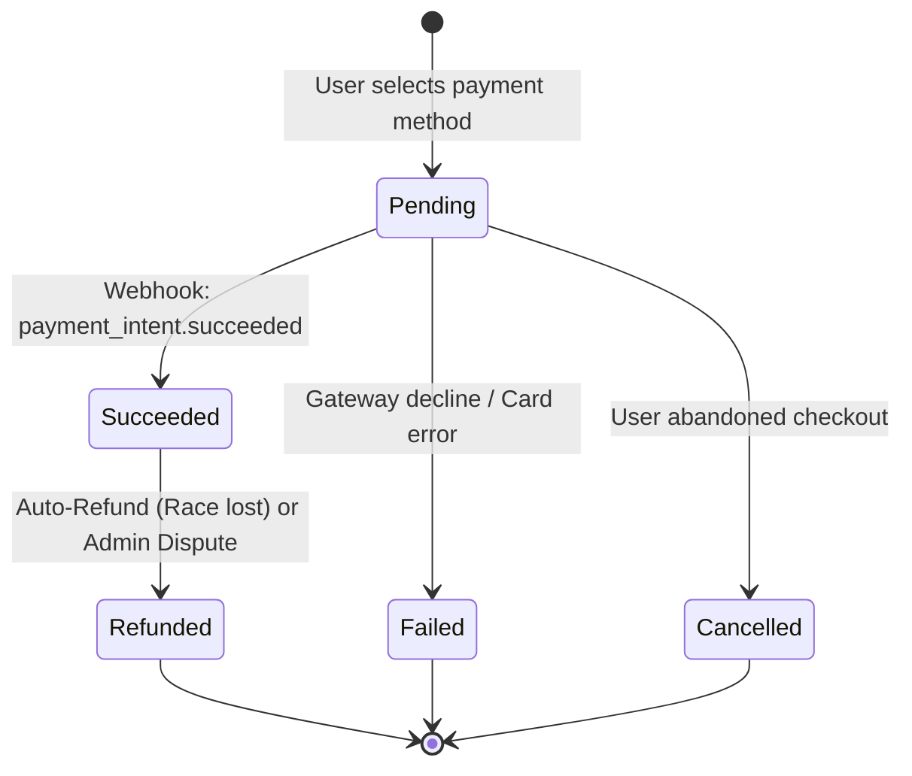

# 💳 Payment & Webhook Reconciliation Engine Plan

> **Scope:** Payment Processing, Webhook Idempotency, Critical Hold-Expiry Race Reconciliation, and Auto-Refund Engine  
> **Source Spec:** [Plan/concert.md](file:///c:/Users/wwwwww/Documents/project-test/concert/Plan/concert.md) (Sections 3.6, 5.2, 5.3)

---

## 1. Payment Lifecycle State Machine



---

## 2. Webhook Security & Idempotency

Payment gateways (Stripe / Omise) retry failed webhooks multiple times. The reconciliation engine must process events idempotently.

### 2.1 Verification & Ingestion Rules
1. **Signature Verification:** Compute HMAC-SHA256 on raw payload using `PAYMENT_WEBHOOK_SECRET`. Reject immediately if invalid.
2. **Atomic Idempotency Key:**
   * Query `payments` table by `payment_intent_id` and webhook `event_id`.
   * If already processed (`payments.status IN ('Succeeded', 'Refunded')`), return `200 OK` immediately without duplicate execution.

---

## 3. The 3 Race Scenarios (Hold-Expiry vs Webhook Arrival)

A race condition occurs when a payment succeeds at the gateway, but the webhook notification arrives after the 10-minute seat hold window has expired.

```
       Payment Webhook Arrives
                  │
                  ▼
      Check Target Seat Status
                  │
     ┌────────────┼────────────┐
     ▼            ▼            ▼
[ Held by User ] [ Available ] [ Taken by Other ]
     │            │            │
     │            ▼            │
     │      Paid within        │
     │    90s grace window?    │
     │     ┌──────┴──────┐     │
     │    YES            NO    │
     ▼     ▼             ▼     ▼
  [ Mark Booked ]     [ Trigger Auto-Refund ]
```

### Scenario Breakdown:

| Scenario | Condition When Webhook Arrives | Action Taken |
| :--- | :--- | :--- |
| **Scenario 1: In-Time Payment** | Seat is still marked `Held` by the booking user | 1. Mark Seat as `Booked`<br>2. Confirm Booking<br>3. Issue QR Code Tickets |
| **Scenario 2: Conflict (Race Lost)** | Seat was acquired and `Held` or `Booked` by **another user** | 1. **New user wins** (Seat remains with new user)<br>2. Existing payment is tagged with `PaymentRaceLost`<br>3. **Instant Auto-Refund** full amount via Gateway API<br>4. Dispatch email apologizing and explaining seat was lost |
| **Scenario 3: Expired But Available** | Seat reverted to `Available` (no other user has taken it yet) | 1. Inspect `payment.paid_at` timestamp<br>2. If within **90-second grace window**: Re-acquire seat and mark `Booked`<br>3. If exceeding 90 seconds: Trigger **Auto-Refund** |

### 3.1 Reconciliation Implementation Logic
```csharp
public async Task ReconcileSuccessfulPaymentAsync(string paymentIntentId, DateTime paidAt, CancellationToken ct)
{
    await using var tx = await _dbContext.Database.BeginTransactionAsync(IsolationLevel.Serializable, ct);

    var booking = await _dbContext.Bookings
        .Include(b => b.Items)
        .FirstOrDefaultAsync(b => b.PaymentIntentId == paymentIntentId, ct);

    var seatIds = booking.Items.Select(i => i.SeatId).ToList();
    var seats = await _dbContext.Seats.Where(s => seatIds.Contains(s.Id)).ToListAsync(ct);

    bool allSeatsRetained = seats.All(s => s.Status == SeatStatus.Held && s.HeldByUserId == booking.UserId);
    bool seatsStillAvailable = seats.All(s => s.Status == SeatStatus.Available);

    if (allSeatsRetained)
    {
        // Scenario 1: Clean transition
        seats.ForEach(s => s.ConfirmBooking());
        booking.MarkConfirmed();
        await IssueTicketQRsAsync(booking, ct);
    }
    else if (seatsStillAvailable && (paidAt - booking.HeldUntil!.Value).TotalSeconds <= 90)
    {
        // Scenario 3: Grace window reclamation
        seats.ForEach(s => s.ConfirmBooking());
        booking.MarkConfirmed();
        await IssueTicketQRsAsync(booking, ct);
    }
    else
    {
        // Scenario 2: Seat lost or expired past grace window -> AUTO-REFUND
        booking.MarkCancelled();
        await _refundService.ExecuteAutoRefundAsync(booking.Id, RefundReason.PaymentRaceLost, ct);
    }

    await _dbContext.SaveChangesAsync(ct);
    await tx.CommitAsync(ct);
}
```

---

## 4. Cryptographic QR Code Generation

To prevent counterfeit tickets, each `BookingItem` receives an encrypted, tamper-proof QR code.

* **Payload Structure:**
  ```json
  {
    "ticketId": "b1a2c3d4-...",
    "bookingRef": "TW-2026-9812",
    "eventId": "e5f6a7...",
    "seatNumber": "A-12",
    "issuedAt": 1789500000,
    "signature": "hmac_sha256_hash_here"
  }
  ```
* **Verification:** Organizer staff scanning the QR code offline or online decrypts and verifies the signature using the event's public/symmetric key before granting admission.
