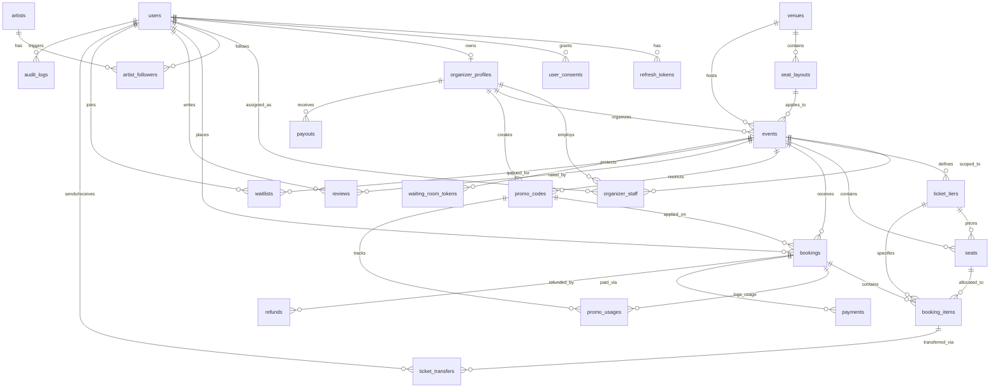

# 📚 TicketWorld — Database Data Dictionary & Schema Specification

> **Version:** 2.2.0  
> **Database Engine:** PostgreSQL 16 (UTF-8, UTC)  
> **ORM & Framework:** EF Core 10 / ASP.NET Core Clean Architecture  
> **Target Schema:** `public`  
> **Key Conventions:** UUIDv4 Primary Keys (`gen_random_uuid()`), snake_case database naming, UTC `TIMESTAMPTZ`, Optimistic Concurrency Control, PDPA Soft-Delete.

---

## 📑 สารบัญ (Table of Contents)
1. [สถาปัตยกรรมและมาตรฐานการออกแบบฐานข้อมูล (Database Conventions)](#1-สถาปัตยกรรมและมาตรฐานการออกแบบฐานข้อมูล)
2. [แผนภาพความสัมพันธ์ของข้อมูล (Entity Relationship Diagram - ERD)](#2-แผนภาพความสัมพันธ์ของข้อมูล)
3. [ตารางข้อมูลแบบละเอียดทั้ง 26 ตาราง (Table Specifications)](#3-ตารางข้อมูลแบบละเอียดทั้ง-26-ตาราง)
   - [กลุ่มที่ 1: Identity, Users & PDPA Compliance](#กลุ่มที่-1-identity-users--pdpa-compliance)
     - 1.1 [`users`](#11-ตาราง-users)
     - 1.2 [`refresh_tokens`](#12-ตาราง-refresh_tokens)
     - 1.3 [`organizer_profiles`](#13-ตาราง-organizer_profiles)
     - 1.4 [`organizer_staff`](#14-ตาราง-organizer_staff)
     - 1.5 [`user_consents`](#15-ตาราง-user_consents)
   - [กลุ่มที่ 2: Catalog — Artists & Venues](#กลุ่มที่-2-catalog--artists--venues)
     - 2.1 [`artists`](#21-ตาราง-artists)
     - 2.2 [`artist_followers`](#22-ตาราง-artist_followers)
     - 2.3 [`venues`](#23-ตาราง-venues)
     - 2.4 [`seat_layouts`](#24-ตาราง-seat_layouts)
   - [กลุ่มที่ 3: Events, Tiers & Seats Inventory](#กลุ่มที่-3-events-tiers--seats-inventory)
     - 3.1 [`events`](#31-ตาราง-events)
     - 3.2 [`ticket_tiers`](#32-ตาราง-ticket_tiers)
     - 3.3 [`seats`](#33-ตาราง-seats)
   - [กลุ่มที่ 4: Bookings, Tickets & Promo Codes](#กลุ่มที่-4-bookings-tickets--promo-codes)
     - 4.1 [`promo_codes`](#41-ตาราง-promo_codes)
     - 4.2 [`bookings`](#42-ตาราง-bookings)
     - 4.3 [`booking_items`](#43-ตาราง-booking_items)
     - 4.4 [`promo_usages`](#44-ตาราง-promo_usages)
     - 4.5 [`ticket_transfers`](#45-ตาราง-ticket_transfers)
   - [กลุ่มที่ 5: Payments, Refunds & Settlements](#กลุ่มที่-5-payments-refunds--settlements)
     - 5.1 [`payments`](#51-ตาราง-payments)
     - 5.2 [`webhook_events`](#52-ตาราง-webhook_events)
     - 5.3 [`payouts`](#53-ตาราง-payouts)
     - 5.4 [`refunds`](#54-ตาราง-refunds)
   - [กลุ่มที่ 6: Operations, Queue, Reviews & Governance](#กลุ่มที่-6-operations-queue-reviews--governance)
     - 6.1 [`reviews`](#61-ตาราง-reviews)
     - 6.2 [`waitlists`](#62-ตาราง-waitlists)
     - 6.3 [`waiting_room_tokens`](#63-ตาราง-waiting_room_tokens)
     - 6.4 [`audit_logs`](#64-ตาราง-audit_logs)
     - 6.5 [`system_configs`](#65-ตาราง-system_configs)
4. [รายการ Enums ประจำระบบ (Domain Enumerations)](#4-รายการ-enums-ประจำระบบ)

---

## 1. สถาปัตยกรรมและมาตรฐานการออกแบบฐานข้อมูล

* **Primary Key:** ทุกตาราง (ยกเว้น `system_configs` และ Junction tables) ใช้ `UUID` v4 สร้างอัตโนมัติด้วย `gen_random_uuid()`
* **Naming Conventions:**
  * ตารางและคอลัมน์ใน PostgreSQL: `snake_case` รูปพหูพจน์สำหรับชื่อตาราง เช่น `users`, `booking_items`
  * โมเดลใน C# .NET: `PascalCase` รูปเอกพจน์ เช่น `User`, `BookingItem`
* **Auditing:** ตารางที่สืบทอด `IAuditableEntity` จะมีฟิลด์ `created_at` และ `updated_at` (TIMESTAMPTZ UTC) จัดการผ่าน SaveChanges Interceptor
* **Soft Delete:** ตารางที่ใช้ `ISoftDeletable` มีคอลัมน์ `deleted_at TIMESTAMPTZ` ทำงานคู่กับ EF Core Global Query Filter (`deleted_at IS NULL`) เพื่อรองรับ PDPA Erasure
* **High Concurrency & Financial Protection:**
  * Optimistic Concurrency ใน [`seats`](#33-ตาราง-seats) ผ่านคอลัมน์ `version INT` (Incremented ทุกการเปลี่ยนสถานะ) ร่วมกับ RedLock และ PostgreSQL `FOR UPDATE NOWAIT`
  * Idempotency Keys บนการชำระเงินและ Webhook (`idempotency_key`, `(gateway, event_id) UNIQUE`)
  * เข้ารหัสข้อมูลอ่อนไหวระดับ Application-level (AES-256-GCM + KMS): ฟิลด์ `bank_account_no_enc`, `bank_account_snapshot_enc`

---

## 2. แผนภาพความสัมพันธ์ของข้อมูล

---

## 3. ตารางข้อมูลแบบละเอียดทั้ง 26 ตาราง

### กลุ่มที่ 1: Identity, Users & PDPA Compliance

#### 1.1 ตาราง: `users`
* **Entity:** [`User`](file:///c:/Users/wwwwww/Documents/project-test/concert/backend/src/Domain/Entities/User.cs)
* **Configuration:** [`IdentityConfigurations.cs`](file:///c:/Users/wwwwww/Documents/project-test/concert/backend/src/Infrastructure/Persistence/Configurations/IdentityConfigurations.cs)
* **วัตถุประสงค์:** จัดเก็บข้อมูลบัญชีผู้ใช้งานระบบทุกบทบาท (Customer, Organizer, OrgStaff, Admin)

| คอลัมน์ | ชนิดข้อมูล | Constraints | Nullable | ค่า Default | รายละเอียด / Business Rule | ตัวอย่างข้อมูล |
| :--- | :--- | :--- | :---: | :--- | :--- | :--- |
| `id` | `UUID` | PK | NO | `gen_random_uuid()` | รหัสประจำตัวผู้ใช้ (UUID v4) | `a1b2c3d4-e5f6-7890-abcd-ef1234567890` |
| `email` | `VARCHAR(255)` | UNIQUE, Index | NO | - | อีเมลสำหรับยืนยันตัวตนและแจ้งเตือน (Normalized Lowercase) | `somchai.dev@gmail.com` |
| `password_hash` | `TEXT` | - | NO | - | รหัสผ่านแฮชความปลอดภัยสูง (Argon2id / BCrypt) | `$argon2id$v=19$m=65536,t=3,p=4$...` |
| `full_name` | `VARCHAR(200)` | - | NO | - | ชื่อ-นามสกุลจริงของผู้ใช้งาน | `Somchai Prasert` |
| `phone` | `VARCHAR(20)` | - | YES | NULL | เบอร์โทรศัพท์ตามรูปแบบ E.164 | `+66812345678` |
| `avatar_url` | `TEXT` | - | YES | NULL | URL ไฟล์ภาพโปรไฟล์บน Object Storage / CDN | `https://cdn.ticketworld.io/avatars/u1.webp` |
| `preferred_lang` | `VARCHAR(5)` | - | NO | `'th'` | ภาษาที่ต้องการแสดงผล (`th`, `en`, `ja`, `ko`) | `'th'` |
| `preferred_currency` | `VARCHAR(3)` | - | NO | `'THB'` | สกุลเงินแสดงผลหลักตามมาตรฐาน ISO 4217 | `'THB'` |
| `timezone` | `VARCHAR(50)` | - | NO | `'Asia/Bangkok'` | โซนเวลาผู้ใช้ตามมาตรฐาน IANA Timezone | `'Asia/Bangkok'` |
| `role` | `VARCHAR(20)` | Index | NO | `'Customer'` | สิทธิ์ผู้ใช้ (`Customer`, `Organizer`, `OrgStaff`, `Admin`) | `'Customer'` |
| `is_verified` | `BOOLEAN` | - | NO | `FALSE` | สถานะการยืนยันอีเมลยืนยันตัวตน | `TRUE` |
| `is_banned` | `BOOLEAN` | Index | NO | `FALSE` | ระงับการใช้งานโดยผู้ดูแลระบบ (Deny token check) | `FALSE` |
| `banned_reason` | `TEXT` | - | YES | NULL | บันทึกเหตุผลการระงับการใช้งาน | NULL |
| `two_factor_enabled` | `BOOLEAN` | - | NO | `FALSE` | เปิดใช้งาน 2-Factor Authentication (TOTP) | `TRUE` |
| `failed_login_count` | `INT` | - | NO | `0` | ตัวนับรหัสผ่านผิดสะสม (Lockout ที่ 5 ครั้ง) | `0` |
| `locked_until` | `TIMESTAMPTZ` | - | YES | NULL | เวลาที่สิ้นสุดการล็อกบัญชีจากการพยายามผิดซ้ำ | NULL |
| `auth_provider` | `VARCHAR(20)` | - | NO | `'local'` | ช่องทางสร้างบัญชี (`local`, `google`) | `'local'` |
| `google_sub` | `VARCHAR(100)` | UNIQUE, Index | YES | NULL | Identifier จาก Google OAuth สำหรับ Social Login | `'108234857209348572034'` |
| `deleted_at` | `TIMESTAMPTZ` | Index | YES | NULL | เวลาที่ขอลบบัญชี Soft-Delete ตามนโยบาย PDPA | NULL |
| `created_at` | `TIMESTAMPTZ` | - | NO | `NOW()` | วันเวลาที่สร้างบัญชี (UTC) | `2026-09-25T14:00:00Z` |
| `updated_at` | `TIMESTAMPTZ` | - | NO | `NOW()` | วันเวลาที่แก้ไขข้อมูลล่าสุด (UTC) | `2026-09-25T14:00:00Z` |

---

#### 1.2 ตาราง: `refresh_tokens`
* **Entity:** [`RefreshToken`](file:///c:/Users/wwwwww/Documents/project-test/concert/backend/src/Domain/Entities/RefreshToken.cs)
* **Configuration:** [`IdentityConfigurations.cs`](file:///c:/Users/wwwwww/Documents/project-test/concert/backend/src/Infrastructure/Persistence/Configurations/IdentityConfigurations.cs)
* **วัตถุประสงค์:** จัดเก็บ JWT Refresh Token พร้อมกลไก One-Time Rotation และ Reuse Detection

| คอลัมน์ | ชนิดข้อมูล | Constraints | Nullable | ค่า Default | รายละเอียด / Business Rule | ตัวอย่างข้อมูล |
| :--- | :--- | :--- | :---: | :--- | :--- | :--- |
| `id` | `UUID` | PK | NO | `gen_random_uuid()` | รหัสประจำตัวเรคคอร์ดโทเคน | `aa11bb22-cc33-dd44-ee55-ff6677889900` |
| `user_id` | `UUID` | FK (`users.id`) ON DELETE CASCADE, Index | NO | - | ผู้ใช้งานเจ้าของ Session | `a1b2c3d4-e5f6-7890-abcd-ef1234567890` |
| `token_hash` | `VARCHAR(128)` | UNIQUE, Index | NO | - | ค่า SHA-256 Hash ของ Refresh Token (ห้ามเก็บ Plaintext) | `e3b0c44298fc1c149afbf4c8996fb92427ae41...` |
| `device_info` | `VARCHAR(300)` | - | YES | NULL | ข้อมูลเบราว์เซอร์หรืออุปกรณ์ที่เข้าสู่ระบบ | `Chrome 128 on Windows 11` |
| `ip_address` | `INET` | - | YES | NULL | หมายเลข IP Address ที่ร้องขอ Session | `203.144.144.168` |
| `expires_at` | `TIMESTAMPTZ` | Index | NO | - | วันเวลาหมดอายุ (ค่ามาตรฐาน 7 วัน) | `2026-10-02T14:00:00Z` |
| `is_revoked` | `BOOLEAN` | Index | NO | `FALSE` | สถานะการเพิกถอนสิทธิ์ | `FALSE` |
| `revoked_at` | `TIMESTAMPTZ` | - | YES | NULL | วันเวลาที่ถูกสั่งยกเลิก | NULL |
| `replaced_by_token` | `VARCHAR(128)` | - | YES | NULL | Hash ของ Token ใหม่ที่สืบทอดไป (ตรวจจับ Token Replay) | NULL |
| `created_at` | `TIMESTAMPTZ` | - | NO | `NOW()` | วันเวลาที่ออกโทเคน | `2026-09-25T14:00:00Z` |

---

#### 1.3 ตาราง: `organizer_profiles`
* **Entity:** [`OrganizerProfile`](file:///c:/Users/wwwwww/Documents/project-test/concert/backend/src/Domain/Entities/OrganizerProfile.cs)
* **Configuration:** [`IdentityConfigurations.cs`](file:///c:/Users/wwwwww/Documents/project-test/concert/backend/src/Infrastructure/Persistence/Configurations/IdentityConfigurations.cs)
* **วัตถุประสงค์:** จัดเก็บข้อมูลนิติบุคคลผู้จัดงาน ข้อมูลภาษี และเลขบัญชีรับเงินโอนค่าบัตร

| คอลัมน์ | ชนิดข้อมูล | Constraints | Nullable | ค่า Default | รายละเอียด / Business Rule | ตัวอย่างข้อมูล |
| :--- | :--- | :--- | :---: | :--- | :--- | :--- |
| `id` | `UUID` | PK | NO | `gen_random_uuid()` | รหัสประจำตัวโปรไฟล์ผู้จัดงาน | `b2c3d4e5-f6a7-8901-bcde-f12345678901` |
| `user_id` | `UUID` | FK (`users.id`) ON DELETE CASCADE, UNIQUE | NO | - | ผูกกับบัญชี User หลัก (1-to-1) | `a1b2c3d4-e5f6-7890-abcd-ef1234567890` |
| `company_name` | `VARCHAR(300)` | Index | NO | - | ชื่อจดทะเบียนบริษัทหรือองค์กรผู้จัดงาน | `Live Nation Tero Co., Ltd.` |
| `company_logo_url` | `TEXT` | - | YES | NULL | ภาพสัญลักษณ์องค์กร | `https://cdn.ticketworld.io/orgs/logo.png` |
| `description` | `TEXT` | - | YES | NULL | ประวัติหรือคำอธิบายองค์กร | `Leading global concert promoter in SEA` |
| `website` | `VARCHAR(500)` | - | YES | NULL | เว็บไซต์ทางการ | `https://www.livenation.co.th` |
| `tax_id` | `VARCHAR(50)` | UNIQUE | YES | NULL | เลขประจำตัวผู้เสียภาษีอากร 13 หลัก | `0105561000000` |
| `bank_account_no_enc` | `TEXT` | - | NO | - | เลขที่บัญชีธนาคารเข้ารหัสระดับแอปพลิเคชัน (AES-256-GCM) | `v1:gQw9x2...encrypted...` |
| `bank_name` | `VARCHAR(100)` | - | NO | - | ชื่อธนาคารผู้รับเงินโอน | `Kasikornbank (KBANK)` |
| `bank_account_last4` | `VARCHAR(4)` | - | NO | - | เลขบัญชี 4 หลักท้ายสำหรับแสดงผลบนหน้าจอ UI | `8901` |
| `payout_schedule` | `VARCHAR(20)` | - | NO | `'monthly'` | รอบเวลาคำนวณเบิกจ่าย (`weekly`, `biweekly`, `monthly`) | `'monthly'` |
| `commission_rate` | `DECIMAL(5,4)` | CHECK (0..1) | NO | `0.0500` | ส่วนแบ่งแพลตฟอร์ม (0.0500 = 5.00%) | `0.0500` |
| `is_approved` | `BOOLEAN` | Index | NO | `FALSE` | การอนุมัติสถานะผู้จัดงานโดย Platform Admin | `TRUE` |
| `approved_at` | `TIMESTAMPTZ` | - | YES | NULL | วันเวลาที่ Admin ทำการอนุมัติ | `2026-09-25T15:00:00Z` |
| `approved_by` | `UUID` | FK (`users.id`) | YES | NULL | รหัสแอดมินผู้อนุมัติเอกสาร | `ff112233-4455-6677-8899-aabbccddeeff` |
| `deleted_at` | `TIMESTAMPTZ` | Index | YES | NULL | วันที่ Soft-Delete ยกเลิกนิติบุคคล | NULL |
| `created_at` | `TIMESTAMPTZ` | - | NO | `NOW()` | วันเวลาที่ลงทะเบียน | `2026-09-25T14:00:00Z` |
| `updated_at` | `TIMESTAMPTZ` | - | NO | `NOW()` | วันเวลาที่ปรับปรุงข้อมูลล่าสุด | `2026-09-25T15:00:00Z` |

---

#### 1.4 ตาราง: `organizer_staff`
* **Entity:** [`OrganizerStaff`](file:///c:/Users/wwwwww/Documents/project-test/concert/backend/src/Domain/Entities/OrganizerStaff.cs)
* **Configuration:** [`IdentityConfigurations.cs`](file:///c:/Users/wwwwww/Documents/project-test/concert/backend/src/Infrastructure/Persistence/Configurations/IdentityConfigurations.cs)
* **วัตถุประสงค์:** จัดการสิทธิ์การทำงานของทีมงานในสังกัด Organizer แบบจำกัดขอบเขต (เช่น เฉพาะสแกนตั๋ว Check-in)

| คอลัมน์ | ชนิดข้อมูล | Constraints | Nullable | ค่า Default | รายละเอียด / Business Rule | ตัวอย่างข้อมูล |
| :--- | :--- | :--- | :---: | :--- | :--- | :--- |
| `id` | `UUID` | PK | NO | `gen_random_uuid()` | รหัสประจำตัวการมอบหมายงาน | `b9d0e1f2-a3b4-5678-cd90-123456789abc` |
| `organizer_id` | `UUID` | FK (`organizer_profiles.id`) ON DELETE CASCADE, Index | NO | - | ผู้จัดงานต้นสังกัด | `b2c3d4e5-f6a7-8901-bcde-f12345678901` |
| `user_id` | `UUID` | FK (`users.id`) ON DELETE CASCADE, Index | NO | - | บัญชีผู้ใช้ของทีมงาน (`Role = OrgStaff`) | `a9b8c7d6-e5f4-4321-dcba-0987654321fe` |
| `event_id` | `UUID` | FK (`events.id`) ON DELETE CASCADE, Index | YES | NULL | อีเวนต์ที่ได้รับมอบหมาย (NULL = ทุกงานของผู้จัด) | `e5f6a7b8-c9d0-1234-ef12-345678901234` |
| `permissions` | `TEXT[]` | - | NO | `'{}'` | สิทธิ์ที่อนุญาต เช่น `['checkin.scan', 'bookings.view:event']` | `ARRAY['checkin.scan']` |
| `is_active` | `BOOLEAN` | - | NO | `TRUE` | สถานะเปิด/ปิดสิทธิ์การเข้าถึง | `TRUE` |
| `invited_by` | `UUID` | FK (`users.id`) | NO | - | ผู้ใช้องค์กรที่ส่งคำเชิญ | `a1b2c3d4-e5f6-7890-abcd-ef1234567890` |
| `created_at` | `TIMESTAMPTZ` | - | NO | `NOW()` | วันเวลาที่กำหนดสิทธิ์ | `2026-09-25T14:00:00Z` |

* **Unique Key:** `(organizer_id, user_id, event_id)`

---

#### 1.5 ตาราง: `user_consents`
* **Entity:** [`UserConsent`](file:///c:/Users/wwwwww/Documents/project-test/concert/backend/src/Domain/Entities/UserConsent.cs)
* **Configuration:** [`IdentityConfigurations.cs`](file:///c:/Users/wwwwww/Documents/project-test/concert/backend/src/Infrastructure/Persistence/Configurations/IdentityConfigurations.cs)
* **วัตถุประสงค์:** จัดเก็บบันทึกประวัติความยินยอมการประมวลผลข้อมูลส่วนบุคคลตาม พ.ร.บ. คุ้มครองข้อมูลส่วนบุคคล (PDPA)

| คอลัมน์ | ชนิดข้อมูล | Constraints | Nullable | ค่า Default | รายละเอียด / Business Rule | ตัวอย่างข้อมูล |
| :--- | :--- | :--- | :---: | :--- | :--- | :--- |
| `id` | `UUID` | PK | NO | `gen_random_uuid()` | รหัสรายการความยินยอม | `c4d5e6f7-a8b9-0123-def1-234567890123` |
| `user_id` | `UUID` | FK (`users.id`) ON DELETE CASCADE, Index | NO | - | ผู้ให้ความยินยอม | `a1b2c3d4-e5f6-7890-abcd-ef1234567890` |
| `consent_type` | `VARCHAR(50)` | - | NO | - | ชนิดความยินยอม (`terms_of_service`, `marketing_email`, `analytics`) | `'terms_of_service'` |
| `version` | `VARCHAR(20)` | - | NO | - | หมายเลขเวอร์ชันของนโยบายหรือข้อตกลง | `'2026.1'` |
| `is_granted` | `BOOLEAN` | - | NO | `TRUE` | สถานะการให้ความยินยอม (TRUE = ยินยอม, FALSE = เพิกถอน) | `TRUE` |
| `granted_at` | `TIMESTAMPTZ` | - | NO | `NOW()` | วันเวลาที่บันทึกความยินยอม | `2026-09-25T14:00:00Z` |
| `revoked_at` | `TIMESTAMPTZ` | - | YES | NULL | วันเวลาที่ผู้ใช้กดยกเลิกความยินยอม | NULL |
| `ip_address` | `INET` | - | YES | NULL | IP ต้นทางขณะกดยืนยันความยินยอม | `203.144.144.168` |

---

### กลุ่มที่ 2: Catalog — Artists & Venues

#### 2.1 ตาราง: `artists`
* **Entity:** [`Artist`](file:///c:/Users/wwwwww/Documents/project-test/concert/backend/src/Domain/Entities/Artist.cs)
* **Configuration:** [`CatalogConfigurations.cs`](file:///c:/Users/wwwwww/Documents/project-test/concert/backend/src/Infrastructure/Persistence/Configurations/CatalogConfigurations.cs)
* **วัตถุประสงค์:** แค็ตตาล็อกข้อมูลศิลปิน นักดนตรี และวงดนตรี

| คอลัมน์ | ชนิดข้อมูล | Constraints | Nullable | ค่า Default | รายละเอียด / Business Rule | ตัวอย่างข้อมูล |
| :--- | :--- | :--- | :---: | :--- | :--- | :--- |
| `id` | `UUID` | PK | NO | `gen_random_uuid()` | รหัสประจำตัวศิลปิน | `c3d4e5f6-a7b8-9012-cdef-123456789012` |
| `name` | `VARCHAR(300)` | Index | NO | - | ชื่อทางการของศิลปินหรือวงดนตรี | `Coldplay` |
| `slug` | `VARCHAR(300)` | UNIQUE, Index | NO | - | SEO Slug สำหรับเรียกดูหน้าโปรไฟล์ | `'coldplay'` |
| `bio` | `TEXT` | - | YES | NULL | ชีวประวัติและรายละเอียดผลงาน | `British rock band formed in London in 1997...` |
| `profile_image_url` | `TEXT` | - | YES | NULL | URL รูปโปรไฟล์ศิลปิน | `https://cdn.ticketworld.io/artists/coldplay.jpg` |
| `cover_image_url` | `TEXT` | - | YES | NULL | URL แบนเนอร์ส่วนหัว | `https://cdn.ticketworld.io/artists/coldplay-cover.jpg` |
| `genre` | `VARCHAR(100)` | Index | YES | NULL | แนวดนตรีหลัก (`Alternative Rock`, `Pop`, `K-Pop`) | `'Alternative Rock'` |
| `country` | `VARCHAR(100)` | - | YES | NULL | สัญชาติหรือประเทศต้นทาง | `'United Kingdom'` |
| `social_links` | `JSONB` | - | YES | `'{}'` | ข้อมูลโซเชียลมีเดียในรูปแบบ JSON Object | `{"spotify": "...", "instagram": "..."}` |
| `follower_count` | `INT` | Index | NO | `0` | ยอดผู้ติดตามสะสม (Atomic Counter) | `145200` |
| `created_at` | `TIMESTAMPTZ` | - | NO | `NOW()` | วันเวลาที่เพิ่มข้อมูลเข้าสู่ระบบ | `2026-09-25T14:00:00Z` |

---

#### 2.2 ตาราง: `artist_followers`
* **Entity:** [`ArtistFollower`](file:///c:/Users/wwwwww/Documents/project-test/concert/backend/src/Domain/Entities/ArtistFollower.cs)
* **Configuration:** [`CatalogConfigurations.cs`](file:///c:/Users/wwwwww/Documents/project-test/concert/backend/src/Infrastructure/Persistence/Configurations/CatalogConfigurations.cs)
* **วัตถุประสงค์:** ตารางเชื่อมโยง (Junction Table) การกดติดตามศิลปินของผู้ใช้

| คอลัมน์ | ชนิดข้อมูล | Constraints | Nullable | ค่า Default | รายละเอียด / Business Rule | ตัวอย่างข้อมูล |
| :--- | :--- | :--- | :---: | :--- | :--- | :--- |
| `user_id` | `UUID` | PK (Composite), FK (`users.id`) ON DELETE CASCADE | NO | - | ผู้ใช้งานที่กดติดตาม | `a1b2c3d4-e5f6-7890-abcd-ef1234567890` |
| `artist_id` | `UUID` | PK (Composite), FK (`artists.id`) ON DELETE CASCADE, Index | NO | - | ศิลปินที่ได้รับการติดตาม | `c3d4e5f6-a7b8-9012-cdef-123456789012` |
| `followed_at` | `TIMESTAMPTZ` | - | NO | `NOW()` | วันเวลาที่กดเริ่มติดตาม | `2026-09-25T14:00:00Z` |

---

#### 2.3 ตาราง: `venues`
* **Entity:** [`Venue`](file:///c:/Users/wwwwww/Documents/project-test/concert/backend/src/Domain/Entities/Venue.cs)
* **Configuration:** [`CatalogConfigurations.cs`](file:///c:/Users/wwwwww/Documents/project-test/concert/backend/src/Infrastructure/Persistence/Configurations/CatalogConfigurations.cs)
* **วัตถุประสงค์:** จัดเก็บข้อมูลสถานที่จัดงานแสดง คอนเสิร์ตฮอลล์ สนามกีฬา พร้อมพิกัดภูมิศาสตร์

| คอลัมน์ | ชนิดข้อมูล | Constraints | Nullable | ค่า Default | รายละเอียด / Business Rule | ตัวอย่างข้อมูล |
| :--- | :--- | :--- | :---: | :--- | :--- | :--- |
| `id` | `UUID` | PK | NO | `gen_random_uuid()` | รหัสประจำตัวสถานที่ | `d4e5f6a7-b8c9-0123-def1-234567890123` |
| `name` | `VARCHAR(300)` | Index | NO | - | ชื่อทางการของสถานที่จัดงาน | `Rajamangala National Stadium` |
| `address` | `TEXT` | - | NO | - | ที่ตั้งโดยละเอียด | `286 Ramkhamhaeng Rd, Hua Mak, Bang Kapi` |
| `city` | `VARCHAR(100)` | Index | NO | - | เมือง / จังหวัด | `'Bangkok'` |
| `country` | `VARCHAR(100)` | - | NO | `'Thailand'` | ประเทศ | `'Thailand'` |
| `postal_code` | `VARCHAR(20)` | - | YES | NULL | รหัสไปรษณีย์ | `'10240'` |
| `latitude` | `DECIMAL(10,8)` | - | YES | NULL | พิกัดละติจูด (WGS 84) | `13.75531700` |
| `longitude` | `DECIMAL(11,8)` | - | YES | NULL | พิกัดลองจิจูด (WGS 84) | `100.62228500` |
| `total_capacity` | `INT` | - | NO | - | ความจุผู้ชมสูงสุดตามใบอนุญาต | `51552` |
| `deleted_at` | `TIMESTAMPTZ` | Index | YES | NULL | เวลาที่ Soft-Delete สถานที่ | NULL |
| `created_at` | `TIMESTAMPTZ` | - | NO | `NOW()` | วันเวลาที่สร้างข้อมูล | `2026-09-25T14:00:00Z` |
| `updated_at` | `TIMESTAMPTZ` | - | NO | `NOW()` | วันเวลาที่ปรับปรุงข้อมูล | `2026-09-25T14:00:00Z` |

---

#### 2.4 ตาราง: `seat_layouts`
* **Entity:** [`SeatLayout`](file:///c:/Users/wwwwww/Documents/project-test/concert/backend/src/Domain/Entities/SeatLayout.cs)
* **Configuration:** [`CatalogConfigurations.cs`](file:///c:/Users/wwwwww/Documents/project-test/concert/backend/src/Infrastructure/Persistence/Configurations/CatalogConfigurations.cs)
* **วัตถุประสงค์:** จัดเก็บโครงสร้างผังที่นั่งแม่แบบ (Seat Map Schema) ในรูปแบบพิกัด Vector JSONB

| คอลัมน์ | ชนิดข้อมูล | Constraints | Nullable | ค่า Default | รายละเอียด / Business Rule | ตัวอย่างข้อมูล |
| :--- | :--- | :--- | :---: | :--- | :--- | :--- |
| `id` | `UUID` | PK | NO | `gen_random_uuid()` | รหัสประจำตัวผังที่นั่ง | `e1f2a3b4-c5d6-7890-ef12-345678901234` |
| `venue_id` | `UUID` | FK (`venues.id`) ON DELETE CASCADE, Index | NO | - | ผูกกับสถานที่จัดงาน | `d4e5f6a7-b8c9-0123-def1-234567890123` |
| `name` | `VARCHAR(200)` | - | NO | - | ชื่อผังที่นั่ง เช่น 'Standard Center Stage Layout' | `'End Stage Concourse Layout'` |
| `layout_json` | `JSONB` | - | NO | - | พิกัดและมิติของผังที่นั่ง (SVG / Section Coordinates) | `{"sections": [{"name": "A1", "capacity": 200}]}` |
| `created_at` | `TIMESTAMPTZ` | - | NO | `NOW()` | วันเวลาที่สร้างผัง | `2026-09-25T14:00:00Z` |
| `updated_at` | `TIMESTAMPTZ` | - | NO | `NOW()` | วันเวลาที่แก้ไขผัง | `2026-09-25T14:00:00Z` |

---

### กลุ่มที่ 3: Events, Tiers & Seats Inventory

#### 3.1 ตาราง: `events`
* **Entity:** [`Event`](file:///c:/Users/wwwwww/Documents/project-test/concert/backend/src/Domain/Entities/Event.cs)
* **Configuration:** [`EventConfigurations.cs`](file:///c:/Users/wwwwww/Documents/project-test/concert/backend/src/Infrastructure/Persistence/Configurations/EventConfigurations.cs)
* **วัตถุประสงค์:** ตารางหลักในการบริหารจัดการวงจรชีวิตคอนเสิร์ตและงานแสดงทั้งหมด

| คอลัมน์ | ชนิดข้อมูล | Constraints | Nullable | ค่า Default | รายละเอียด / Business Rule | ตัวอย่างข้อมูล |
| :--- | :--- | :--- | :---: | :--- | :--- | :--- |
| `id` | `UUID` | PK | NO | `gen_random_uuid()` | รหัสประจำตัวอีเวนต์ | `e5f6a7b8-c9d0-1234-ef12-345678901234` |
| `organizer_id` | `UUID` | FK (`organizer_profiles.id`) ON DELETE RESTRICT, Index | NO | - | ผู้จัดงานที่เป็นเจ้าของอีเวนต์ | `b2c3d4e5-f6a7-8901-bcde-f12345678901` |
| `venue_id` | `UUID` | FK (`venues.id`) ON DELETE RESTRICT, Index | NO | - | สถานที่จัดงาน | `d4e5f6a7-b8c9-0123-def1-234567890123` |
| `seat_layout_id` | `UUID` | FK (`seat_layouts.id`) ON DELETE RESTRICT | YES | NULL | ผังที่นั่งที่เลือกใช้สำหรับงานนี้ | `e1f2a3b4-c5d6-7890-ef12-345678901234` |
| `title` | `VARCHAR(300)` | Index | NO | - | ชื่องานแสดงอย่างเป็นทางการ | `Coldplay Music of the Spheres Bangkok` |
| `slug` | `VARCHAR(300)` | UNIQUE, Index | NO | - | URL Path Slug สำหรับการเข้าชม | `'coldplay-mot-spheres-bangkok-2026'` |
| `description` | `TEXT` | - | YES | NULL | รายละเอียดงาน กฎเกณฑ์ และเงื่อนไขการเข้าชม | `Full tour details, age restrictions...` |
| `category` | `VARCHAR(50)` | Index | NO | `'Concert'` | หมวดหมู่งาน (`Concert`, `Festival`, `Sports`, `Exhibition`) | `'Concert'` |
| `status` | `VARCHAR(30)` | Index | NO | `'Draft'` | สถานะงานตาม State Machine (`Draft`, `Published`, `OnSale`, `SoldOut`, `Completed`, `Cancelled`) | `'OnSale'` |
| `start_at` | `TIMESTAMPTZ` | Index | NO | - | วันเวลาเริ่มการแสดง (UTC) | `2026-11-20T12:00:00Z` |
| `end_at` | `TIMESTAMPTZ` | - | NO | - | วันเวลาสิ้นสุดการแสดง (UTC) | `2026-11-20T16:00:00Z` |
| `sale_start_at` | `TIMESTAMPTZ` | Index | NO | - | วันเวลาเริ่มเปิดระบบให้กดซื้อบัตร (UTC) | `2026-10-01T03:00:00Z` |
| `sale_end_at` | `TIMESTAMPTZ` | - | NO | - | วันเวลาปิดรับการจองบัตร (UTC) | `2026-11-20T10:00:00Z` |
| `currency` | `VARCHAR(3)` | - | NO | `'THB'` | สกุลเงินที่ใช้ขายบัตรตามมาตรฐาน ISO 4217 | `'THB'` |
| `total_seats` | `INT` | - | NO | `0` | จำนวนที่นั่งทั้งหมดในระบบของงานนี้ | `50000` |
| `sold_seats` | `INT` | - | NO | `0` | ยอดที่นั่งที่ขายสำเร็จแล้ว (Atomic Counter) | `48500` |
| `waiting_room_enabled` | `BOOLEAN` | - | NO | `FALSE` | เปิดใช้งาน Virtual Waiting Room เมื่อเปิดขายบัตร | `TRUE` |
| `banner_url` | `TEXT` | - | YES | NULL | ภาพแบนเนอร์ประชาสัมพันธ์งาน (16:9) | `https://cdn.ticketworld.io/banners/event1.webp` |
| `deleted_at` | `TIMESTAMPTZ` | Index | YES | NULL | เวลาที่ Soft-Delete งาน | NULL |
| `created_at` | `TIMESTAMPTZ` | - | NO | `NOW()` | วันเวลาที่สร้างเรคคอร์ด | `2026-09-25T14:00:00Z` |
| `updated_at` | `TIMESTAMPTZ` | - | NO | `NOW()` | วันเวลาที่แก้ไขข้อมูลล่าสุด | `2026-09-25T14:00:00Z` |

---

#### 3.2 ตาราง: `ticket_tiers`
* **Entity:** [`TicketTier`](file:///c:/Users/wwwwww/Documents/project-test/concert/backend/src/Domain/Entities/TicketTier.cs)
* **Configuration:** [`EventConfigurations.cs`](file:///c:/Users/wwwwww/Documents/project-test/concert/backend/src/Infrastructure/Persistence/Configurations/EventConfigurations.cs)
* **วัตถุประสงค์:** จัดการประเภทบัตร โซนราคา และโควตาที่เปิดขายในแต่ละระดับ

| คอลัมน์ | ชนิดข้อมูล | Constraints | Nullable | ค่า Default | รายละเอียด / Business Rule | ตัวอย่างข้อมูล |
| :--- | :--- | :--- | :---: | :--- | :--- | :--- |
| `id` | `UUID` | PK | NO | `gen_random_uuid()` | รหัสประจำตัวระดับบัตร | `f6a7b8c9-d0e1-2345-f123-456789012345` |
| `event_id` | `UUID` | FK (`events.id`) ON DELETE CASCADE, Index | NO | - | ผูกกับอีเวนต์ | `e5f6a7b8-c9d0-1234-ef12-345678901234` |
| `name` | `VARCHAR(100)` | - | NO | - | ชื่อระดับราคา เช่น 'VIP Experience', 'Standing A' | `'VIP Zone'` |
| `tier_type` | `VARCHAR(30)` | - | NO | `'Standard'` | ประเภทบัตร (`Standard`, `VIP`, `EarlyBird`, `Standing`) | `'VIP'` |
| `price` | `DECIMAL(12,2)` | Index | NO | - | ราคาบัตรต่อที่นั่ง (ยังไม่รวมค่าธรรมเนียม) | `6500.00` |
| `color_hex` | `VARCHAR(7)` | - | NO | `'#6366F1'` | สีประจำโซนสำหรับเรนเดอร์บน Interactive Seat Map | `'#EC4899'` |
| `total_quota` | `INT` | - | NO | - | โควตารวมทั้งหมดในระดับราคานี้ | `500` |
| `available_quota` | `INT` | - | NO | - | โควตาที่ยังว่างพร้อมให้จอง | `42` |
| `created_at` | `TIMESTAMPTZ` | - | NO | `NOW()` | วันเวลาที่สร้างระดับบัตร | `2026-09-25T14:00:00Z` |

---

#### 3.3 ตาราง: `seats`
* **Entity:** [`Seat`](file:///c:/Users/wwwwww/Documents/project-test/concert/backend/src/Domain/Entities/Seat.cs)
* **Configuration:** [`EventConfigurations.cs`](file:///c:/Users/wwwwww/Documents/project-test/concert/backend/src/Infrastructure/Persistence/Configurations/EventConfigurations.cs)
* **วัตถุประสงค์:** จัดเก็บสถานะที่นั่งรายตัว รองรับการล็อกชั่วคราว (Hold) และการตรวจสอบ Concurrency ระดับมิลลิวินาที

| คอลัมน์ | ชนิดข้อมูล | Constraints | Nullable | ค่า Default | รายละเอียด / Business Rule | ตัวอย่างข้อมูล |
| :--- | :--- | :--- | :---: | :--- | :--- | :--- |
| `id` | `UUID` | PK | NO | `gen_random_uuid()` | รหัสประจำตัวที่นั่ง | `01a2b3c4-d5e6-7890-abcd-ef1234567890` |
| `event_id` | `UUID` | FK (`events.id`) ON DELETE CASCADE, Index | NO | - | ผูกกับอีเวนต์ | `e5f6a7b8-c9d0-1234-ef12-345678901234` |
| `tier_id` | `UUID` | FK (`ticket_tiers.id`) ON DELETE RESTRICT, Index | NO | - | โซนและระดับราคาที่สังกัด | `f6a7b8c9-d0e1-2345-f123-456789012345` |
| `section` | `VARCHAR(50)` | - | NO | - | รหัสโซน/อัฒจันทร์ เช่น 'A1', 'Zone-VIP' | `'A1'` |
| `row` | `VARCHAR(20)` | - | NO | - | แถวที่นั่ง | `'F'` |
| `seat_number` | `VARCHAR(20)` | - | NO | - | หมายเลขเก้าอี้ | `'12'` |
| `status` | `VARCHAR(30)` | Index | NO | `'Available'` | สถานะที่นั่ง (`Available`, `Held`, `Booked`) | `'Held'` |
| `held_by` | `UUID` | FK (`users.id`) ON DELETE SET NULL, Index | YES | NULL | ผู้ใช้ที่กำลังถือสิทธิ์จองชั่วคราว | `a1b2c3d4-e5f6-7890-abcd-ef1234567890` |
| `held_until` | `TIMESTAMPTZ` | Index | YES | NULL | เวลาที่สิทธิ์การ Hold จะสิ้นสุด (UTC) | `2026-09-25T14:10:00Z` |
| `payment_intent_id` | `VARCHAR(150)` | Index | YES | NULL | Stripe/Omise Intent สำหรับคุ้มครองใน Grace Window 90 วินาที | `'pi_3MtwL2LkdIwHu7ix28a3tqZ'` |
| `version` | `INT` | - | NO | `1` | ตัวนับ Optimistic Concurrency ป้องกันการแย่งที่นั่งชนกัน | `3` |

* **Unique Key:** `(event_id, section, row, seat_number)` ป้องกันการสร้างที่นั่งซ้ำในพิกัดเดียวกัน

---

### กลุ่มที่ 4: Bookings, Tickets & Promo Codes

#### 4.1 ตาราง: `promo_codes`
* **Entity:** [`PromoCode`](file:///c:/Users/wwwwww/Documents/project-test/concert/backend/src/Domain/Entities/PromoCode.cs)
* **Configuration:** [`BookingConfigurations.cs`](file:///c:/Users/wwwwww/Documents/project-test/concert/backend/src/Infrastructure/Persistence/Configurations/BookingConfigurations.cs)
* **วัตถุประสงค์:** รหัสคูปองส่วนลดสำหรับงานแสดง

| คอลัมน์ | ชนิดข้อมูล | Constraints | Nullable | ค่า Default | รายละเอียด / Business Rule | ตัวอย่างข้อมูล |
| :--- | :--- | :--- | :---: | :--- | :--- | :--- |
| `id` | `UUID` | PK | NO | `gen_random_uuid()` | รหัสประจำตัวโปรโมโค้ด | `23c4d5e6-f7a8-9012-cdef-123456789012` |
| `organizer_id` | `UUID` | FK (`organizer_profiles.id`) ON DELETE CASCADE, Index | YES | NULL | ผู้จัดงานที่สร้างโค้ด (NULL = แพลตฟอร์มกลาง) | `b2c3d4e5-f6a7-8901-bcde-f12345678901` |
| `event_id` | `UUID` | FK (`events.id`) ON DELETE CASCADE, Index | YES | NULL | จำกัดการใช้เฉพาะงาน (NULL = ทุกงาน) | `e5f6a7b8-c9d0-1234-ef12-345678901234` |
| `code` | `VARCHAR(50)` | UNIQUE, Index | NO | - | โค้ดส่วนลด (ตัวอักษรพิมพ์ใหญ่) | `'EARLYBIRD2026'` |
| `discount_type` | `VARCHAR(20)` | - | NO | - | ประเภทส่วนลด (`Percentage`, `FixedAmount`) | `'Percentage'` |
| `discount_value` | `DECIMAL(12,2)` | - | NO | - | มูลค่าส่วนลด (เช่น 10.00% หรือ 500.00 THB) | `10.00` |
| `max_uses` | `INT` | - | YES | NULL | จำนวนครั้งที่อนุญาตให้ใช้ได้รวม (NULL = ไม่จำกัด) | `500` |
| `used_count` | `INT` | - | NO | `0` | จำนวนครั้งที่ถูกใช้ไปแล้ว | `142` |
| `valid_from` | `TIMESTAMPTZ` | Index | NO | - | วันเวลาเริ่มต้นการใช้งานได้ | `2026-10-01T00:00:00Z` |
| `valid_until` | `TIMESTAMPTZ` | Index | NO | - | วันเวลาหมดอายุของโค้ด | `2026-11-15T23:59:59Z` |
| `is_active` | `BOOLEAN` | Index | NO | `TRUE` | สถานะเปิด/ปิดการใช้งาน | `TRUE` |
| `created_at` | `TIMESTAMPTZ` | - | NO | `NOW()` | วันเวลาที่สร้างโปรโมโค้ด | `2026-09-25T14:00:00Z` |

---

#### 4.2 ตาราง: `bookings`
* **Entity:** [`Booking`](file:///c:/Users/wwwwww/Documents/project-test/concert/backend/src/Domain/Entities/Booking.cs)
* **Configuration:** [`BookingConfigurations.cs`](file:///c:/Users/wwwwww/Documents/project-test/concert/backend/src/Infrastructure/Persistence/Configurations/BookingConfigurations.cs)
* **วัตถุประสงค์:** จัดเก็บคำสั่งซื้อตั๋ว (Order Record) และสถานะการชำระเงินโดยรวม

| คอลัมน์ | ชนิดข้อมูล | Constraints | Nullable | ค่า Default | รายละเอียด / Business Rule | ตัวอย่างข้อมูล |
| :--- | :--- | :--- | :---: | :--- | :--- | :--- |
| `id` | `UUID` | PK | NO | `gen_random_uuid()` | รหัสประจำตัวคำสั่งซื้อ | `12b3c4d5-e6f7-8901-bcde-f12345678901` |
| `booking_reference` | `VARCHAR(50)` | UNIQUE, Index | NO | - | รหัสอ้างอิงมนุษย์อ่านได้ เช่น 'TW-20260925-A8F1' | `'TW-20260925-8924A'` |
| `user_id` | `UUID` | FK (`users.id`) ON DELETE RESTRICT, Index | NO | - | ผู้ซื้อ | `a1b2c3d4-e5f6-7890-abcd-ef1234567890` |
| `event_id` | `UUID` | FK (`events.id`) ON DELETE RESTRICT, Index | NO | - | อีเวนต์ที่สั่งซื้อ | `e5f6a7b8-c9d0-1234-ef12-345678901234` |
| `promo_code_id` | `UUID` | FK (`promo_codes.id`) ON DELETE SET NULL | YES | NULL | คูปองส่วนลดที่นำมาประยุกต์ใช้ | `23c4d5e6-f7a8-9012-cdef-123456789012` |
| `total_amount` | `DECIMAL(12,2)` | - | NO | - | ราคารวมก่อนหักส่วนลด (Gross Price) | `13000.00` |
| `discount_amount` | `DECIMAL(12,2)` | - | NO | `0.00` | มูลค่าส่วนลดที่ได้รับ | `1300.00` |
| `net_amount` | `DECIMAL(12,2)` | - | NO | - | ยอดเงินสุทธิที่ต้องชำระจริง (Total - Discount) | `11700.00` |
| `currency` | `VARCHAR(3)` | - | NO | `'THB'` | สกุลเงินที่ใช้ชำระเงินตามมาตรฐาน ISO 4217 | `'THB'` |
| `status` | `VARCHAR(30)` | Index | NO | `'Pending'` | สถานะการจอง (`Pending`, `Confirmed`, `Cancelled`, `Refunded`, `PartiallyRefunded`) | `'Confirmed'` |
| `held_until` | `TIMESTAMPTZ` | Index | YES | NULL | เส้นตายเวลาสำหรับการชำระเงิน (ปกติ 10 นาที) | `2026-09-25T14:10:00Z` |
| `payment_intent_id` | `VARCHAR(150)` | Index | YES | NULL | รหัส Intent จาก Payment Gateway | `'pi_3MtwL2LkdIwHu7ix28a3tqZ'` |
| `created_at` | `TIMESTAMPTZ` | - | NO | `NOW()` | วันเวลาที่เปิดคำสั่งซื้อ (UTC) | `2026-09-25T14:00:00Z` |
| `updated_at` | `TIMESTAMPTZ` | - | NO | `NOW()` | วันเวลาที่มีการอัปเดตสถานะ | `2026-09-25T14:05:00Z` |

---

#### 4.3 ตาราง: `booking_items`
* **Entity:** [`BookingItem`](file:///c:/Users/wwwwww/Documents/project-test/concert/backend/src/Domain/Entities/BookingItem.cs)
* **Configuration:** [`BookingConfigurations.cs`](file:///c:/Users/wwwwww/Documents/project-test/concert/backend/src/Infrastructure/Persistence/Configurations/BookingConfigurations.cs)
* **วัตถุประสงค์:** จัดเก็บตั๋วอิเล็กทรอนิกส์รายใบ (Individual E-Ticket), QR Code Payload และสถานะการ Check-in

| คอลัมน์ | ชนิดข้อมูล | Constraints | Nullable | ค่า Default | รายละเอียด / Business Rule | ตัวอย่างข้อมูล |
| :--- | :--- | :--- | :---: | :--- | :--- | :--- |
| `id` | `UUID` | PK | NO | `gen_random_uuid()` | รหัสประจำตัวตั๋วใบย่อย | `34d5e6f7-a8b9-0123-def1-234567890123` |
| `booking_id` | `UUID` | FK (`bookings.id`) ON DELETE CASCADE, Index | NO | - | เชื่อมโยงคำสั่งซื้อแม่ | `12b3c4d5-e6f7-8901-bcde-f12345678901` |
| `seat_id` | `UUID` | FK (`seats.id`) ON DELETE RESTRICT | NO | - | ที่นั่งที่ได้จัดสรรให้กับตั๋วใบนี้ | `01a2b3c4-d5e6-7890-abcd-ef1234567890` |
| `tier_id` | `UUID` | FK (`ticket_tiers.id`) ON DELETE RESTRICT | NO | - | ระดับราคาของตั๋ว | `f6a7b8c9-d0e1-2345-f123-456789012345` |
| `unit_price` | `DECIMAL(12,2)` | - | NO | - | ราคาที่นั่ง ณ เวลาที่ทำรายการซื้อ (Snapshot) | `6500.00` |
| `ticket_code` | `VARCHAR(100)` | UNIQUE, Index | NO | - | โค้ดตั๋วเข้ารหัสความปลอดภัย (HMAC-SHA256 Token) | `'TK-COLDPLAY-89A7B3901C'` |
| `qr_code_payload` | `TEXT` | - | NO | - | ข้อความเข้ารหัสลายเซ็นดิจิทัลสำหรับสแกนหน้างาน | `'v1:sig:eyJhbGciOiJIUzI1NiIsIn...'` |
| `is_checked_in` | `BOOLEAN` | Index | NO | `FALSE` | สถานะการสแกนผ่านประตูเข้างาน | `FALSE` |
| `checked_in_at` | `TIMESTAMPTZ` | - | YES | NULL | วันเวลาที่สแกนตั๋วสำเร็จ | NULL |
| `checked_in_by` | `UUID` | FK (`users.id`) | YES | NULL | เจ้าหน้าที่สแกนบัตร (Audit Trail) | NULL |

---

#### 4.4 ตาราง: `promo_usages`
* **Entity:** [`PromoUsage`](file:///c:/Users/wwwwww/Documents/project-test/concert/backend/src/Domain/Entities/PromoUsage.cs)
* **Configuration:** [`BookingConfigurations.cs`](file:///c:/Users/wwwwww/Documents/project-test/concert/backend/src/Infrastructure/Persistence/Configurations/BookingConfigurations.cs)
* **วัตถุประสงค์:** บันทึกประวัติการนำโปรโมโค้ดไปใช้งานจริง ป้องกันการใช้ซ้ำโดยผู้ใช้รายเดิม

| คอลัมน์ | ชนิดข้อมูล | Constraints | Nullable | ค่า Default | รายละเอียด / Business Rule | ตัวอย่างข้อมูล |
| :--- | :--- | :--- | :---: | :--- | :--- | :--- |
| `id` | `UUID` | PK | NO | `gen_random_uuid()` | รหัสประจำตัวการใช้งานโค้ด | `78c9d0e1-f2a3-4567-b890-123456789012` |
| `promo_code_id` | `UUID` | FK (`promo_codes.id`) ON DELETE CASCADE | NO | - | โค้ดส่วนลดที่ถูกนำมาใช้ | `23c4d5e6-f7a8-9012-cdef-123456789012` |
| `user_id` | `UUID` | FK (`users.id`) ON DELETE CASCADE | NO | - | ผู้ใช้งานที่นำโค้ดมาใช้ | `a1b2c3d4-e5f6-7890-abcd-ef1234567890` |
| `booking_id` | `UUID` | FK (`bookings.id`) ON DELETE CASCADE | NO | - | คำสั่งซื้อที่ได้รับส่วนลด | `12b3c4d5-e6f7-8901-bcde-f12345678901` |
| `used_at` | `TIMESTAMPTZ` | - | NO | `NOW()` | วันเวลาที่นำโค้ดไปใช้งาน | `2026-09-25T14:05:00Z` |

* **Unique Key:** `(promo_code_id, user_id, booking_id)`

---

#### 4.5 ตาราง: `ticket_transfers`
* **Entity:** [`TicketTransfer`](file:///c:/Users/wwwwww/Documents/project-test/concert/backend/src/Domain/Entities/TicketTransfer.cs)
* **Configuration:** [`BookingConfigurations.cs`](file:///c:/Users/wwwwww/Documents/project-test/concert/backend/src/Infrastructure/Persistence/Configurations/BookingConfigurations.cs)
* **วัตถุประสงค์:** บริหารจัดการการโอนตั๋วแบบ Peer-to-Peer ระหว่างผู้ใช้งาน (Ticket Transfer Protocol)

| คอลัมน์ | ชนิดข้อมูล | Constraints | Nullable | ค่า Default | รายละเอียด / Business Rule | ตัวอย่างข้อมูล |
| :--- | :--- | :--- | :---: | :--- | :--- | :--- |
| `id` | `UUID` | PK | NO | `gen_random_uuid()` | รหัสประจำตัวคำขอโอนตั๋ว | `90a1b2c3-d4e5-6789-0123-abcdef456789` |
| `booking_item_id` | `UUID` | FK (`booking_items.id`) ON DELETE RESTRICT | NO | - | ตั๋วใบที่ต้องการส่งต่อ | `34d5e6f7-a8b9-0123-def1-234567890123` |
| `from_user_id` | `UUID` | FK (`users.id`) ON DELETE RESTRICT | NO | - | ผู้โอนตั๋ว (เจ้าของเดิม) | `a1b2c3d4-e5f6-7890-abcd-ef1234567890` |
| `to_user_id` | `UUID` | FK (`users.id`) ON DELETE RESTRICT | NO | - | ผู้รับโอนตั๋วปลายทาง | `a9b8c7d6-e5f4-4321-dcba-0987654321fe` |
| `transfer_status` | `VARCHAR(30)` | Index | NO | `'Pending'` | สถานะการโอน (`Pending`, `Accepted`, `Declined`, `Cancelled`, `Expired`) | `'Pending'` |
| `expires_at` | `TIMESTAMPTZ` | Index | NO | - | วันเวลาสิ้นสุดอายุคำขอรับโอน (ปกติ 48 ชั่วโมง) | `2026-09-27T14:00:00Z` |
| `created_at` | `TIMESTAMPTZ` | - | NO | `NOW()` | วันเวลาที่สร้างคำขอโอน | `2026-09-25T14:00:00Z` |
| `updated_at` | `TIMESTAMPTZ` | - | NO | `NOW()` | วันเวลาที่สถานะเปลี่ยน | `2026-09-25T14:00:00Z` |

---

### กลุ่มที่ 5: Payments, Refunds & Settlements

#### 5.1 ตาราง: `payments`
* **Entity:** [`Payment`](file:///c:/Users/wwwwww/Documents/project-test/concert/backend/src/Domain/Entities/Payment.cs)
* **Configuration:** [`OperationsConfigurations.cs`](file:///c:/Users/wwwwww/Documents/project-test/concert/backend/src/Infrastructure/Persistence/Configurations/OperationsConfigurations.cs)
* **วัตถุประสงค์:** จัดเก็บบันทึกธุรกรรมการชำระเงินและผลการตรวจสอบ 3D Secure จาก Gateway

| คอลัมน์ | ชนิดข้อมูล | Constraints | Nullable | ค่า Default | รายละเอียด / Business Rule | ตัวอย่างข้อมูล |
| :--- | :--- | :--- | :---: | :--- | :--- | :--- |
| `id` | `UUID` | PK | NO | `gen_random_uuid()` | รหัสประจำตัวการชำระเงิน | `45e6f7a8-b9c0-1234-ef12-345678901234` |
| `booking_id` | `UUID` | FK (`bookings.id`) ON DELETE CASCADE, Index | NO | - | คำสั่งซื้อที่ตัดยอดชำระ | `12b3c4d5-e6f7-8901-bcde-f12345678901` |
| `payment_intent_id` | `VARCHAR(150)` | UNIQUE, Index | NO | - | หมายเลขอ้างอิง Intent จาก Stripe / Omise | `'pi_3MtwL2LkdIwHu7ix28a3tqZ'` |
| `idempotency_key` | `VARCHAR(100)` | UNIQUE, Index | NO | - | กุญแจป้องกันการตัดเงินซ้ำซ้อนระดับเครือข่าย | `'idem-8f3a2b1c-9921'` |
| `gateway` | `VARCHAR(30)` | - | NO | - | ผู้ให้บริการการชำระเงิน (`Stripe`, `Omise`, `PromptPay`, `Mock`) | `'Stripe'` |
| `amount` | `DECIMAL(12,2)` | - | NO | - | ยอดเงินที่ตัดจริง | `11700.00` |
| `currency` | `VARCHAR(3)` | - | NO | `'THB'` | สกุลเงินตามมาตรฐาน ISO 4217 | `'THB'` |
| `status` | `VARCHAR(30)` | Index | NO | `'Pending'` | สถานะธุรกรรม (`Pending`, `Succeeded`, `Failed`, `Refunded`) | `'Succeeded'` |
| `three_ds_status` | `VARCHAR(50)` | - | YES | NULL | ผลการยืนยันตัวตน 3D Secure / Strong Customer Authentication | `'authenticated'` |
| `raw_response` | `JSONB` | - | YES | NULL | ข้อมูลการตอบกลับดิบจาก Gateway (ผ่านการ Strip ข้อมูลบัตรเครดิตแล้ว) | `{"status": "succeeded", "charge_id": "ch_..."}` |
| `paid_at` | `TIMESTAMPTZ` | - | YES | NULL | วันเวลาที่การตัดเงินได้รับการยืนยัน | `2026-09-25T14:05:00Z` |
| `created_at` | `TIMESTAMPTZ` | - | NO | `NOW()` | วันเวลาที่เริ่มทำรายการธุรกรรม | `2026-09-25T14:00:00Z` |
| `updated_at` | `TIMESTAMPTZ` | - | NO | `NOW()` | วันเวลาที่มีการปรับปรุงสถานะ | `2026-09-25T14:05:00Z` |

---

#### 5.2 ตาราง: `webhook_events`
* **Entity:** [`WebhookEvent`](file:///c:/Users/wwwwww/Documents/project-test/concert/backend/src/Domain/Entities/WebhookEvent.cs)
* **Configuration:** [`OperationsConfigurations.cs`](file:///c:/Users/wwwwww/Documents/project-test/concert/backend/src/Infrastructure/Persistence/Configurations/OperationsConfigurations.cs)
* **วัตถุประสงค์:** ป้องกันการรัน Webhook ซ้ำซ้อน (Deduplication) และเก็บ Audit Log สัญญาณเรียกกลับจากภายนอก

| คอลัมน์ | ชนิดข้อมูล | Constraints | Nullable | ค่า Default | รายละเอียด / Business Rule | ตัวอย่างข้อมูล |
| :--- | :--- | :--- | :---: | :--- | :--- | :--- |
| `id` | `UUID` | PK | NO | `gen_random_uuid()` | รหัสประจำตัวเรคคอร์ดเว็บฮุก | `66f7a8b9-c0d1-2345-f234-567890123456` |
| `gateway` | `VARCHAR(30)` | - | NO | - | แหล่งที่มาของสัญญาณ (`Stripe`, `Omise`) | `'Stripe'` |
| `event_id` | `VARCHAR(200)` | Index | NO | - | หมายเลขอีเวนต์จากผู้ให้บริการภายนอก | `'evt_3MtwL2LkdIwHu7ix28a3tqZ'` |
| `event_type` | `VARCHAR(100)` | Index | NO | - | ประเภทเหตุการณ์ เช่น `payment_intent.succeeded` | `'payment_intent.succeeded'` |
| `payload` | `JSONB` | - | NO | - | โครงสร้างข้อมูล JSON ทั้งหมดที่ส่งมาใน Webhook | `{"id": "evt_...", "data": {...}}` |
| `signature_valid` | `BOOLEAN` | - | NO | `TRUE` | ผลการตรวจสอบ Cryptographic HMAC Signature | `TRUE` |
| `received_at` | `TIMESTAMPTZ` | Index | NO | `NOW()` | วันเวลาที่ระบบได้รับสัญญาณ | `2026-09-25T14:05:00Z` |
| `processed_at` | `TIMESTAMPTZ` | - | YES | NULL | วันเวลาที่ประมวลผลทางธุรกิจสำเร็จ | `2026-09-25T14:05:01Z` |
| `error` | `TEXT` | - | YES | NULL | ข้อผิดพลาดระหว่างการประมวลผล (หากมี) | NULL |

* **Unique Key:** `(gateway, event_id)` สำหรับป้องกันประมวลผลซ้ำระดับฐานข้อมูล

---

#### 5.3 ตาราง: `payouts`
* **Entity:** [`Payout`](file:///c:/Users/wwwwww/Documents/project-test/concert/backend/src/Domain/Entities/Payout.cs)
* **Configuration:** [`OperationsConfigurations.cs`](file:///c:/Users/wwwwww/Documents/project-test/concert/backend/src/Infrastructure/Persistence/Configurations/OperationsConfigurations.cs)
* **วัตถุประสงค์:** บริหารยอดเงินโอนค่าบัตรคอนเสิร์ตคืนให้กับนิติบุคคลผู้จัดงาน (Settlement Lifecycle)

| คอลัมน์ | ชนิดข้อมูล | Constraints | Nullable | ค่า Default | รายละเอียด / Business Rule | ตัวอย่างข้อมูล |
| :--- | :--- | :--- | :---: | :--- | :--- | :--- |
| `id` | `UUID` | PK | NO | `gen_random_uuid()` | รหัสประจำตัวรอบการโอนเงิน | `56f7a8b9-c0d1-2345-f123-456789012345` |
| `organizer_id` | `UUID` | FK (`organizer_profiles.id`) ON DELETE RESTRICT, Index | NO | - | ผู้จัดงานที่รับเงินโอน | `b2c3d4e5-f6a7-8901-bcde-f12345678901` |
| `amount` | `DECIMAL(12,2)` | - | NO | - | ยอดเงินสุทธิที่จะทำการโอน | `4500000.00` |
| `currency` | `VARCHAR(3)` | - | NO | `'THB'` | สกุลเงินตามมาตรฐาน ISO 4217 | `'THB'` |
| `status` | `VARCHAR(30)` | Index | NO | `'Pending'` | สถานะการโอน (`Pending`, `Approved`, `Processing`, `Completed`, `Rejected`) | `'Completed'` |
| `bank_account_snapshot_enc` | `TEXT` | - | NO | - | ข้อมูลบัญชีธนาคารปลายทางเข้ารหัสระดับความปลอดภัยสูง | `v1:bank_snap_enc...` |
| `approved_by` | `UUID` | FK (`users.id`) | YES | NULL | แอดมินผู้อนุมัติรอบการโอน (ต้องผ่าน Step-up MFA) | `ff112233-4455-6677-8899-aabbccddeeff` |
| `approved_at` | `TIMESTAMPTZ` | - | YES | NULL | วันเวลาที่ได้รับการอนุมัติ | `2026-10-01T08:00:00Z` |
| `processed_at` | `TIMESTAMPTZ` | - | YES | NULL | วันเวลาที่เงินถูกโอนผ่านระบบธนาคารสำเร็จ | `2026-10-01T10:00:00Z` |
| `created_at` | `TIMESTAMPTZ` | - | NO | `NOW()` | วันเวลาที่ตั้งเรื่องคำขอเบิกจ่าย | `2026-09-30T17:00:00Z` |
| `updated_at` | `TIMESTAMPTZ` | - | NO | `NOW()` | วันเวลาที่มีการปรับปรุงสถานะ | `2026-10-01T10:00:00Z` |

---

#### 5.4 ตาราง: `refunds`
* **Entity:** [`Refund`](file:///c:/Users/wwwwww/Documents/project-test/concert/backend/src/Domain/Entities/Refund.cs)
* **Configuration:** [`OperationsConfigurations.cs`](file:///c:/Users/wwwwww/Documents/project-test/concert/backend/src/Infrastructure/Persistence/Configurations/OperationsConfigurations.cs)
* **วัตถุประสงค์:** จัดการคำขอคืนเงินลูกค้ารายการจอง (Refund Engine) รวมถึงการคืนเงินอัตโนมัติเมื่อเกิด Race Condition

| คอลัมน์ | ชนิดข้อมูล | Constraints | Nullable | ค่า Default | รายละเอียด / Business Rule | ตัวอย่างข้อมูล |
| :--- | :--- | :--- | :---: | :--- | :--- | :--- |
| `id` | `UUID` | PK | NO | `gen_random_uuid()` | รหัสประจำตัวรายการคืนเงิน | `55e8a9b0-c1d2-3456-f234-567890123456` |
| `booking_id` | `UUID` | FK (`bookings.id`) ON DELETE RESTRICT, Index | NO | - | คำสั่งซื้อที่ขอคืนเงิน | `12b3c4d5-e6f7-8901-bcde-f12345678901` |
| `amount` | `DECIMAL(12,2)` | - | NO | - | จำนวนเงินที่ต้องคืนลูกค้า | `11700.00` |
| `reason` | `VARCHAR(50)` | - | NO | - | เหตุผลการคืน (`CustomerRequest`, `EventCancelled`, `RaceConditionLost`, `Fraud`) | `'RaceConditionLost'` |
| `status` | `VARCHAR(30)` | Index | NO | `'Requested'` | สถานะการคืนเงิน (`Requested`, `Approved`, `Processing`, `Completed`, `Failed`, `Rejected`) | `'Completed'` |
| `transaction_reference` | `VARCHAR(150)` | Index | YES | NULL | รหัสการคืนเงินจาก Payment Gateway เช่น `re_3MtwL2...` | `'re_3MtwL2LkdIwHu7ix28a3tqZ'` |
| `requested_by` | `UUID` | FK (`users.id`) | YES | NULL | ผู้ใช้ที่ยื่นคำร้อง (NULL ในกรณีระบบคืนอัตโนมัติ) | NULL |
| `approved_by` | `UUID` | FK (`users.id`) | YES | NULL | ผู้อนุมัติคำขอคืนเงิน | `ff112233-4455-6677-8899-aabbccddeeff` |
| `created_at` | `TIMESTAMPTZ` | - | NO | `NOW()` | วันเวลาที่สร้างเรื่องขอคืนเงิน | `2026-09-25T14:10:00Z` |
| `updated_at` | `TIMESTAMPTZ` | - | NO | `NOW()` | วันเวลาที่คำขอได้รับการดำเนินการ | `2026-09-25T14:11:00Z` |

---

### กลุ่มที่ 6: Operations, Queue, Reviews & Governance

#### 6.1 ตาราง: `reviews`
* **Entity:** [`Review`](file:///c:/Users/wwwwww/Documents/project-test/concert/backend/src/Domain/Entities/Review.cs)
* **Configuration:** [`OperationsConfigurations.cs`](file:///c:/Users/wwwwww/Documents/project-test/concert/backend/src/Infrastructure/Persistence/Configurations/OperationsConfigurations.cs)
* **วัตถุประสงค์:** จัดเก็บรีวิวและคะแนนดาวความประทับใจสำหรับผู้ที่เข้าชมคอนเสิร์ตจริง

| คอลัมน์ | ชนิดข้อมูล | Constraints | Nullable | ค่า Default | รายละเอียด / Business Rule | ตัวอย่างข้อมูล |
| :--- | :--- | :--- | :---: | :--- | :--- | :--- |
| `id` | `UUID` | PK | NO | `gen_random_uuid()` | รหัสประจำตัวรีวิว | `78b9c0d1-e2f3-4567-b234-567890123456` |
| `event_id` | `UUID` | FK (`events.id`) ON DELETE CASCADE | NO | - | อีเวนต์ที่ถูกรีวิว | `e5f6a7b8-c9d0-1234-ef12-345678901234` |
| `user_id` | `UUID` | FK (`users.id`) ON DELETE CASCADE | NO | - | ผู้ใช้งานที่เขียนรีวิว (ต้องเคยมีตั๋วสถานะ Check-in หรือ Confirmed) | `a1b2c3d4-e5f6-7890-abcd-ef1234567890` |
| `rating` | `INT` | CHECK (1..5) | NO | - | คะแนนประเมิน (1 ถึง 5 ดาว) | `5` |
| `comment` | `TEXT` | - | YES | NULL | ความคิดเห็นและข้อความติชม | `'The sound production and stage setup were magnificent!'` |
| `created_at` | `TIMESTAMPTZ` | - | NO | `NOW()` | วันเวลาที่เขียนรีวิว | `2026-11-21T08:00:00Z` |
| `updated_at` | `TIMESTAMPTZ` | - | NO | `NOW()` | วันเวลาที่มีการแก้ไขรีวิว | `2026-11-21T08:00:00Z` |

* **Unique Key:** `(event_id, user_id)` จำกัด 1 คนต่อ 1 รีวิวในแต่ละอีเวนต์

---

#### 6.2 ตาราง: `waitlists`
* **Entity:** [`Waitlist`](file:///c:/Users/wwwwww/Documents/project-test/concert/backend/src/Domain/Entities/Waitlist.cs)
* **Configuration:** [`OperationsConfigurations.cs`](file:///c:/Users/wwwwww/Documents/project-test/concert/backend/src/Infrastructure/Persistence/Configurations/OperationsConfigurations.cs)
* **วัตถุประสงค์:** จัดการคิวสำรองสำหรับผู้ใช้งานที่ต้องการรอซื้อบัตรหลุดหลังรอบการขายหลักหมดลง (Sold Out)

| คอลัมน์ | ชนิดข้อมูล | Constraints | Nullable | ค่า Default | รายละเอียด / Business Rule | ตัวอย่างข้อมูล |
| :--- | :--- | :--- | :---: | :--- | :--- | :--- |
| `id` | `UUID` | PK | NO | `gen_random_uuid()` | รหัสประจำตัวเรคคอร์ดคิวสำรอง | `89c0d1e2-f3a4-5678-c345-678901234567` |
| `event_id` | `UUID` | FK (`events.id`) ON DELETE CASCADE | NO | - | อีเวนต์ที่รอคิว | `e5f6a7b8-c9d0-1234-ef12-345678901234` |
| `user_id` | `UUID` | FK (`users.id`) ON DELETE CASCADE | NO | - | ผู้ใช้งานที่ลงชื่อรอ | `a1b2c3d4-e5f6-7890-abcd-ef1234567890` |
| `queue_number` | `INT` | - | NO | - | หมายเลขลำดับคิวสำรอง | `42` |
| `status` | `VARCHAR(30)` | Index | NO | `'Queued'` | สถานะคิว (`Queued`, `Notified`, `Claimed`, `Expired`) | `'Queued'` |
| `notified_at` | `TIMESTAMPTZ` | - | YES | NULL | วันเวลาที่ส่งแจ้งเตือนให้สิทธิ์ซื้อ | NULL |
| `expired_at` | `TIMESTAMPTZ` | - | YES | NULL | วันเวลาหมดอายุของข้อเสนอสิทธิ์ซื้อ (ปกติ 15 นาที) | NULL |
| `created_at` | `TIMESTAMPTZ` | - | NO | `NOW()` | วันเวลาที่ลงชื่อเข้าคิว | `2026-10-02T10:00:00Z` |

* **Unique Key:** `(event_id, user_id)` ป้องกันการลงชื่อคิวสำรองซ้ำ

---

#### 6.3 ตาราง: `waiting_room_tokens`
* **Entity:** [`WaitingRoomToken`](file:///c:/Users/wwwwww/Documents/project-test/concert/backend/src/Domain/Entities/WaitingRoomToken.cs)
* **Configuration:** [`OperationsConfigurations.cs`](file:///c:/Users/wwwwww/Documents/project-test/concert/backend/src/Infrastructure/Persistence/Configurations/OperationsConfigurations.cs)
* **วัตถุประสงค์:** จัดเก็บบันทึกโทเคนอนุญาตข้ามห้องรอเสมือน (Virtual Waiting Room Pass) เพื่อเข้าสู่กระบวนการจอง

| คอลัมน์ | ชนิดข้อมูล | Constraints | Nullable | ค่า Default | รายละเอียด / Business Rule | ตัวอย่างข้อมูล |
| :--- | :--- | :--- | :---: | :--- | :--- | :--- |
| `id` | `UUID` | PK | NO | `gen_random_uuid()` | รหัสประจำตัวโทเคนห้องรอ | `99d0e1f2-a3b4-5678-cd90-123456789abc` |
| `event_id` | `UUID` | FK (`events.id`) ON DELETE CASCADE, Index | NO | - | อีเวนต์ที่เปิดห้องรอ | `e5f6a7b8-c9d0-1234-ef12-345678901234` |
| `token_hash` | `VARCHAR(128)` | UNIQUE, Index | NO | - | ค่า SHA-256 Hash ของ Waiting Room Token | `b4c6e8...token_hash...` |
| `priority_score` | `BIGINT` | Index | NO | - | คะแนนการจัดคิว FIFO รวม Millisecond และ Counter | `1727272800000000042` |
| `issued_at` | `TIMESTAMPTZ` | - | NO | `NOW()` | วันเวลาที่ออกโทเคนรับคิว | `2026-09-25T14:00:00Z` |
| `expires_at` | `TIMESTAMPTZ` | Index | NO | - | วันเวลาหมดอายุของสิทธิ์การเข้าซื้อ (มาตรฐาน 5 นาที) | `2026-09-25T14:05:00Z` |

---

#### 6.4 ตาราง: `audit_logs`
* **Entity:** [`AuditLog`](file:///c:/Users/wwwwww/Documents/project-test/concert/backend/src/Domain/Entities/AuditLog.cs)
* **Configuration:** [`OperationsConfigurations.cs`](file:///c:/Users/wwwwww/Documents/project-test/concert/backend/src/Infrastructure/Persistence/Configurations/OperationsConfigurations.cs)
* **วัตถุประสงค์:** ตารางเก็บบันทึกหลักฐานประวัติการเปลี่ยนแปลงข้อมูลสำคัญแบบแก้ไขย้อนหลังไม่ได้ (Immutable Audit Trail)

| คอลัมน์ | ชนิดข้อมูล | Constraints | Nullable | ค่า Default | รายละเอียด / Business Rule | ตัวอย่างข้อมูล |
| :--- | :--- | :--- | :---: | :--- | :--- | :--- |
| `id` | `UUID` | PK | NO | `gen_random_uuid()` | รหัสประจำตัวบันทึกการตรวจสอบ | `88a9b0c1-d2e3-4567-f890-abcdef123456` |
| `actor_id` | `UUID` | FK (`users.id`) ON DELETE SET NULL, Index | YES | NULL | ผู้กระทำการบันทึก (NULL = งานประมวลผลอัตโนมัติของระบบ) | `a1b2c3d4-e5f6-7890-abcd-ef1234567890` |
| `action` | `VARCHAR(100)` | Index | NO | - | การกระทำที่เกิดขึ้น เช่น `Event.Publish`, `Seat.Lock` | `'Seat.Lock'` |
| `entity_name` | `VARCHAR(100)` | Index | NO | - | ชื่อของ Entity หรือตารางเป้าหมาย | `'Seat'` |
| `entity_id` | `VARCHAR(100)` | Index | NO | - | รหัสประจำตัวของข้อมูลที่ถูกแก้ไข | `'01a2b3c4-d5e6-7890-abcd-ef1234567890'` |
| `old_values_json` | `JSONB` | - | YES | NULL | ค่าสถานะเดิมก่อนแก้ไขในรูปแบบ JSON Object | `{"status": "Available"}` |
| `new_values_json` | `JSONB` | - | YES | NULL | ค่าสถานะใหม่หลังการแก้ไขในรูปแบบ JSON Object | `{"status": "Held", "held_by": "..."}` |
| `ip_address` | `INET` | - | YES | NULL | หมายเลข IP Address ของผู้กระทำ | `203.144.144.168` |
| `user_agent` | `TEXT` | - | YES | NULL | สภาพแวดล้อม Client / Browser ที่ส่งคำสั่ง | `'Mozilla/5.0 (Windows NT 10.0; Win64; x64)...'` |
| `created_at` | `TIMESTAMPTZ` | Index | NO | `NOW()` | วันเวลาที่บันทึกข้อมูล (UTC) | `2026-09-25T14:00:00Z` |

---

#### 6.5 ตาราง: `system_configs`
* **Entity:** [`SystemConfig`](file:///c:/Users/wwwwww/Documents/project-test/concert/backend/src/Domain/Entities/SystemConfig.cs)
* **Configuration:** [`OperationsConfigurations.cs`](file:///c:/Users/wwwwww/Documents/project-test/concert/backend/src/Infrastructure/Persistence/Configurations/OperationsConfigurations.cs)
* **วัตถุประสงค์:** จัดเก็บการตั้งค่าระบบกลางแบบไดนามิก (Dynamic System Configuration) และ Feature Flags

| คอลัมน์ | ชนิดข้อมูล | Constraints | Nullable | ค่า Default | รายละเอียด / Business Rule | ตัวอย่างข้อมูล |
| :--- | :--- | :--- | :---: | :--- | :--- | :--- |
| `key` | `VARCHAR(100)` | PK | NO | - | ชื่อคีย์การกำหนดค่า | `'maintenance_mode'` |
| `value` | `JSONB` | - | NO | - | ค่าตัวแปรในรูปแบบ Dynamic JSON | `{"enabled": false, "message": ""}` |
| `description` | `TEXT` | - | YES | NULL | คำอธิบายวัตถุประสงค์ของการตั้งค่า | `'Global maintenance flag'` |
| `updated_by` | `UUID` | FK (`users.id`) ON DELETE SET NULL | YES | NULL | แอดมินผู้ปรับปรุงค่าล่าสุด | `ff112233-4455-6677-8899-aabbccddeeff` |
| `updated_at` | `TIMESTAMPTZ` | - | NO | `NOW()` | วันเวลาที่มีการปรับปรุงล่าสุด | `2026-09-25T14:00:00Z` |

---

## 4. รายการ Enums ประจำระบบ (Domain Enumerations)

| ชื่อ Enum | นิยามในโค้ด C# | ค่าที่เป็นไปได้ (Allowed String Values) | รายละเอียด |
| :--- | :--- | :--- | :--- |
| **`UserRole`** | [`UserRole.cs`](file:///c:/Users/wwwwww/Documents/project-test/concert/backend/src/Domain/Enums/UserRole.cs) | `Customer`, `Organizer`, `OrgStaff`, `Admin` | บทบาทผู้ใช้งานและระดับสิทธิ์ของระบบ |
| **`AuthProvider`** | [`AuthProvider.cs`](file:///c:/Users/wwwwww/Documents/project-test/concert/backend/src/Domain/Enums/AuthProvider.cs) | `local`, `google` | ผู้ให้บริการยืนยันตัวตนตอนสมัครสมาชิก |
| **`EventCategory`** | [`EventCategory.cs`](file:///c:/Users/wwwwww/Documents/project-test/concert/backend/src/Domain/Enums/EventCategory.cs) | `Concert`, `Festival`, `FanMeeting`, `Sports`, `Exhibition`, `Other` | หมวดหมู่ประเภทของงานแสดง |
| **`EventStatus`** | [`EventStatus.cs`](file:///c:/Users/wwwwww/Documents/project-test/concert/backend/src/Domain/Enums/EventStatus.cs) | `Draft`, `Published`, `OnSale`, `SoldOut`, `Completed`, `Cancelled` | สถานะวงจรชีวิตของงานคอนเสิร์ต |
| **`TicketTierType`** | [`TicketTierType.cs`](file:///c:/Users/wwwwww/Documents/project-test/concert/backend/src/Domain/Enums/TicketTierType.cs) | `Standard`, `VIP`, `EarlyBird`, `Standing` | การแบ่งชนิดและระดับตั๋วของผังราคา |
| **`SeatStatus`** | [`SeatStatus.cs`](file:///c:/Users/wwwwww/Documents/project-test/concert/backend/src/Domain/Enums/SeatStatus.cs) | `Available`, `Held`, `Booked` | สถานะการจับจองของที่นั่งรายตัว |
| **`BookingStatus`** | [`BookingStatus.cs`](file:///c:/Users/wwwwww/Documents/project-test/concert/backend/src/Domain/Enums/BookingStatus.cs) | `Pending`, `Confirmed`, `Cancelled`, `Refunded`, `PartiallyRefunded` | วงจรชีวิตของคำสั่งซื้อบัตร |
| **`DiscountType`** | [`DiscountType.cs`](file:///c:/Users/wwwwww/Documents/project-test/concert/backend/src/Domain/Enums/DiscountType.cs) | `Percentage`, `FixedAmount` | รูปแบบการคำนวณส่วนลดของคูปอง |
| **`PaymentGateway`** | [`PaymentGateway.cs`](file:///c:/Users/wwwwww/Documents/project-test/concert/backend/src/Domain/Enums/PaymentGateway.cs) | `Stripe`, `Omise`, `PromptPay`, `Mock` | ผู้ให้บริการประมวลผลธุรกรรมการเงิน |
| **`PaymentStatus`** | [`PaymentStatus.cs`](file:///c:/Users/wwwwww/Documents/project-test/concert/backend/src/Domain/Enums/PaymentStatus.cs) | `Pending`, `Succeeded`, `Failed`, `Refunded` | ผลการชำระเงินของธุรกรรม |
| **`PayoutStatus`** | [`PayoutStatus.cs`](file:///c:/Users/wwwwww/Documents/project-test/concert/backend/src/Domain/Enums/PayoutStatus.cs) | `Pending`, `Approved`, `Processing`, `Completed`, `Rejected` | สถานะการโอนเงินคืนให้ผู้จัดงาน |
| **`RefundReason`** | [`RefundReason.cs`](file:///c:/Users/wwwwww/Documents/project-test/concert/backend/src/Domain/Enums/RefundReason.cs) | `CustomerRequest`, `EventCancelled`, `RaceConditionLost`, `Fraud`, `Other` | มูลเหตุของการทำเรื่องขอเงินคืน |
| **`RefundStatus`** | [`RefundStatus.cs`](file:///c:/Users/wwwwww/Documents/project-test/concert/backend/src/Domain/Enums/RefundStatus.cs) | `Requested`, `Approved`, `Processing`, `Completed`, `Failed`, `Rejected` | ขั้นตอนการอนุมัติและคืนเงินสู่บัตร |
| **`TransferStatus`** | [`TransferStatus.cs`](file:///c:/Users/wwwwww/Documents/project-test/concert/backend/src/Domain/Enums/TransferStatus.cs) | `Pending`, `Accepted`, `Declined`, `Cancelled`, `Expired` | ความคืบหน้าการส่งต่อตั๋วให้บุคคลอื่น |
| **`WaitlistStatus`** | [`WaitlistStatus.cs`](file:///c:/Users/wwwwww/Documents/project-test/concert/backend/src/Domain/Enums/WaitlistStatus.cs) | `Queued`, `Notified`, `Claimed`, `Expired` | สถานะของผู้ลงทะเบียนในคิวสำรอง |
| **`NotificationType`** | [`NotificationType.cs`](file:///c:/Users/wwwwww/Documents/project-test/concert/backend/src/Domain/Enums/NotificationType.cs) | `BookingConfirmed`, `BookingCancelled`, `RefundProcessed`, `EventReminder`, `WaitlistAvailable`, `TicketTransferred` | รหัสประเภทการแจ้งเตือนในระบบ |
