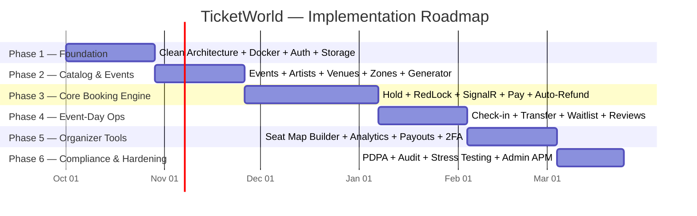

# 🗺️ System Implementation Roadmap & Sprint Plan

> **Scope:** Full Lifecycle Development Plan for TicketWorld Multi-Portal Platform  
> **Architecture Reference:** Clean Architecture (.NET 8) + Angular 18 + PostgreSQL 16 + Redis + SignalR  
> **Source Spec:** [Plan/concert.md](file:///c:/Users/wwwwww/Documents/project-test/concert/Plan/concert.md) (v2.0) | Reordered per [Scrutinize Report](file:///C:/Users/gayza/.gemini/antigravity/brain/0b7361bd-9f83-426c-94b4-39a088dc8efa/scrutinize_report.md)

---

## 1. Phase Breakdown Overview

| Phase | Focus Area | Deliverables | Target Duration |
| :---: | :--- | :--- | :---: |
| **Phase 1** | Foundation, Identity & Storage | Clean Architecture skeleton, JWT RS256, Refresh Token Rotation, RBAC/ABAC, Docker environment, MinIO file upload, MailDev notifications skeleton | Sprint 1-2 (4 weeks) |
| **Phase 2** | Catalog, Venues & Event Lifecycle | Artists, Venues, Zones, Events lifecycle, Form-based Seat Generator, Promo codes, Organizer settings | Sprint 3-4 (4 weeks) |
| **Phase 3** | Core Booking Engine & Reconciliation | Waiting Room, RedLock Seat Hold, SignalR `/hubs/seats`, Stripe Checkout, Webhook Reconciliation, Auto-Refund, HMAC QR tickets | Sprint 5-7 (6 weeks) |
| **Phase 4** | Event-Day Operations & Logistics | Staff QR Scanner (WebRTC), Ticket Transfers, Waitlist FCFS Engine, Post-event Reviews, In-app Notifications | Sprint 8-9 (4 weeks) |
| **Phase 5** | Organizer Experience & Payouts | Interactive Drag-and-Drop SVG Seat Map Builder, Sales Analytics, Payout Workflows, 2FA Step-up Auth | Sprint 10-11 (4 weeks) |
| **Phase 6** | Compliance, Hardening & Platform Admin | PDPA Data Erasure/Export, Audit Log Interceptors, k6 Concurrency Stress Tests, Playwright E2E, Admin Dashboard | Sprint 12-13 (3 weeks) |

---

## 2. Detailed Phase Specifications

### Phase 1: Foundation, Identity & Storage (Sprint 1–2, 4 weeks)
* **Backend:**
  * Clean Architecture solution structure (`Domain`, `Application`, `Infrastructure`, `WebAPI`).
  * Authentication: JWT RS256 signing, Refresh Token Rotation & Reuse Detection.
  * Security: Argon2id password hashing, Account Lockout, Claims-based Policies (`Customer`, `Organizer`, `Admin`).
  * Cross-Cutting: Global RFC 7807 `ProblemDetails` exception handler, `X-Correlation-Id` Serilog tracing, Rate limiting middleware.
  * Storage Service: S3/MinIO presigned URL generator (`POST /api/v1/files/presigned-url`, `POST /api/v1/files/confirm`).
  * Notification Skeleton: In-app `notifications` schema & transactional email dispatcher (MailDev).
* **Database & Infra:**
  * EF Core Migrations for `users`, `refresh_tokens`, `organizer_profiles`, `organizer_staff`, `notifications`.
  * Docker Compose stack verification (PostgreSQL 16, Redis 7, MinIO, Seq, MailDev).
* **Frontend:**
  * Angular 18 base project, Tailwind CSS design system tokens.
  * Core services: `AuthService`, `TokenService`, `JwtInterceptor`, `AuthGuard`, `RoleGuard`.
  * Auth screens: Login, Register, Forgot/Reset Password, Verify Email.

### Phase 2: Catalog, Venues & Event Lifecycle (Sprint 3–4, 4 weeks)
* **Backend:**
  * Catalog CRUD: `artists`, `artist_followers` (atomic counter trigger), `venues`.
  * Zone & Seat Schema: `zones` (spatial & pricing: color, capacity, is_numbered_seat) and `seats` (`xmin` optimistic concurrency).
  * High-Volume Bulk Seeding: PostgreSQL `COPY BINARY` (`NpgsqlBinaryImporter`) for rapid seat generation.
  * Event State Machine: `Draft` ➜ `PendingApproval` ➜ `Published` ➜ `OnSale` ➜ `SoldOut` ➜ `Completed` / `Cancelled`.
  * Admin Moderation: Approve / Reject Event workflows.
  * Promo Codes: `promo_codes` and `promo_usages` management for Organizers.
  * Organizer Profile Settings: Company profile, bank account encryption (AES-256-GCM).
* **Frontend:**
  * Customer Portal: Event discovery catalog, faceted search/filter, Artist profiles with Follow toggle.
  * Organizer Portal: Event creation wizard (5-step), **Form-based Seat Generator** (grid/row generator tool to generate thousands of seats quickly without drag-and-drop).
  * Organizer Promo code management.

### Phase 3: Core Booking Engine & Reconciliation (Sprint 5–7, 6 weeks)
> [!IMPORTANT]
> Merged High-Concurrency + Payments + Auto-Refund into one continuous, rigorously tested critical path.

* **High-Concurrency Engine:**
  * **Virtual Waiting Room:** Redis Sorted Sets (`ZADD waiting_room:queue:{eventId}`) for fair queuing under traffic spikes, position polling, and bypass token issuance (`X-WaitingRoom-Token`).
  * **Distributed Locking:** RedLock algorithm (3-second TTL: `lock:seat:{seatId}`) preventing microsecond double-holds.
  * **Real-time SignalR Hub:** `/hubs/seats` broadcasting `SeatStatusChanged` (`Available` ➜ `Held` ➜ `Booked`) to connected clients.
  * **Hold Expiry Background Worker:** Hangfire recurring job evaluating expired holds every 10s with 60s soft-extension for active checkouts.
* **Financial Transactions & Reconciliation:**
  * Booking lifecycle state machine (`Pending` ➜ `Confirmed` / `Cancelled` / `Refunded`).
  * Stripe/Omise Payment Gateway integration with `X-Idempotency-Key` and webhook HMAC-SHA256 signature verification.
  * **Critical Race Reconciliation:** Serializable evaluation of all 3 hold-expiry scenarios:
    1. In-Time: Confirm booking & seats.
    2. Race Lost: Instant **Auto-Refund** via Gateway API.
    3. Grace Window: Re-acquire if within 90s, otherwise trigger **Auto-Refund**.
  * Cryptographic QR Code Ticket Generation (HMAC-SHA256 signed payload).
* **Frontend:**
  * Real-time Interactive SVG Seat Map viewer with live color updates and 10-minute hold countdown timer.
  * Virtual Waiting Room screen with live queue position indicator.
  * Checkout page, payment element integration, order confirmation, and digital ticket wallet.

### Phase 4: Event-Day Operations & Ticketing Logistics (Sprint 8–9, 4 weeks)
* **Backend:**
  * Organizer Staff sub-role assignment via `organizer_staff` table with scoped permissions (`checkin.scan`).
  * Ticket Check-in API with sub-200ms scan latency, duplicate scan rejection, and audit entry.
  * Ticket Transfer state machine (`Pending` ➜ `Accepted` / `Expired` / `Cancelled`) with invalidation of old QR codes.
  * Waitlist automated FCFS conversion engine triggered when booked tickets are cancelled.
  * Post-event Reviews API: Verified attendee check (event completed + confirmed booking).
  * Notification triggers for booking confirmation, waitlist notifications, and 24-hour event reminders.
* **Frontend:**
  * Organizer Staff Mobile Web App: WebRTC camera-based QR code scanner with immediate visual/sound feedback.
  * Customer Ticket Management: Ticket transfer modal, waitlist enrollment, post-event review submission.

### Phase 5: Organizer Experience & Payouts (Sprint 10–11, 4 weeks)
* **Frontend:**
  * **Interactive Drag-and-Drop SVG Seat Map Builder:** Visual canvas tool for Organizers to design complex stadium/theater layouts, define zones, draw curved rows, and disable seats.
  * Organizer Sales Analytics: Dapper-powered revenue charts, seat heatmaps, and attendee check-in progress.
  * Staff invitation and permission management UI.
* **Backend & Security:**
  * Organizer Payouts: Automated commission fee calculation and payout release workflows (`Pending` ➜ `Approved` ➜ `Processing` ➜ `Completed`).
  * Step-up Authentication: TOTP 2FA requirement for sensitive actions (payout requests, admin role promotions).

### Phase 6: Compliance, Hardening & Platform Admin (Sprint 12–13, 3 weeks)
* **Compliance & Security:**
  * PDPA (Thailand): Soft-delete anonymization procedure (`DELETE /api/v1/auth/me`), data export, and marketing consent management.
  * Audit Trail: EF Core `SaveChangesInterceptor` logging mutations into immutable `audit_logs` (Who, When, Old Values, New Values).
  * Security Hardening: Key rotation policies (JWKS), `gitleaks` pre-commit hooks, sensitive field data masking in logs.
* **Platform Admin Portal:**
  * Global GMV and platform revenue analytics.
  * Payout approval desk with step-up auth validation.
  * APM telemetry monitor (DB connection pool, Redis hit rates, Hangfire queues).
  * Feature flags and platform config management (`platform_configs`).
* **Quality Assurance & Verification:**
  * NetArchTest architecture boundary tests (100% pass).
  * k6 load stress tests: Hot on-sale seat hold race (500 concurrent VUs), waiting room surge (5,000 users).
  * Playwright E2E tests covering all 5 critical user journeys.
